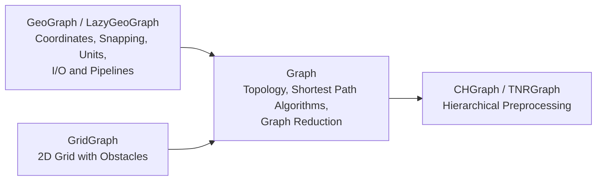
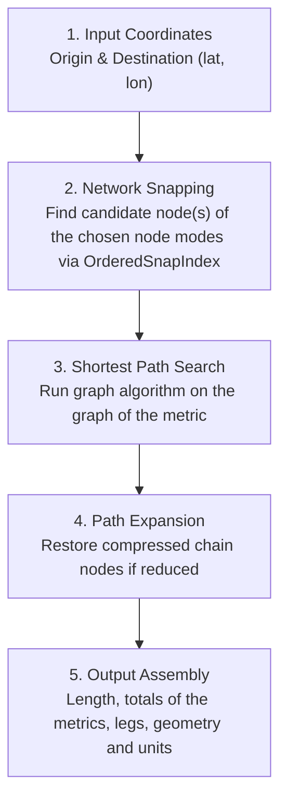
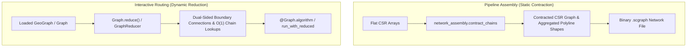
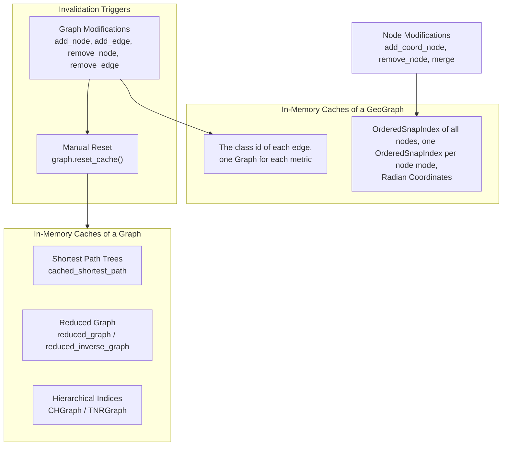

# scgraph — Architecture

This document explains how `scgraph` works inside.

The [README](README.md), the guides of [`guides/`](guides/) and the [API Documentation](https://connor-makowski.github.io/scgraph/scgraph.html) show how to use scgraph. [DEVELOPMENT.md](DEVELOPMENT.md) gives the rules of a contribution.

**Words of the network.**

* **edge**: it joins one node to another, in one direction, and has a weight.
* **node mode**: the kind of place where a node is: `road`, `rail`, `sea`, `port`, `airport` or `rail_terminal`.
* **hub**: a port, an airport or a rail terminal.
* **class**: the category of an edge in its source, such as `motorway` or `suez`.
* **edge mode**: the kind of transport of the edges of a class: `road`, `rail`, `sea` or `air`.

**Words of a metric.**

* **metric**: one weight for every edge of a network, under a name. `length` is the metric that every network has: the length of each edge.
* **weight per km**: the weight of 1 km of an edge.
* **closed**: an edge is closed in a metric when its weight is infinity. No route by this metric takes it.

**Words of a route.**

* **query point**: the origin or the destination of a query.
* **off-graph leg**: the straight line between a query point and the node that it snaps to.
* **total**: the total of a metric along a route is the sum of the weights of its edges and of its two off-graph legs.
* **leg**: a part of a route on one edge mode.
* **transfer**: a node where a route goes from a leg of one edge mode to a leg of another.
* **circuity**: a factor that multiplies a straight-line distance.

---

## Table of Contents

1. [Overview](#1-overview)
2. [Data Model](#2-data-model)
3. [Answering a Geographic Query](#3-answering-a-geographic-query)
4. [Graph Reduction](#4-graph-reduction)
5. [Adding an Algorithm](#5-adding-an-algorithm)
6. [Caches and Invalidation](#6-caches-and-invalidation)
7. [Network File Format](#7-network-file-format)

---

## 1. Overview



`scgraph` separates the graph algorithms from the geographic logic and from the grid logic:

* **`Graph`**: A graph of node ids, with no coordinates. It holds the search algorithms (Dijkstra, Bidirectional Dijkstra, A\*, Bellman-Ford, BMSSP) and graph reduction. [guides/routing.md](guides/routing.md#choosing-an-algorithm) lists every algorithm with its use.
* **`GeoGraph`**: A `GeoGraph` holds a `Graph` (attribute `graph_object`) and one point for each node (WGS84 latitude and longitude). It snaps a point to the network with a `OrderedSnapIndex`, computes distances, and handles networks with several node modes. It also holds the class of each edge and the metrics of the network, with one `Graph` for each metric.
* **`LazyGeoGraph`**: A `LazyGeoGraph` downloads and loads its network at the first query.
* **`GridGraph`**: A 2D grid with obstacles, with 4 or 8 directions of movement.
* **`CHGraph` / `TNRGraph`**: Two hierarchies that a `Graph` builds on demand to answer queries faster: Contraction Hierarchies and Transit Node Routing.

### The C++ Extension and the Pure-Python Code

Each graph operation has two implementations that give the same results:
1. **C++ extension (`scgraph/cpp/`)**: compiled with nanobind, in C++20 with `-O3`. It is the faster one.
2. **Pure Python**: used when the C++ extension is not compiled.

### Pipeline Subsystem (`scgraph.pipelines`)

The package `scgraph.pipelines` builds networks from their online sources. A pipeline is one module of this package. It lists the sources of one network and has a `build` function. The docstring of `scgraph.pipelines` gives the contract of a pipeline, and lists the steps of a build with their modules.

* `network_builder.build_network_file` downloads the sources and calls `build` in a work folder. It writes a `.scgraph` file with the metadata of the build in its header, then moves the file into the cache.
* `derived_networks.derive_network_file` writes a network file from another network file, the parent file, and downloads nothing. The derived file holds some node modes of the parent file, and its land node modes inside a bbox. The pipeline of the parent file lists its land node modes in `LAND_MODES`.
* The costly functions of `step2_land_mask` and of `scgraph.network_assembly` have a C++ version in `scgraph/cpp/src/` (`network_assembly.hpp`) and in `scgraph/cpp/src/pipelines/` (`land_mask.hpp`). Their pure-Python version gives the same results.

A build of roads runs these steps in this order. Each line says, on the right, what the step does for the turn restrictions.

```
read the ways -> build the graph -> list the forbidden turns
     -> join the hubs            each junction still has one node
     -> add the junction nodes   scgraph/turn_restrictions.py explains the method
     -> keep the components      a junction keeps all its nodes or none
     -> contract the chains      never through a junction with several nodes
     -> order the nodes          the nodes of a junction stay together
```

`load_from_osm` runs the same functions, without the hubs and without the contraction of the chains.

The guide [Network Pipelines](scgraph/pipelines/README.md) follows one build, one derivation, one network release and one load, with the numbers of real runs.

#### Design Choices

1. **One network is built from the sources, and every other network is derived from it.** A build of the world reads the whole OpenStreetMap planet and takes more than an hour. A derivation downloads nothing and takes seconds, and all the networks of one network release hold the same data.
2. **A network file records where it comes from.** A user can then cite the sources, and name the exact file behind a result.
3. **A published file never changes, and each version of scgraph pins one network release.** So one version of scgraph loads the same network on every machine, today and in a year. A correction is a new network release, with a new tag.
4. **A check follows the build, each derivation and each download.** A network that fails a check goes no further.

---

## 2. Data Model

### How a Graph Is Stored in Memory

`scgraph` stores a graph in two ways: an adjacency list in Python, and Compressed Sparse Row (CSR) arrays in C++.

#### 1. The Python Adjacency List

In Python, a graph is a list of dictionaries. The position of a dictionary in the list is the id of an origin node:

```python
# graph[origin_node] = {destination_node: weight, ...}
graph = [
    {1: 4.5, 2: 7.2},  # Node 0 has an edge to node 1 (weight 4.5) and to node 2 (weight 7.2)
    {2: 2.1},          # Node 1 has an edge to node 2 (weight 2.1)
    {0: 7.2},          # Node 2 has an edge to node 0 (weight 7.2)
    {},                # Node 3 has no outgoing edge
]
```

* **Directed edges**: Every edge has one direction. A two-way road between `A` and `B` is two edges: `graph[A][B] = w` and `graph[B][A] = w`.
* **Node ids**: The nodes are numbered from `0` to `n - 1`. Every node has an entry in `graph`, even a node with no outgoing edge (`graph[u] = {}`).
* **Reverse graph (`inverse_graph`)**: A bidirectional search also explores backward from the destination. It reads `inverse_graph[v] = {u: weight}`. scgraph builds this structure at the first query that needs it.
* **`graph` and `search_graph`**:
  * `graph` is always the original graph.
  * `search_graph` is the graph that the algorithms search. After `graph.reduce()`, `search_graph` is the reduced graph, and `graph` does not change.
  * `inverse_graph` and `search_inverse_graph` follow the same rule.

#### 2. The C++ CSR Arrays

A Python dictionary per node takes much memory on a large network, and its entries are scattered in memory.

In the C++ extension, [`CsrGraph`](scgraph/cpp/src/csr_graph.hpp) stores the same graph in **three arrays**:

```
Node IDs:                      0         1      2   3
First edge ids:  [ 0,        2,     3,  4,  4 ]  (length: n + 1)
                   │         │      │   │   │
                   └──┬───┘  └──┬─┘ └─┬─┘ └─┴─ (Node 3 has 0 edges: 4 - 4 = 0)
                      ▼         ▼     ▼
Destination ids: [ 1,   2,     2,     0   ]      (length: m = total edges)
Weights:         [ 4.5, 7.2,   2.1,   7.2 ]      (length: m = total edges)
```

* **Reading the edges of a node**: The edges of node `u` are at the positions `node_first_edge_ids_[u]` to `node_first_edge_ids_[u + 1] - 1` of `edge_destination_node_ids_` and `weights_`.
* **Mapped files (`mmap`)**: When scgraph opens a `.scgraph` network file, `CsrGraph` reads the arrays in the mapped file. It makes no copy.
* **Edits**:
  * A CSR array is not edited in place. `add_node`, `add_edge` and `remove_edge` record their changes in a hash map (`RowEdits`).
  * The next search writes the changed rows and the unchanged rows into a new `CsrGraph`, in one pass.

### What a GeoGraph Adds

A `GeoGraph` adds these attributes to its `Graph`:

* **`nodes`**: The point of each node, as `[latitude, longitude]` in degrees.
* **`external_node_ids`**: The id that each node has outside this network: in its data source (for example its 64-bit OpenStreetMap id), or in the file of release 3.6.0. A node that scgraph adds gets a negative id: a node added after the load, and the node that a build puts where it splits an edge. The node mode of a node and its id together name the node. A junction is one crossing of roads. In a network that follows turn restrictions, the node mode and the id name a junction, and a junction may have several nodes.
* **Turn restrictions**: A network that follows the turn restrictions of its source gives some junctions more than one node. [`turn_restrictions.py`](scgraph/turn_restrictions.py) explains the method, with diagrams. The nodes of a junction follow each other. They have the same point, the same external id and the same node mode. The row of this node mode in `node_modes` has `has_turn_restrictions`.
* **`node_mode_ids`**: A byte array that gives the node mode of each node, such as `road`, `sea` or `port`. Each node has one node mode. The value is the position of that node mode in `node_modes`, counted from 0. [`node_modes.py`](scgraph/node_modes.py) holds the rules of the table `node_modes`: the table of one node mode without a name, the names of the node modes, and the node mode ids of a network file.
* **`intermediate_nodes`**: The shape of each edge: `intermediate_nodes[u][v] = [[lat, lon], ...]`. The shape of an edge is the list of points that draw it on a map between its two nodes.
* **Node order**: A `.scgraph` file numbers its nodes along a 2D Hilbert curve. This curve is one line that visits every cell of a square grid, so that cells close on the line are close on the grid. A network with several node modes groups its nodes by node mode first, in the order of `node_modes`, then orders each group along the curve. Two nodes that are close on the globe then have close ids: a search reads nearby parts of memory, and the snapping index is faster.

### Classes and Metrics

A `GeoGraph` also holds the class of each edge and the metrics of the network. Its code is in these modules:

* `scgraph/edge_classes.py` holds the class of each edge, and finds it by the two nodes of the edge.
* `scgraph/metrics.py` holds the record of a metric, and computes its weights.
* `scgraph/geograph.py` holds the constructor, the properties, the list of the nodes and the validation of nodes.
* `scgraph/geograph_edges.py` holds the code that reads the edges and their classes.
* `scgraph/geograph_metrics.py` holds the code that creates and reads the metrics.
* `scgraph/geograph_routing.py` holds the queries, their totals and their legs.
* `scgraph/geograph_modifiers.py` holds the edits of the network.
* `scgraph/geograph_io.py` holds the loaders and savers.
* `scgraph/geograph_networks.py` holds the methods that load, build, list and clear the networks of scgraph.

Two docstrings explain this code with an example:

* The docstring of [`edge_classes.py`](scgraph/edge_classes.py) defines the class id and the edge id. It shows how the geograph finds the class of an edge by its two nodes, before and after an edit.
* The docstring of [`metrics.py`](scgraph/metrics.py) defines a metric and an array by edge id. It shows how `create_metric` computes the weights.

* **The edges**: `graph_object._get_edge_arrays()` gives the edges by origin, in three arrays: `node_first_edge_ids`, `edge_destination_node_ids` and the lengths.
* **Where the classes come from**: A loader gives the classes, or the constructor with its arguments `classes` and `edge_classes`. `classes` gives the rows `{"name", "edge_mode"}`. `edge_classes` gives, for each node, a dict from the destination of an edge to the name of its class. `intermediate_nodes` has the same structure.
  * Without these arguments, a geograph made from a list of dictionaries has no classes.
* **The array of the class ids**: A network file and the weights per km of `create_metric` need a `uint8` array by edge id: the class id of each edge. The geograph keeps this array beside the arrays of the edges.
* **The metrics**: Each metric is one record, with a `float64` array of weights by edge id and the weight per km of the off-graph legs (`off_graph_weight_per_km`). The record of `length` has no array: its weights are those of `graph_object`. The geograph builds this record without a read of the edges, and builds it again when `graph_object` or `geograph_units` changes.
* **An edge without a class**: Its class id is 255. `create_metric` gives this class id the weight per km of the off-graph legs, and no weight at a hub.
* **The kernels**: The kernels of the weights have a C++ version (`scgraph/cpp/src/metric_weights.hpp`) and a pure-Python version (`scgraph/helpers/metric_weights.py`).
* **The default metric**: `default_metric` names the metric of a query that names no metric. It is `length`, until a loader or the caller sets it. For example, `load_from_osmnx_graph` sets it to `travel_time` with `weight_key="travel_time"`, and the `length` of this geograph is still in km.
  * A query raises a `ValueError` while the geograph does not have its default metric, for example after an edit.
* **One `Graph` for each metric**: For `length`, `get_graph_object(metric)` returns `graph_object`. For another metric, it builds a `Graph` from `node_first_edge_ids`, `edge_destination_node_ids` and the weights of the metric, at the first query by this metric.
  * In the C++ build, the graphs of all the metrics share `node_first_edge_ids` and `edge_destination_node_ids`.
  * A search on the graph of a metric returns `{"path", "length"}`, and `length` holds the total of the metric.

**After an edit.** An edit of the graph changes the ids of the edges, so an array by edge id is out of date. This table gives what scgraph does with each part:

| Part | After an edit | Computed again |
| :--- | :--- | :--- |
| The class of an edge | Stays the same, because the geograph finds it by the two nodes of the edge | Not needed |
| The class of an edge of a removed node | Is forgotten: a node added later with the same id has none of these classes | Not needed |
| The edges (`node_first_edge_ids`, `edge_destination_node_ids`, lengths) | Are read again from `graph_object` at the next read of an edge or of a metric | At this next read |
| The array of the class ids | Is dropped with the arrays of the edges | When `create_metric` or `save_as_scgraph` needs it |
| The metrics other than `length` | Are removed, with one `UserWarning` that gives their names | Never: the caller creates them again with `create_metric` |

An edit method of a `GeoGraph` removes the metrics at the call: `add_coord_node`, `remove_edge` or `merge_with_other_geograph`, for example. An edit made on `graph_object` directly is found later:

| Change | How scgraph finds it |
| :--- | :--- |
| A call of `add_node`, `remove_node`, `add_edge` or `remove_edge` on `graph_object` | Each `Graph` counts its edits (`_edit_count`). The geograph compares this count at the next read of the edges or of the metrics |
| A write into `graph_object.graph[u][v]` of a pure-Python graph | `create_metric` and `save_as_scgraph` count the edges, and raise a `ValueError` when the count changed |
| A new weight on an existing edge, written into `graph_object.graph[u][v]` | scgraph does not find it, because the count of the edges stays the same |
| A write into `graph_object.graph[u][v]` in the C++ build | Changes nothing, because this list is a copy |

A query does not count the edges, because the count reads every node.

### What an Algorithm Takes and Returns

An algorithm takes its origin and its destination in one of three forms:
* one node id: `int`;
* a set of candidate node ids: `set[int]`;
* a dictionary of start distances: `dict[int, float]`. A query from a point uses it, with one entry for each node that the point is connected to.

An algorithm returns a dictionary:
```python
{"path": [node_0, node_1, ...], "length": total_path_weight}
```

### Trees and Hierarchies

Three algorithms of `Graph` prepare a structure once and then answer queries from it:

* **`cached_shortest_path`**: `get_shortest_path_tree(origin_id)` runs Dijkstra from one origin to every node. `get_tree_path` reads one path from that tree. `cached_shortest_path` keeps the tree of each origin, so a second query from the same origin runs no search.
* **`contraction_hierarchy`**: `create_contraction_hierarchy()` builds a `CHGraph` and stores it on the graph. The preprocessing contracts the nodes in order of importance and adds shortcut edges. A query is a bidirectional Dijkstra search that only goes up in that order.
* **`tnr`**: `create_tnr_hierarchy()` builds a `TNRGraph`. A `TNRGraph` is a `CHGraph` with a set of transit nodes (the most important nodes) and a table of the distances between them. A long query reads the table instead of searching.

`contraction_hierarchy` and `tnr` build their hierarchy at the first query if it does not exist. A hierarchy can be saved and loaded (`save_as_chjson` / `CHGraph.load_from_chjson`, `save_as_tnrjson` / `TNRGraph.load_from_tnrjson`).

---

## 3. Answering a Geographic Query

`GeoGraph.get_shortest_path` takes two points and runs five steps:



### 1. Input Coordinates
The origin and the destination are dictionaries with `latitude` and `longitude` in degrees.

### 2. Network Snapping (`OrderedSnapIndex`)
An `OrderedSnapIndex` finds the nodes that are near a point. It is a tree of bounding boxes, with 8 children per box.

**The node modes.** By default, a query point snaps to its closest road node when the geograph has roads, and to its closest node otherwise. A geograph has roads when one of its nodes has the node mode `road`. With roads, a query point also snaps to a node of the node mode `None`: a node that `add_coord_node` added without `node_mode`. So a default query can start at a node that the user added.

`snap_to_node_modes` lists the node modes that a query point may snap to, in place of this default.

**The indexes.** The geograph has one `OrderedSnapIndex` of all its nodes. It builds one more `OrderedSnapIndex` for each node mode, at the first query that snaps to this node mode. A query point snaps to the closest node among the indexes of its node modes. The nodes of a network file are sorted by node mode, so the index of a node mode reads the points of its nodes in the file.

`scgraph/node_snapping.py` holds these indexes and gives the index of a query. Its docstring gives an example with real values.

**The nodes.** The option `node_addition_type` chooses the nodes that the point is connected to, among the nodes of these node modes:
* `'closest'`: the closest node.
* `'quadrant'`: the closest node in each of the four quadrants around the point.
* `'all'`: every node within `node_addition_lat_lon_bound` degrees of latitude and of longitude of the point. If there is none, the closest node.

**A junction with several nodes.** A query point that is connected to one node of a junction is connected to each of them, at the same distance (`connect_to_nodes_of_junctions` in `scgraph/turn_restrictions.py`). So a route may end at any node of the junction. The same module says why this is also right for a route that starts there.

**The off-graph legs.** With `'quadrant'` or `'all'`, a point has several candidate nodes. The search multiplies the km of each off-graph leg by `node_addition_circuity` (default: 4). Without this penalty, a route could reach a distant node in a straight line, for example across land in a sea network, and not enter the network at a nearby node.

The result multiplies the km of each off-graph leg by `off_graph_circuity` (default: 1), in place of the penalty. A value of `1.2` models winding streets, and `0` leaves the off-graph legs out.

In each metric, the weight of 1 km of an off-graph leg is `off_graph_weight_per_km` of the metric: 1 km in `geograph_units` for `length`. So in the search, the weight of an off-graph leg is its km times `node_addition_circuity` times `off_graph_weight_per_km`. The result counts it as its km times `off_graph_circuity` times `off_graph_weight_per_km`.

Example: the metric `hours` gives 1 / 30 hour to 1 km of an off-graph leg. The weight of an off-graph leg of 2 km is then 2 × 4 / 30 hour in the search, and 2 × 1 / 30 hour in the result.

### 3. Shortest Path Search
If the straight line from origin to destination is not longer than the shortest connection of either point to the network, `scgraph` returns the straight line and runs no search. Both lengths include `node_addition_circuity`. This test compares lengths for every metric, so a metric whose off-graph legs have a weight of zero does not make every route direct.

The selected algorithm (default: `bidirectional_buckets`) runs from the origin candidates to the destination candidates:
* The search runs on the graph of the metric of the query: `get_graph_object(metric)`. It reads the `search_graph` of this graph: the reduced graph if `reduce()` was called, the original graph otherwise.
* No search takes a closed edge. When every route needs one, the search raises `PathNotFoundError`.
* `a_star` uses a distance to the destination as a lower bound. The argument `heuristic_fn` is the function that gives this distance:
  * With `heuristic_fn=geograph.haversine`, the bound is the great-circle distance. The search computes it from the coordinates in radians, which the `GeoGraph` keeps.
  * With `heuristic_fn=geograph.cheap_ruler`, the bound is the distance that `cheap_ruler` returns.
  * For a metric other than `length`, the `GeoGraph` multiplies each of these two bounds by the smallest weight that the metric gives to 1 km of an open edge (`min_weight_per_length_unit`). The total of a route of `d` km is at least `d` times this value, so the bound stays below the real total.
  * Another heuristic function is used as it is.
  * The search stops when, for the node taken from the queue, the distance from the origin plus the lower bound reaches the length of the best route found. With more than 4 destination candidates, it computes no lower bound and works as Dijkstra does.
* A search counts its node scans. A node scan is one pass over the edges of one node. When the search ends, it stores the count for its thread (`guides/routing.md`, *Logging*; `_last_search_in_thread` in Python, `tl_node_scans` in C++). `GeoGraph.get_shortest_path` reads it for its DEBUG record.

### 4. Path Expansion
If the search ran on a reduced graph, `run_with_reduced` replaces each contracted edge of the path by the nodes of its chain.

### 5. Length, Totals and Coordinates of the Result
* **Length**: `length` is the length of the route in `output_units`, for every metric: the lengths of its edges, plus the two off-graph legs times `off_graph_circuity`. For the metric `length`, the search returns this value with the search penalty, and the penalty is removed. For another metric, `get_path_weight` adds the lengths of the edges of the path.
* **Totals**: `metric_totals` gives the total of each metric along the route, `length` first: the weights of its edges, plus the two off-graph legs. `metric_totals["length"]` is `length`. The total of the metric of the query is the value that the search returned, without the search penalty.
* **Coordinates**: The `coordinate_path` is built from `nodes` and `intermediate_nodes`, in the requested format (`list_of_lists`, `list_of_dicts`, or GeoJSON).
* **Legs**: With `output_legs=True`, the geograph cuts the edges of the path where the edge mode of their class changes. Each part is a leg, with its length, its totals and its length on each class. Its `mode` is the edge mode of its edges.
  * One off-graph leg comes before the first leg, and one after the last leg: their `edge_mode` is `off_graph`. The sum of the lengths of the legs is `length`, and the sum of their totals is `metric_totals`.
  * `transfers` lists the transfers of the route, each with its node id and its node mode. The two nodes where an off-graph leg meets the network are not transfers.

---

## 4. Graph Reduction

A pass-through node offers no choice: a route that enters it can only go on to one other node. A chain is a run of such nodes. Graph reduction replaces a chain by one contracted edge with the sum of the weights. A search then visits fewer nodes, and every route keeps its exact length.

`scgraph` has two reductions, for two moments:



### Reduction of a Loaded Graph (`GraphReducer`)

`graph.reduce(iterations=-1)` reduces a `Graph` in memory:

1. **Find the pass-through nodes**: the docstring of `scgraph/graph_reducer.py` gives the rule, with examples.
2. **Group them into chains**: `reduced_node_chain_ids` gives the chain of each node.
3. **Connect the boundaries**: A boundary node is a kept node at the end of a chain. The reducer adds one contracted edge between the two boundary nodes of a chain. It also records the distance from each node of the chain to its boundary nodes.
4. **Answer a query (`run_with_reduced`)**:
   * **Both ends outside chains**: the search runs on the reduced graph.
   * **Origin inside a chain**: the origin becomes a dictionary of distances to the boundary nodes of its chain.
   * **Destination inside a chain**: the destination becomes a dictionary of distances from the boundary nodes of its chain.
   * **Both ends inside the same chain**: the query is answered on the original graph, without the reduced graph.
   * **Path expansion**: `@Graph.algorithm` replaces each contracted edge of the result by the nodes of its chain.

`iterations=-1`, the default, repeats the passes until a pass marks no new node. `iterations=1` runs one pass.

`GeoGraph.reduce` reduces `graph_object` and the graph of each metric, each with its own weights (section 2, *Classes and Metrics*). A graph of a metric that is built later is reduced the same way. The pass-through nodes are the same in every graph, because they depend on the edges and not on the weights.

---

### Static CSR Contraction (`network_assembly.contract_chains`)

`contract_chains` works on the CSR arrays of a build:
* It takes `(node_first_edge_ids, edge_destination_node_ids, weights, node_mode_ids, max_km_between_nodes, edge_class_ids, kept_node_flags)` and returns a `ContractedGraph` namedtuple:
  * `kept`: the ids of the kept nodes.
  * `origins`, `edge_destination_node_ids`, `weights`: the contracted edges.
  * `member_offsets`, `members`: the ids of the input edges that each contracted edge replaces.
* `node_mode_ids` is optional. A chain is never contracted across two node modes.
* `edge_class_ids` is optional: the class of each edge. The header of `scgraph/network_assembly.py` gives its rule.
* `max_km_between_nodes` cuts a chain into pieces of about that length (default: no cut).
* `kept_node_flags` is optional: one byte for each node. A node with a byte other than 0 is never removed. `assemble_network` flags the nodes of each junction that has several nodes, so that no edge is merged through such a junction.
* A piece that would create a self-loop or a duplicate edge is split at its midpoint. So the node that the build put in the middle of a split edge is kept (the guide [Network Pipelines](scgraph/pipelines/README.md#2-reading-and-cutting-the-ways), step 2).
* `build_chain_shapes` gives each contracted edge the shape points of its members.

---

## 5. Adding an Algorithm

The decorator `@Graph.algorithm` wraps an algorithm for graph reduction. With `name="my_search"`, it also adds the function to `Graph` as the method `my_search`:

```python
from scgraph import Graph

@Graph.algorithm(bidirectional=False, name="my_search")
def my_search(graph, origin_id, destination_id, **kwargs):
    # graph.search_graph is the graph to search (reduced or not)
    adjacency = graph.search_graph

    # origin_id and destination_id take the forms of "What an Algorithm Takes
    # and Returns" (section 2)
    ...
    return {"path": [origin_id, ..., destination_id], "length": total_weight}
```

### What the Decorator Does
* **On a reduced graph**: It replaces an end inside a chain by a dictionary of distances to the boundary nodes. It runs the function on `search_graph`. It then expands the returned path to the original nodes.
* **With `bidirectional=True`**: The function can also read `graph.search_inverse_graph`.
* **On a graph that is not reduced**: It calls the function directly.

---

## 6. Caches and Invalidation

`scgraph` keeps caches in memory, for one process, and on disk.



### Caches in Memory

**Of a `Graph`.** `reset_cache()` empties the caches below. `add_node`, `remove_node`, `add_edge` and `remove_edge` call it:
* the shortest path trees of `cached_shortest_path`;
* the reduced graph, its chains, its connections and its hidden-node pointers;
* the hierarchies (`CHGraph` and `TNRGraph`);
* the graph that `bmssp` builds, the largest edge weight and the bucket width.

An edit drops `inverse_graph`, and the next read builds it again.

**Of a `GeoGraph`.** A `GeoGraph` keeps what it builds from its nodes and from its edges:

| Cache | Built | Dropped |
| :--- | :--- | :--- |
| The snapping index of every node (`snap_index`), and the coordinates in radians | At the load of a network file, or at the first snap | When the nodes change: `add_coord_node`, `remove_node`, `remove_coord_node`, `merge_with_other_geograph` |
| One snapping index for each node mode | At the first query that snaps to this node mode | With `snap_index` |
| The edges (`node_first_edge_ids`, `edge_destination_node_ids`, lengths) | At the first read of an edge or of a metric | At the first read after an edit of `graph_object` (section 2, *Classes and Metrics*) |
| The id of the class of each edge, by edge id | At the load of a network file with classes. After an edit, at the first call that needs the array: `create_metric` from weights per km, or `save_as_scgraph` | With the edges |
| The ratio `min_weight_per_length_unit` of a metric: the smallest weight of one unit of length | At the first A* search by this metric | With the record of the metric |
| The record of `length` | At the first read of `length` | When `graph_object` or `geograph_units` changes |
| `graph`, the original graph (`_graph`) | At the first read of `graph` | By an assignment to `graph`. An edit of `graph_object` does not drop it |
| `geokdtree` (`_geokdtree`) | At the first read of `geokdtree` | With `snap_index`, when its setter gets `None` |
| The `Graph` of each metric other than `length`, with its reduced graph, its trees and its hierarchies | At the first query by this metric | With its metric: at an edit of the network, at `remove_metric`, and when `create_metric` makes this metric again |

### Persistent Filesystem Cache (`SCGRAPH_CACHE_DIR`)

scgraph keeps the networks that it builds or downloads in a cache directory (default on Linux: `~/.cache/scgraph`). The module `scgraph/geograph_networks.py` loads, builds, lists and clears the networks of scgraph, and downloads the file of a network of a network release into the cache. The module `scgraph/built_in_geographs.py` downloads the seven networks of release 3.6.0 and warns that they are deprecated. `geograph_networks.py` converts each one. The module `scgraph/geograph_cache.py` holds the names of the folders below, the read and the write of `cache.json`, and the guard that refuses a save into `networks/`. The cache directory holds:
* **Built networks**: `networks/<name>/<region>/<content_sha256>.scgraph` next to a `cache.json` that names the file and gives the download time. The folder `networks/` holds a `CACHEDIR.TAG` file, so a backup tool can leave it out. A save also reads this tag: `save_as_scgraph` and `save_as_graphjson` refuse a file under a folder `networks/` that holds it.
* **Built-in networks**: `<name>.graphjson` is a built-in network of release 3.6.0 that `load_geograph` downloaded. `<name>.scgraph` is its conversion, which the first load writes and later loads read. A damaged conversion is made again from the `.graphjson`.
* **Network Releases**: `releases/<tag>/<name>.scgraph` is a network file that `load_geograph` downloaded from the network release `<tag>`, and `<name>.no_shapes.scgraph` is the same network without edge shapes. A file gets this name only after its content is checked, so a later load does not check it again. The guide [scgraph/pipelines/README.md](scgraph/pipelines/README.md), Part 4, shows the steps of a load.
* **Atomic Writes**: A build writes into its work folder: `.work/<name>/<region>` of the cache directory, or the `work_dir` of the caller. It then moves the finished `.scgraph` file into the cache.
  * The file arrives beside its final place and takes its name in one step. `cache.json` is written the same way, after the file. `cache.json` therefore always names a whole file.
  * A build that succeeds removes its work folder. A build that fails keeps its work folder, with the downloaded sources. The next build resumes from it, and `refresh=True` empties it first.
  * The work folder holds `scgraph_work.json`: the pipeline, its `PIPELINE_VERSION`, the region and the version of scgraph. When `scgraph_work.json` gives other values, a build does not reuse the files, which may follow old rules. It empties its own folder first, and it refuses a folder that the caller gave until the caller passes `refresh=True`. The other files of the folder are the downloaded sources (`sources/`) and the files of the steps, such as `ways.inputs.json` and `ways.done` of the OpenStreetMap pipelines.
* **Offline Operation**: With `SCGRAPH_OFFLINE=1` or `local_files_only=True`, scgraph makes no network request. It loads only what the cache holds.
* **Cache Management**: `GeoGraph.clear_geograph_cache()` removes the cached networks. It leaves every other file of the directory in place.

---

## 7. Network File Format

A `.scgraph` file stores the edges, the node points, the metrics and the metadata of one network, in one file that loads fast. For a metric, it stores the weights, not the weights per km or the function that made them. It does not store the default metric. scgraph reads and writes it with the Python standard library only.

This section specifies `format_version` 1. A file of `build_geograph` records its scgraph version in `metadata.software.scgraph`. For a version of scgraph on PyPI, this section at the git tag of that version specifies the file.

**The example.** The section follows one network near Le Havre, built with `GeoGraph(...)`, `create_metric` and `save_as_scgraph`, and read with `network_file.read`:

| Node id | Node mode | Place |
| :--- | :--- | :--- |
| 0 | road | Honfleur |
| 1 | road | Le Havre |
| 2 | road | Rouen |
| 3 | sea | the Channel |
| 4 | sea | off Le Havre |
| 5 | port | Port of Le Havre |

Five links join them, each as two edges, one each way. A `motorway` joins Rouen to Le Havre, with a shape of two points, and a `primary` road joins Le Havre to Honfleur. A `road_connector` joins Le Havre to the port, a `sea_connector` the port to the sea, and an `open_sea` lane the sea to the Channel. The metric `hours` gives 1/110 hour to a km of motorway, 1/80 to a km of other road, and 1/30 to a km of sea.

### Design Principles

1. **Mapped files**: In the C++ build, the algorithms read the edge arrays in the file mapped into memory (`mmap`), without a copy.
2. **A digest of the content**: Two builds from the same sources, with the same software on the same platform, give the same file, byte for byte. The software includes the C++ extension: a file written with the extension and a file written by the pure-Python code list the edges of a node in another order.

### Binary File Layout

All multi-byte integers are **little-endian**:

| Bytes | Size | Content |
| :--- | :--- | :--- |
| `0 .. 7` | 8 | The magic bytes `SCGRAPH1` (ASCII) |
| `8 .. 39` | 32 | The raw SHA-256 digest of bytes 40 to the end |
| `40 .. 47` | 8 | $L_H$, the length of the JSON header, as a uint64 |
| `48 .. 48 + L_H - 1` | $L_H$ | The header: UTF-8 JSON, keys sorted (`json.dumps(header, sort_keys=True)`) |
| next | 0 to 63 | Zeros, up to a multiple of 64 bytes |
| array section | variable | The arrays, each starting at a multiple of 64 bytes |

In the example, the header of 1,590 bytes ends at byte 1,637, so the arrays start at byte 1,664. `write` stores the arrays in the order of *Stored Binary Arrays*; a reader finds an array by its name and `offset`, so this order is not a rule of the format.

### Header JSON Schema

The header of the example, one line for each row:

```json
{
  "arrays": {
    "node_first_edge_ids": {"dtype": "int32", "offset": 0, "shape": [7]},
    "edge_destination_node_ids": {"dtype": "int32", "offset": 64, "shape": [10]},
    "metric_length": {"dtype": "float64", "offset": 128, "shape": [10]},
    "metric_hours": {"dtype": "float64", "offset": 256, "shape": [10]},
    "edge_class_ids": {"dtype": "uint8", "offset": 384, "shape": [10]},
    "node_points": {"dtype": "int32", "offset": 448, "shape": [6, 2]},
    "external_node_ids": {"dtype": "int32", "offset": 512, "shape": [6]},
    "edge_first_shape_point_ids": {"dtype": "int32", "offset": 576, "shape": [11]},
    "shape_points": {"dtype": "int32", "offset": 640, "shape": [4, 2]}
  },
  "format_version": 1,
  "metadata": {
    "classes": [
      {"edge_mode": "road", "name": "motorway"},
      {"edge_mode": "road", "name": "primary"},
      {"edge_mode": "road", "name": "road_connector"},
      {"edge_mode": "sea", "name": "sea_connector"},
      {"edge_mode": "sea", "name": "open_sea"}
    ],
    "crs": "EPSG:4326",
    "metrics": [
      {"name": "length", "unit": "km"},
      {"description": "Travel time.", "name": "hours", "off_graph_weight_per_km": 0.03333333333333333, "unit": "h"}
    ],
    "node_modes": [
      {"name": "road", "node_count": 3, "source": "osm"},
      {"name": "sea", "node_count": 2, "source": "sea"},
      {"name": "port", "node_count": 1, "source": "ports"}
    ],
    "node_order": "hilbert",
    "pipeline": {"name": "example", "region": "normandy", "version": 1},
    "sources": [
      {"credit": "© OpenStreetMap contributors", "license": "ODbL-1.0", "name": "osm"},
      {"credit": "Eurostat, SeaRoute", "license": "EUPL-1.2", "name": "sea"},
      {"credit": "NGA World Port Index", "license": "LicenseRef-US-Government-Work", "name": "ports"}
    ]
  }
}
```

The file sorts the keys by name; this block lists the arrays in the order of their bytes.

#### Header Fields Specification

| Field | Type | Description |
| :--- | :--- | :--- |
| `format_version` | `int` | `1` (see *Compatibility Between Versions*). |
| `arrays` | `dict` | Each array's `dtype`, `shape`, and byte `offset` in the array section. |
| `metadata.crs` | `str` | `EPSG:4326`. `read` and `write` refuse another value. |
| `metadata.metrics` | `list[dict]` | One row for each metric, `length` first. |
| `metadata.node_order` | `str` | `"hilbert"`. `read` and `write` refuse another value. |
| `metadata.node_modes` | `list[dict]` | One row for each node mode: its `name`, the `source` of its node ids, and its `node_count`. A row has `"has_turn_restrictions": true` when the node mode follows turn restrictions: a junction may then have several nodes (`scgraph/turn_restrictions.py`). |
| `metadata.classes` | `list[dict]` | Only with `edge_class_ids`: one row for each class, its `name` and `edge_mode`. 255 rows at most. |
| `metadata.pipeline` | `dict` | The pipeline that built the file: `name`, `region`, and `PIPELINE_VERSION` as `version`. |
| `metadata.software` | `dict` | The `scgraph` version, `backend` (`cpp` or `python`) and `platform` of the build. |
| `metadata.sources` | `list[dict]` | The sources: name, URL, digest, size, license, credit, version. |
| `metadata.description` | `str` | Optional. A text about the network. |
| `metadata.derivation` | `dict` | Only in a file of `scgraph.pipelines.derived_networks`: `parent_content_sha256`, `node_modes`, `bbox`, `min_component_nodes`. Such a file has no `description`. |

**A row of `metrics`.** It has the `name` of the metric (small letters, digits and `_`, starting with a letter), and may have a free-text `unit` and `description`. The row of `length` has its `unit`: `km`, `m`, `mi` or `ft`. Each other row has `off_graph_weight_per_km`, zero or more: the weight of 1 km of an off-graph leg.

**The node order.** The nodes are sorted by node mode, in the order of the rows of `metadata.node_modes`: this sort is a rule of the format. The nodes of the first row have the ids `0` to `node_count - 1`, and the next rows follow. `"hilbert"` orders the nodes of one node mode along a 2D Hilbert curve.

**One node mode.** The file has no `node_modes` only if its one node mode is the row with `name: None` and no other key.

### Stored Binary Arrays

* **point**: one `[latitude, longitude]` pair, its two coordinates.
* **node**: a vertex of the graph, from `0` to $N - 1$, at a point.
* **edge id**: the position of an edge in `edge_destination_node_ids`, from `0` to $M - 1$.
* **shape points**: the $K$ points of the edges between their two nodes, which the search never visits (`GeoGraph.intermediate_nodes`).

The edges are stored by origin node, in Compressed Sparse Row (CSR) arrays. The edges of a node are consecutive, in the order that a search visits them.

The latitude comes first, as in `EPSG:4326`; `save_as_geojson` puts the longitude first, as GeoJSON does. A latitude is from -90 to 90 degrees, a longitude from -180 to 180 (`GeoGraph.validate_nodes`). Each array is a raw C-order buffer:

| Array | Dtype | Length | One value for each | A value |
| :--- | :--- | :--- | :--- | :--- |
| `node_first_edge_ids` | `int32` | $N + 1$ | node, and one more | The id of its first edge: the edges of node $u$ are `node_first_edge_ids[u]` to `node_first_edge_ids[u+1] - 1`. |
| `edge_destination_node_ids` | `int32` | $M$ | edge | Its end node. |
| `metric_length` | `float64` | $M$ | edge | Its length, in the `unit` of `length`. |
| `metric_<name>` *(opt)* | `float64` | $M$ | edge | Its weight in the metric `<name>`, infinity if closed, never below zero or NaN. |
| `edge_class_ids` *(opt)* | `uint8` | $M$ | edge | Its class id: a row of `metadata.classes`, or 255 for no class. |
| `node_points` | `int32` or `float64` | $N \times 2$ | node | Its latitude, then its longitude. |
| `external_node_ids` *(opt)* | `int32` or `int64` | $N$ | node | Its id outside this network, such as a 64-bit OpenStreetMap id. |
| `edge_first_shape_point_ids` *(opt)* | `int32` | $M + 1$ | edge, and one more | The id of its first shape point: edge $e$ has points `edge_first_shape_point_ids[e]` to `edge_first_shape_point_ids[e+1] - 1`. |
| `shape_points` *(opt)* | as `node_points` | $K \times 2$ | shape point | Its latitude, then its longitude. |

* **Weights**: `read` refuses weights of another dtype than `float64`.
* **`edge_class_ids`**: a program reads the name of a class from the header: a later version may give a class another position.
* **Coordinates**: `float64` is in degrees, exact. `int32` is in $10^{-7}$ degree, as in OpenStreetMap: about 1.1 cm at the equator, in 4 bytes instead of 8. `scgraph/coordinates.py` converts between the two forms, and `scgraph/cpp/src/coordinates.hpp` is its C++ version.
* **`external_node_ids`**: a node that the build adds has an id below zero. No two nodes of one node mode have the same id, except the nodes of one junction, in a node mode with `has_turn_restrictions`; `read` does not check it.

The arrays of the example, weights rounded (count of values in parentheses):

```
node_first_edge_ids (7): [0, 1, 4, 5, 6, 8, 10]
edge_destination_node_ids (10): [1, 2, 0, 5, 1, 4, 5, 3, 1, 4]
metric_length (10): [12.3, 73.6, 12.3, 1.4, 73.6, 96.9, 17.3, 96.9, 1.4, 17.3]
metric_hours (10): [0.15, 0.67, 0.15, 0.02, 0.67, 3.23, 0.58, 3.23, 0.02, 0.58]
edge_class_ids (10): [1, 0, 1, 2, 0, 4, 3, 4, 2, 3]
node_points (12): [494190000, 2330000, 494944000, 1079000, 494431000, 10993000, 502000000, -10000000, 495500000, -1000000, 494833000, 1167000]
external_node_ids (6): [103, 102, 101, 1, 0, 35840]
edge_first_shape_point_ids (11): [0, 0, 2, 2, 2, 4, 4, 4, 4, 4, 4]
shape_points (8): [495300000, 4500000, 495200000, 8000000, 495200000, 8000000, 495300000, 4500000]
```

### Lookup Examples

**A node mode.** The counts of `node_modes` put node 5 after 3 road nodes and 2 sea nodes, in row 2: `port`. Its point is values 10 and 11 of `node_points`: 49.4833 and 0.1167 degrees. Its external id, 35840, is its World Port Index number; the other ids are made up.

**A class.** The edges of node 5 are `node_first_edge_ids[5]` = 8 to `node_first_edge_ids[6] - 1` = 9. Edge 8 goes to `edge_destination_node_ids[8]` = 1, Le Havre. Its class id `edge_class_ids[8]` = 2 is the row `road_connector`, of edge mode `road`. Edge 9 goes to node 4, with class id 3 (`sea_connector`, edge mode `sea`), 17.3 km and 0.58 hour.

**A shape.** Edge 1, the motorway from Le Havre to Rouen, has the shape points `edge_first_shape_point_ids[1]` = 0 to `edge_first_shape_point_ids[2] - 1` = 1: (49.53, 0.45), then (49.52, 0.80). Edge 4, from Rouen, has them in reverse order. The other edges have no shape point.

### How scgraph Reads a File

`network_file.read` copies the arrays into memory, or maps the file with `mapped=True` on a little-endian computer. In the C++ build, `load_from_scgraph` always maps the file.

**Some node modes.** With `node_modes`, `read` keeps the nodes of these node modes and the edges between them. It builds the node mode of each node from the counts of the header. `select_edges` then visits each edge of the kept nodes once (`scgraph/cpp/src/edge_selection.hpp`).

`select_edges` writes new `node_first_edge_ids`, `edge_destination_node_ids` and `edge_first_shape_point_ids`. The other arrays keep their values: a kept edge keeps its class and weights. In a mapped read, such an array is a view of the file when its kept values are consecutive in the file, and a new array otherwise.

A read of `road` and `port` in the example keeps nodes 0, 1, 2 and 5, which becomes node 3. It keeps six edges, `edge_destination_node_ids` = `[1, 2, 0, 3, 1, 1]`, and drops the four sea edges. `metadata.node_modes` keeps the counts of the whole file, and `metadata.classes` stays whole. `node_modes.build_node_mode_ids` gives the kept nodes the ids `[0, 0, 0, 2]`.

#### Validation on Read

`read` raises a `ValueError` when one of these checks fails:

1. The file starts with `SCGRAPH1`, and its header is valid JSON inside the file.
2. `format_version` is `1`; otherwise the message gives the version of the file.
3. Each name given in `node_modes` is in `metadata.node_modes`.
4. Each known array, `metric_<name>` included, has a dtype of the table, and lies inside the file from a multiple of 64 bytes.
5. Every array not marked *(opt)* is there, both shape arrays or neither, each with its length. `node_first_edge_ids` goes from `0` to $M$, `edge_first_shape_point_ids` from `0` to $K$.
6. The first metric is `length`, with a `unit`. Each metric has its array of weights, and each array of weights has its metric. Each other metric has `off_graph_weight_per_km`.
7. The point arrays have one dtype.
8. `metadata.node_modes` has 256 rows at most, whose `node_count` values sum to $N$.
9. `edge_class_ids` and a list `classes` come together. The list has 255 rows at most, each with a `name` and an `edge_mode`.
10. A read that copies the whole file checks the values: the node_first_edge_ids do not decrease, each destination id is a node, and each class id is a row of `classes`, or 255.

A mapped read does not check the values; the C++ graph checks node_first_edge_ids and edge_destination_node_ids when built. A read of some node modes checks each value that it reads.

`read` does not check the weights. `load_from_scgraph` calls `metrics.check_weights` for each metric other than `length`. This function refuses a weight below zero or not a number, with the kernel `check_edge_weights` (`metric_weights.hpp`). It reads each weight once, also in a mapped file. `read` does not check the digest (`content_sha256`), which names a cached file. `network_file.check_content` computes it again, to find a file cut or changed after its writing; `load_geograph` calls it after a download.

### Node Mode Counts and Edge Class Ids

**The nodes.** The header gives the `node_count` of each node mode, whose nodes are one range of ids (*The node order*). The file thus needs no array for the node mode of a node. A read of some node modes and a load take the ranges from the counts.

**The edges.** The file stores the edges by origin node, for the search, so it cannot also group them by class. The class of each edge is one byte in `edge_class_ids`.

### Compatibility Between Versions

A later version can add an optional array or a metadata key and keep `format_version` at `1`. An earlier version still reads such a file:

- `read` ignores an array whose name it does not know.
- `read` keeps all the keys of `metadata`, known or not. `GeoGraph.get_scgraph_info` returns them all.

`format_version` changes when an earlier version would refuse a file or read it incorrectly. Examples: a new array that the graph needs, or a new meaning for the values of an array.
