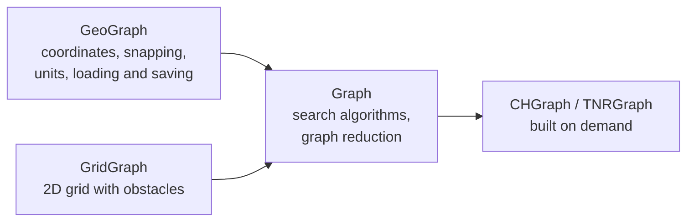
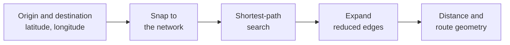
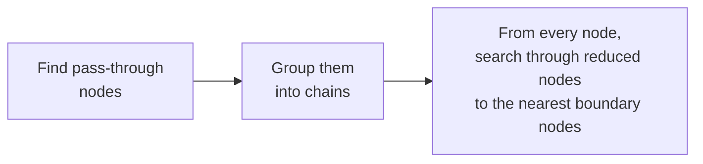

# scgraph — Architecture

How scgraph works inside: how a routing query is answered, how graph reduction works,
where a new algorithm plugs in, and what invalidates the caches. Written for
contributors and for researchers who want to test a new algorithm on scgraph's networks.

For how to use scgraph, see the [README](README.md), also published as the
[API docs](https://connor-makowski.github.io/scgraph/scgraph.html). For how to work on the
repository and what each class provides, see [DEVELOPMENT.md](DEVELOPMENT.md#key-classes).

1. [Overview](#1-overview)
2. [Data model](#2-data-model)
3. [Answering a geographic query](#3-answering-a-geographic-query)
4. [Graph reduction](#4-graph-reduction)
5. [Adding an algorithm](#5-adding-an-algorithm)
6. [Caches and invalidation](#6-caches-and-invalidation)
7. [Network file](#7-network-file)

## 1. Overview

`Graph` knows nothing about geography. `GeoGraph` and `GridGraph` each hold a `Graph`
(`graph_object`) and delegate every search to it. A `GeoGraph` comes from a built-in
network, a saved file, a GeoJSON file, an OSMnx graph or an OpenStreetMap file (`pipelines/steps/osm.py`,
with the optional dependency `osmium`); every loader produces the same `graph`, `nodes` and
`intermediate_nodes`; the GeoJSON and OpenStreetMap loaders cut polylines into arcs with
`helpers/polylines.py`. `build_geograph` builds a reference network from its online
sources: each network has a pipeline, a module of `pipelines/` (source URLs, credit, and
which steps of `pipelines/steps/` or loaders to call with which options; the road + sea
network combines two networks with `merge_with_other_geograph`), whose contract is stated in
`pipelines/__init__.py`; `build_geograph` also takes a module object, cached under the last
part of its name. The core imports `pipelines` only when `load_from_osm` or
`build_geograph` is called. The sources are downloaded once, the built network is written
as a `.scgraph` network file to the local cache, whose header says what built it (§7; no
clock time, so the same inputs give the same `content_sha256`), and later calls read the
cache. `pipelines/steps/assembly.py` (arcs → arrays, components,
Douglas–Peucker) has a C++ twin in `cpp/src/pipelines/`, bound in
`cpp/bindings/pipelines_bindings.cpp`. Network files written by scgraph (`save_as_scgraph`, so built
networks and the conversions of published networks, §6) number their nodes along a Hilbert
curve over longitude and latitude (`helpers/hilbert.py`, within each mode, so that the nodes
of a mode stay together; header key `node_order`), so that nodes close on the globe get
close ids; the GeoGraph saved is not renumbered (`Graph._csr(order)` gives the renumbered
arcs, one copy). `_in_hilbert_order` renumbers a GeoGraph in memory, for the conversions of
published networks and `load_from_geojson`. `CHGraph` and `TNRGraph` are built from a `Graph` on the first
query that needs them.

`Graph` and `CHGraph` exist twice: in C++ (`cpp/`) and in pure Python. When the C++
extension is compiled, `from scgraph import Graph` returns the C++ class; otherwise it
returns the Python one. Both expose the same methods.

## 2. Data model

A graph is a list of dictionaries, `graph[u] = {v: weight}` (see
[Graph Structure](README.md#graph-structure)). Edges are directed: a two-way road is two
entries, and every node has an entry, even with no outgoing edge.

- Backward searches use the **inverse graph** (`inverse_graph[v] = {u: weight}`), built
  on demand.
- The C++ backend stores the arcs by origin in three arrays (offsets, heads, weights), as in a
  network file (§7), and so do its inverse and reduced graphs. An edit copies the rows it
  touches, and the next search packs every row into new arrays, so a series of edits costs
  one packing.
- `GeoGraph` adds `nodes[u] = [latitude, longitude]` (read from the file's arrays for a
  GeoGraph read from a network file, §7), `node_ids[u]` (the node's stable id, for example
  its OSM id, which saves and merges keep; nodes added later get negative ids below all
  the others; without ids, a node's id is its position), `node_modes[u]` (its mode, a row
  of `modes`: `{"name": ..., "source": ...}`, the source naming where the node's id comes
  from, so that `(mode, node id)` identifies a node) and, optionally,
  `intermediate_nodes`: the detailed shape of an edge, used only to draw the route
  (`intermediate_nodes[u][v]`: the points between `u` and `v`, from `u` to `v`;
  the loaders give no entry to an arc without such points).
  Node ids in graphs, paths and algorithms are positions; loaders that number the nodes
  themselves (`load_from_osm`, `load_from_osmnx_graph`, `load_from_geojson`) number them
  along a Hilbert curve.
- Algorithms take an origin and a destination as a node id, a set of node ids, or a
  dict `{node_id: distance}` (several sources or targets, each with a starting
  distance). They return `{"path": [node ids], "length": total weight}`.

## 3. Answering a geographic query

| Step | What happens | Code |
|---|---|---|
| Snap to the network | Each point is linked to its nearest node(s) with an access distance. The graph is not modified | `__snap_node__`, `node_addition_type` = `closest`, `quadrant` or `all`; `snap_index` |
| Shortest-path search | The chosen algorithm runs from the origin's nodes to the destination's nodes. For `a_star` with `geo.haversine`, the bound is computed natively from cached node coordinates | `algorithm_fn` (`bidirectional_buckets` by default); `a_star_great_circle` |
| Expand reduced edges | Only if the graph is reduced: each reduced edge is replaced by the nodes it hides | `run_with_reduced`, `expand_path` |
| Distance and route geometry | Access distances (scaled by circuity) are added, units converted, coordinates collected | `output_units`, `coordinate_path` |

If the origin and destination are closer to each other than to the network, no search
is run: the result is the straight-line distance, scaled by circuity. For the snapping
options, see [Node Addition Options](README.md#node-addition-options).

Snapping uses `snap_index` (`cpp/src/snap_index.cpp`; `helpers/snap_index.py` in pure Python,
with the same answers): the exact nearest node, ties to the lowest id (to the earliest on the
curve when `GeoGraph.snap_index` sorted the nodes, below), and the nearest node per quadrant.
- It reads the nodes in their own order, in place, in leaves of 32. That order must keep nearby
  nodes together, as the Hilbert order of network files does: the index measures how many
  leaves a query would scan and raises `NodeOrderError` above 16. `GeoGraph.snap_index` then
  indexes the nodes in Hilbert order and maps the answers back to the node ids (a graph built
  from a list, or many added nodes).
- A tree of 8 children per node keeps each child's box.
- A search skips every box farther than the best node found. The C++ index uses float
  distances to select candidates, then checks each candidate again in double. The pure-Python
  index works in double throughout. `cpp/src/snap_index.hpp` describes the design and what
  the two indexes must share.

`GeoGraph.geokdtree` is deprecated.

## 4. Graph reduction

Graph reduction replaces the nodes where no route choice is possible with direct edges
of the same total weight (usage: [Graph Reduction](README.md#graph-reduction)). It uses
the edges and weights only, never coordinates, so it works on any `Graph`.

It is not the `simplify_geojson` / MapShaper simplification, which removes vertices from
the source data before the graph is built: graph reduction removes nothing, and every
node can be restored.

**Terms**

| Term | Meaning |
|---|---|
| Pass-through node | A node with a single way to continue, apart from turning back: 1 outgoing edge and at least 1 incoming edge, or 2 outgoing edges whose incoming neighbours are among them |
| Chain | A connected group of reduced nodes (`reduced_node_chain_ids`) |
| Boundary node | A non-reduced node at an end of a chain |
| Pass | One sweep over all nodes to find pass-through nodes. Later passes look through already-reduced nodes, which also reduces dead ends and loops |
| `iterations` | Maximum number of passes (`-1`, the default: until a pass reduces nothing) |

**Preprocessing** — `reduce(iterations)`, or `reduce_iterations` when loading a
`GeoGraph`:

The last step runs a small Dijkstra from every node, reduced or not, that stops at the
first non-reduced nodes it reaches. It gives boundary nodes direct edges to each other,
and gives each reduced node direct edges to the boundary nodes of its chain. Forward
and backward, this is the **reduced graph** (`reduced_graph`, `reduced_inverse_graph`)
together with, for each direct edge, the nodes it hides (`reduced_graph_connections`,
`reduced_inverse_graph_connections`). `graph` and `inverse_graph` stay the original
graph (`unreduced_graph` is the same); `search_graph` and `search_inverse_graph` are the graph
the searches read: the reduced graph after `reduce()`, else the original. Both backends
expose the same four.

**Queries** — `run_with_reduced`:

| Origin and destination | What runs |
|---|---|
| Both outside chains | The algorithm, on the reduced graph |
| Origin inside a chain | The origin is replaced by the boundary nodes it reaches (start distance kept); it is put back in front of the path |
| Destination inside a chain | The destination is replaced by its chain's boundary entry nodes; the rest of the chain is appended to the path |
| Both in the same chain | The unreduced graph: Dijkstra in Python, the requested algorithm in C++ |

Searches thus start and end on non-reduced nodes, where `reduced_inverse_graph` is exactly
the reverse of `reduced_graph`: bidirectional searches rely on it. `contraction_hierarchy`
and `tnr` run on their own graph.

A query on a reduced graph returns the same length as on the unreduced graph, with a path
of the original graph (when several shortest paths exist, possibly a different one). Tested
in `test/32_*`, `test/33_*` and `test/38_*` to `test/43_*`.

## 5. Adding an algorithm

An algorithm decorated with `@Graph.algorithm` (example:
[Custom Graph](README.md#custom-graph)) takes `self` (the `Graph`), an origin and a
destination, reads the graph from `self.search_graph` (and `self.search_inverse_graph` with
`bidirectional=True`), and returns `{"path": ..., "length": ...}`. Its origin and
destination must accept every form of
the [Data model](#2-data-model), dicts included: on a reduced graph, an origin or
destination inside a chain is passed as a dict of boundary nodes with their distances.

The decorator adds graph-reduction support: on a reduced graph, it routes the call
through `run_with_reduced`, which handles origins and destinations inside chains and
expands the returned path.

An algorithm that reads `self.graph` instead walks the original graph: still correct, but
without the speed-up of the reduction. With the C++ backend, each read of these properties
copies the graph to Python: read it once per call.

`GeoGraph.get_shortest_path` takes the algorithm as `algorithm_fn`: the name of a
`Graph` method (`"dijkstra"`, `"a_star"`, …), or a callable, which receives the graph as
`graph=`.

## 6. Caches and invalidation

Changing the graph (`add_node`, `add_edge`, `remove_node`, `remove_edge`) calls
`reset_cache`, which drops

- the cached shortest-path trees,
- the reduced graph,
- the `CHGraph` and `TNRGraph` (in Python, also the BMSSP graph and the cached maximum
  edge weight).

The inverse graph, built once for backward searches, is not dropped.

A GeoGraph also caches its snapping index (`snap_index`, built when a network file is loaded,
else at the first snap) and its node coordinates in radians (native A\* bound). Both are dropped
by `add_coord_node`, `remove_coord_node` and `merge_with_other_geograph`, and rebuilt at the next
query; the coordinates are also rebuilt when the number of nodes changes. In-place edits of `nodes` are not
detected.

They are rebuilt only when asked for again (`reduce()` must be called again). Downloaded
built-in networks and networks built by `build_geograph` stay on disk until
`clear_geograph_cache`. The first `load_geograph` of a published network converts its
`<name>.graphjson` into `<name>.scgraph` beside it (§7), which later loads read; a conversion
that can't be read (damaged, another format version) is made again from the `.graphjson`, and
a cache that can't be written keeps reading the `.graphjson`. In the C++ build a loaded
conversion stays mapped: on Windows it can't be removed or replaced while a geograph read from
it is alive. A built network is not rebuilt when its source changes, but it is
when its file's header names another `PIPELINE_VERSION` or its file format is another, or its
file is missing, or when `refresh=True` asks for it. With `local_files_only=True` (the
default when `SCGRAPH_OFFLINE=1`), nothing is downloaded: `load_geograph` and `build_geograph` raise `FileNotFoundError` for a
network that is not in the cache, and `build_geograph` loads a build of another pipeline
version with a warning that names both versions, but refuses one of another file
format. `list_geographs` lists the published networks from a fixed list in the code, without
a request (`contents.txt` is read only for another `geograph_url`). A built network lives in
`networks/<name>/<region>/` of the cache: a
file named by its content (`<content_sha256>.scgraph`, §7) and a `cache.json` that names
it, with the download time (the only clock time). Each build works in its own `.building-*`
folder at the root of the cache, then moves the network file and then `cache.json` into
place (`os.replace`), so `cache.json` always names a whole file (a file of the same name has the same content and is kept: it may be
open); the old file is removed last, or stays as an orphan if it cannot be
(Windows, still open). Two builds of one network can run at once: the last `cache.json` wins.
`save_as_scgraph` and `save_as_graphjson` refuse a target under `networks/` of the cache
directory, so that a cached file stays the one its `cache.json` names. Whenever scgraph builds a
network, it writes a `CACHEDIR.TAG` in `networks/` (https://bford.info/cachedir/).
`cache_info` reads the cache from disk only; `clear_geograph_cache` removes only the files
scgraph writes (all of them, or those of one network or region), and leaves a file it can't
remove (Windows: a network still loaded in the process) with a logging warning. A
`.scgraph` file is written next to its target and then moved onto it, so a failed save
leaves the previous file whole.

For how to use each cache, see the README:
[cached queries](README.md#cached-queries-same-origin-many-destinations),
[built-in network cache](README.md#built-in-geographs-cache-management),
[lazy loading](README.md#lazy-loading).

## 7. Network file

`save_as_scgraph` writes a GeoGraph to a binary `.scgraph` file and `load_from_scgraph` reads
it back (`network_file.py`, standard library only). It holds the same data as a graphjson
file, but loads without parsing JSON. In the C++ backend, the file is mapped read-only and
the graph reads its arcs in place (the private `Graph._from_mapped_csr` keeps them;
`Graph.from_csr` copies). A GeoGraph read from a network file (so also from `load_geograph`
and `build_geograph`) has as `nodes` a `network_file.NodeCoordinates`, which reads the latitude
and longitude arrays (in place in the C++ backend) and keeps added nodes after them;
`SnapIndex.from_arrays` indexes the arrays (the C++ index reads them in place and keeps
them), and `NodeCoordinates.take` builds a route's coordinates from them in C++ when
available. Its `intermediate_nodes`, if the file has shapes, is a read-only
`network_file.ArcShapes`, which reads each shape from the shape arrays when asked for;
`ArcShapes.coordinate_path` builds a route's coordinates with its shapes in C++ when
available. The mapping lasts as long as those `nodes`, shapes or the snapping index, even after
the graph is edited. Windows does not replace a mapped file, so there, saving onto a file that
an open geograph was read from raises a `PermissionError`.
`network_file.write` takes the arrays as stored; `save_as_scgraph` passes it the graph's arcs
from the private `Graph._csr()`, in the C++ backend views of the graph's own arrays, so that
saving copies no arc there, and the metadata from `network_file.header_metadata` (scgraph's
keys plus the identity card, the keys scgraph writes refused), which a writer of arrays uses
too.

| Bytes | Content |
|---|---|
| 0–7 | magic `SCGRAPH1` |
| 8–39 | the SHA-256 (raw 32 bytes; `content_sha256` is its hex) of every byte from 40 to the end of the file |
| 40–47 | length of the header, little-endian unsigned 64-bit integer |
| 48– | header: UTF-8 JSON with sorted keys, then zeros up to a multiple of 64 bytes |
| then | arrays, little-endian, each starting at a multiple of 64 bytes |

`content_sha256` is the identity of the file, header included, so a file named by it
(`build_geograph`'s) holds exactly those bytes; the reader returns it unchecked, so that
opening a file does not read the whole file. It identifies a build: same pipeline, same
sources, same scgraph version, same backend and same platform and C library or macOS
version give a byte-identical file (tested). The C++ and Python builds give the same
graph, the same nodes, arcs and lengths (tested with the `marnet` pipeline on a small
synthetic input); only the order of arcs within a node (the order the backend visits them)
and ties between equal-length routes may differ. Across platforms, a few lengths or shape
points may differ in the last bit (the platform's math library). The header has no size
limit; it gives `format_version` (1), `spec` (a link to this section), `arrays` (for each
array: `dtype`, `shape` and `offset` from the end of the padded header, a multiple of 64)
and `metadata`: `crs` (`EPSG:4326`), `units` of the weights, the GeoGraph defaults
`default_off_graph_circuity` and `default_node_addition_circuity`, and `symmetric` (true
when every arc has a reverse arc of the same weight; scgraph does not read it yet),
`node_order`; and, when known, `sources`: where the data comes from, each with its `name`,
`url`, `sha256`, `bytes`, `credit`, `license` (an SPDX identifier, `LicenseRef-…` when
SPDX has none, `NOASSERTION` when it could not be established), `license_url` and
`version` (the time its data is up to, in UTC with a Z, or a tag; absent when the source
gives none), so that attribution travels with the file; for a built network, `pipeline`
(`name`, `region`, `version`), `software` (`scgraph`, `backend`, and `platform` with its C
library or macOS version), `description` and `steps` (see `pipelines/__init__.py`); and
`modes`, the list that `node_modes` indexes, for example `[{"name": "road", "source":
"roads"}, {"name": "sea", "source": "sea"}]` (`source`, optional, must name an entry of
`sources`). `save_as_scgraph(metadata=...)` sets the optional keys, never those scgraph
writes itself.

| Array | dtype | Shape | Content |
|---|---|---|---|
| `offsets` | int32 | n + 1 | the arcs of node `u` are `offsets[u]` to `offsets[u + 1] - 1` |
| `heads` | int32 | m | destination of each arc, in the graph's order within each origin |
| `weights` | float64 | m | weight of each arc |
| `latitudes`, `longitudes` | int32 or float64 | n | node coordinates: in units of 1e-7 degree (int32) or in degrees (float64) |
| `shape_offsets` (optional) | int32 | m + 1 | the shape of arc `j` is points `shape_offsets[j]` to `shape_offsets[j + 1] - 1`: the points between its two nodes, which it does not repeat |
| `shape_points` (optional) | int32 or float64 | k × 2 | latitude and longitude of each shape point, as the node coordinates |
| `node_ids` (optional) | int32 or int64 (int32 only when every id fits, as for converted built-in networks; OSM ids need int64) | n | the id of each node in its source (negative for nodes scgraph created); without it, a node's id is its position |
| `node_modes` (optional) | uint8 | n | the mode of each node, an index into the metadata's `modes`; without it, every node has one mode |

The reader checks the magic, the version, that the header and every array lie inside the
file (the arrays after the header), and that
the arrays describe a graph (offsets from 0 to m, non-decreasing, heads between 0 and n − 1;
one node id and one node mode per node, the modes listed in `modes`; one dtype for the
coordinates),
and raises a `ValueError` otherwise; on a mapped file it leaves the order of offsets and heads to
the C++ graph and the bounds of each shape to `ArcShapes`, which check them where they read,
and does not read the node modes.
The coordinates (`latitudes`, `longitudes`, `shape_points`) share one dtype, which the writer
chooses (`save_as_scgraph(coordinate_dtype=...)`, by default the GeoGraph's own): float64
degrees, exact, or int32 in units of 1e-7 degree (OSM's encoding, about 1 cm), rounded to it; a
reader divides an int32 value by 1e7 (that division, not a product by 1e-7, gives the stored
value back exactly). `network_file.info` reads a file's header alone (`GeoGraph.scgraph_info`). A file holds fewer than 2³¹ shape points. The writer keeps the arcs of each row in the graph's order and writes each arc once, so a row
holds each head once (the `symmetric` flag relies on it); the reader does not check it. It ignores header keys and arrays it does not know, so later versions
can add optional arrays (for example the mode of each arc) that older readers skip: such additions
keep `format_version` 1, which changes only when a reader of the current version would misread
the file.

