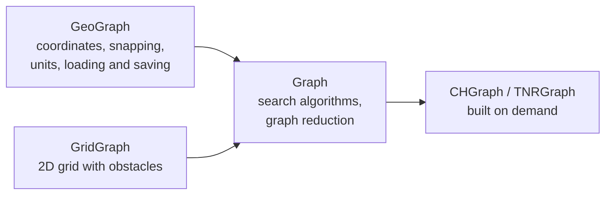
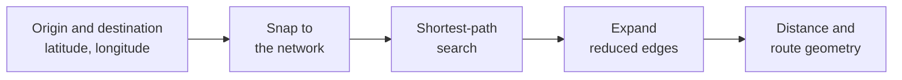
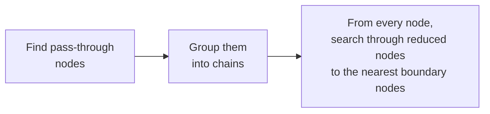

# scgraph — Architecture

How scgraph works inside: how a routing query is answered, how graph reduction works,
where a new algorithm plugs in, and what invalidates the caches. Written for
contributors and for researchers who want to test a new algorithm on scgraph's networks.

For how to use scgraph, see the [README](README.md), also published as the
[API docs](https://connor-makowski.github.io/scgraph/scgraph.html). For how to work on the
repository and what each class provides, see [DEVELOPMENT.md](DEVELOPMENT.md#key-classes).

1. [Overview](#1-overview)
2. [Data model](#2-data-model)
3. [Answering a geographic query](#3-answering-a-geographic-query)
4. [Graph reduction](#4-graph-reduction)
5. [Adding an algorithm](#5-adding-an-algorithm)
6. [Caches and invalidation](#6-caches-and-invalidation)

## 1. Overview

`Graph` knows nothing about geography. `GeoGraph` and `GridGraph` each hold a `Graph`
(`graph_object`) and delegate every search to it. `CHGraph` and `TNRGraph` are built
from a `Graph` on the first query that needs them.

`Graph` and `CHGraph` exist twice: in C++ (`cpp/`) and in pure Python. When the C++
extension is compiled, `from scgraph import Graph` returns the C++ class; otherwise it
returns the Python one. Both expose the same methods.

## 2. Data model

A graph is a list of dictionaries, `graph[u] = {v: weight}` (see
[Graph Structure](README.md#graph-structure)). Edges are directed: a two-way road is two
entries, and every node has an entry, even with no outgoing edge.

- Backward searches use the **inverse graph** (`inverse_graph[v] = {u: weight}`), built
  on demand.
- `GeoGraph` adds `nodes[u] = [latitude, longitude]` and, optionally,
  `intermediate_nodes`: the detailed shape of an edge, used only to draw the route.
- Algorithms take an origin and a destination as a node id, a set of node ids, or a
  dict `{node_id: distance}` (several sources or targets, each with a starting
  distance). They return `{"path": [node ids], "length": total weight}`.

## 3. Answering a geographic query

| Step | What happens | Code |
|---|---|---|
| Snap to the network | Each point is linked to its nearest node(s) with an access distance. The graph is not modified | `__snap_node__`, `node_addition_type` = `closest`, `quadrant` or `all` |
| Shortest-path search | The chosen algorithm runs from the origin's nodes to the destination's nodes | `algorithm_fn` (`bidirectional_buckets` by default) |
| Expand reduced edges | Only if the graph is reduced: each reduced edge is replaced by the nodes it hides | `run_with_reduced`, `expand_path` |
| Distance and route geometry | Access distances (scaled by circuity) are added, units converted, coordinates collected | `output_units`, `coordinate_path` |

If the origin and destination are closer to each other than to the network, no search
is run: the result is the straight-line distance, scaled by circuity. For the snapping
options, see [Node Addition Options](README.md#node-addition-options).

## 4. Graph reduction

Graph reduction replaces the nodes where no route choice is possible with direct edges
of the same total weight (usage: [Graph Reduction](README.md#graph-reduction)). It uses
the edges and weights only, never coordinates, so it works on any `Graph`.

It is not the `simplify_geojson` / MapShaper simplification, which removes vertices from
the source data before the graph is built: graph reduction removes nothing, and every
node can be restored.

**Terms**

| Term | Meaning |
|---|---|
| Pass-through node | A node with a single way to continue, apart from turning back: 1 outgoing edge and at least 1 incoming edge, or 2 outgoing edges whose incoming neighbours are among them |
| Chain | A connected group of reduced nodes (`reduced_node_chain_ids`) |
| Boundary node | A non-reduced node at an end of a chain |
| Pass | One sweep over all nodes to find pass-through nodes. Later passes look through already-reduced nodes, which also reduces dead ends and loops |
| `iterations` | Maximum number of passes (`-1`: until a pass reduces nothing) |

**Preprocessing** — `reduce(iterations)`, or `reduce_iterations` when loading a
`GeoGraph`:

The last step runs a small Dijkstra from every node, reduced or not, that stops at the
first non-reduced nodes it reaches. It gives boundary nodes direct edges to each other,
and gives each reduced node direct edges to the boundary nodes of its chain. Forward
and backward, this is the **reduced graph** (`reduced_graph`, `reduced_inverse_graph`)
together with, for each direct edge, the nodes it hides (`reduced_graph_connections`,
`reduced_inverse_graph_connections`). The original graph stays available as
`unreduced_graph`.

**Queries** — `run_with_reduced`:

| Origin and destination | What runs |
|---|---|
| Both outside chains | The algorithm, on the reduced graph |
| Origin inside a chain | The origin is replaced by the boundary nodes it reaches (start distance kept); it is put back in front of the path |
| Destination inside a chain | The destination is replaced by its chain's boundary entry nodes; the rest of the chain is appended to the path |
| Both in the same chain | The unreduced graph: Dijkstra in Python, the requested algorithm in C++ |

Searches thus start and end on non-reduced nodes, where `reduced_inverse_graph` is exactly
the reverse of `reduced_graph`: bidirectional searches rely on it. `contraction_hierarchy`
and `tnr` run on their own graph.

A query on a reduced graph returns the same length as on the unreduced graph, with a path
of the original graph (when several shortest paths exist, possibly a different one). Tested
in `test/32_*`, `test/33_*` and `test/38_*` to `test/43_*`.

## 5. Adding an algorithm

An algorithm decorated with `@Graph.algorithm` (example:
[Custom Graph](README.md#custom-graph)) takes `self` (the `Graph`), an origin and a
destination, reads the graph from `self.graph` (and `self.inverse_graph` with
`bidirectional=True`), and returns `{"path": ..., "length": ...}`. Its origin and
destination must accept every form of
the [Data model](#2-data-model), dicts included: on a reduced graph, an origin or
destination inside a chain is passed as a dict of boundary nodes with their distances.

The decorator adds graph-reduction support: on a reduced graph, it routes the call
through `run_with_reduced`, which handles origins and destinations inside chains and
expands the returned path.

The two backends do not expose the same graph to a decorated algorithm: with the
pure-Python `Graph`, `self.graph` and `self.inverse_graph` are the reduced graphs; with the
C++ `Graph`, `self.graph` is the unreduced graph and `self.inverse_graph` does not exist.

`GeoGraph.get_shortest_path` takes the algorithm as `algorithm_fn`: the name of a
`Graph` method (`"dijkstra"`, `"a_star"`, …), or a callable, which receives the graph as
`graph=`.

## 6. Caches and invalidation

Changing the graph (`add_node`, `add_edge`, `remove_node`, `remove_edge`) calls
`reset_cache`, which drops

- the cached shortest-path trees,
- the reduced graph,
- the `CHGraph` and `TNRGraph` (in Python, also the BMSSP graph and the cached maximum
  edge weight).

The inverse graph, built once for backward searches, is not dropped.

They are rebuilt only when asked for again (`reduce()` must be called again). Downloaded
built-in networks stay on disk.

For how to use each cache, see the README:
[cached queries](README.md#cached-queries-same-origin-many-destinations),
[built-in network cache](README.md#built-in-geographs-cache-management),
[lazy loading](README.md#lazy-loading).
