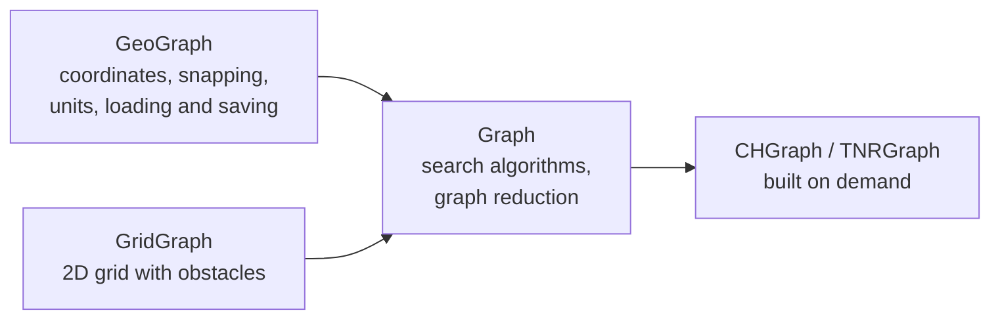
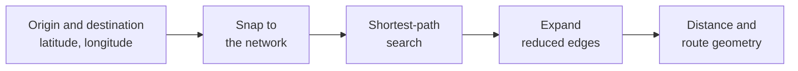
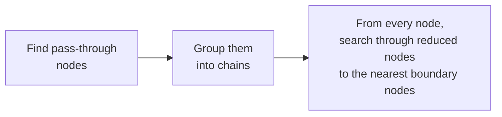

# scgraph — Architecture

How scgraph works inside: how a routing query is answered, how graph reduction works,
where a new algorithm plugs in, and what invalidates the caches. Written for
contributors and for researchers who want to test a new algorithm on scgraph's networks.

For how to use scgraph, see the [README](README.md), also published as the
[API docs](https://connor-makowski.github.io/scgraph/scgraph.html). For how to work on the
repository and what each class provides, see [DEVELOPMENT.md](DEVELOPMENT.md#key-classes).

1. [Overview](#1-overview)
2. [Data model](#2-data-model)
3. [Answering a geographic query](#3-answering-a-geographic-query)
4. [Graph reduction](#4-graph-reduction)
5. [Adding an algorithm](#5-adding-an-algorithm)
6. [Caches and invalidation](#6-caches-and-invalidation)
7. [Network file](#7-network-file)

## 1. Overview

`Graph` knows nothing about geography. `GeoGraph` and `GridGraph` each hold a `Graph`
(`graph_object`) and delegate every search to it. A `GeoGraph` comes from a built-in
network, a saved file, a GeoJSON file, an OSMnx graph or an OpenStreetMap file (`osm.py`,
with the optional dependency `osmium`); every loader produces the same `graph`, `nodes` and
`intermediate_nodes`. `build_geograph` builds a reference network from its online
sources: each network has a small build script in `networks/` (source URLs, credit, and
which loaders to call with which options; the road + sea network combines two networks with
`merge_with_other_geograph`); the sources are downloaded once, the built network is written
as a `.scgraph` network file to the local cache with a manifest of what was downloaded, and
later calls read the cache. `CHGraph` and `TNRGraph` are built from a `Graph` on the first
query that needs them.

`Graph` and `CHGraph` exist twice: in C++ (`cpp/`) and in pure Python. When the C++
extension is compiled, `from scgraph import Graph` returns the C++ class; otherwise it
returns the Python one. Both expose the same methods.

## 2. Data model

A graph is a list of dictionaries, `graph[u] = {v: weight}` (see
[Graph Structure](README.md#graph-structure)). Edges are directed: a two-way road is two
entries, and every node has an entry, even with no outgoing edge.

- Backward searches use the **inverse graph** (`inverse_graph[v] = {u: weight}`), built
  on demand.
- `GeoGraph` adds `nodes[u] = [latitude, longitude]` and, optionally,
  `intermediate_nodes`: the detailed shape of an edge, used only to draw the route.
- Algorithms take an origin and a destination as a node id, a set of node ids, or a
  dict `{node_id: distance}` (several sources or targets, each with a starting
  distance). They return `{"path": [node ids], "length": total weight}`.

## 3. Answering a geographic query

| Step | What happens | Code |
|---|---|---|
| Snap to the network | Each point is linked to its nearest node(s) with an access distance. The graph is not modified | `__snap_node__`, `node_addition_type` = `closest`, `quadrant` or `all` |
| Shortest-path search | The chosen algorithm runs from the origin's nodes to the destination's nodes. For `a_star` with `geo.haversine`, the bound is computed natively from cached node coordinates | `algorithm_fn` (`bidirectional_buckets` by default); `a_star_great_circle` |
| Expand reduced edges | Only if the graph is reduced: each reduced edge is replaced by the nodes it hides | `run_with_reduced`, `expand_path` |
| Distance and route geometry | Access distances (scaled by circuity) are added, units converted, coordinates collected | `output_units`, `coordinate_path` |

If the origin and destination are closer to each other than to the network, no search
is run: the result is the straight-line distance, scaled by circuity. For the snapping
options, see [Node Addition Options](README.md#node-addition-options).

## 4. Graph reduction

Graph reduction replaces the nodes where no route choice is possible with direct edges
of the same total weight (usage: [Graph Reduction](README.md#graph-reduction)). It uses
the edges and weights only, never coordinates, so it works on any `Graph`.

It is not the `simplify_geojson` / MapShaper simplification, which removes vertices from
the source data before the graph is built: graph reduction removes nothing, and every
node can be restored.

**Terms**

| Term | Meaning |
|---|---|
| Pass-through node | A node with a single way to continue, apart from turning back: 1 outgoing edge and at least 1 incoming edge, or 2 outgoing edges whose incoming neighbours are among them |
| Chain | A connected group of reduced nodes (`reduced_node_chain_ids`) |
| Boundary node | A non-reduced node at an end of a chain |
| Pass | One sweep over all nodes to find pass-through nodes. Later passes look through already-reduced nodes, which also reduces dead ends and loops |
| `iterations` | Maximum number of passes (`-1`, the default: until a pass reduces nothing) |

**Preprocessing** — `reduce(iterations)`, or `reduce_iterations` when loading a
`GeoGraph`:

The last step runs a small Dijkstra from every node, reduced or not, that stops at the
first non-reduced nodes it reaches. It gives boundary nodes direct edges to each other,
and gives each reduced node direct edges to the boundary nodes of its chain. Forward
and backward, this is the **reduced graph** (`reduced_graph`, `reduced_inverse_graph`)
together with, for each direct edge, the nodes it hides (`reduced_graph_connections`,
`reduced_inverse_graph_connections`). `graph` and `inverse_graph` stay the original
graph (`unreduced_graph` is the same); `search_graph` and `search_inverse_graph` are the graph
the searches read: the reduced graph after `reduce()`, else the original. Both backends
expose the same four.

**Queries** — `run_with_reduced`:

| Origin and destination | What runs |
|---|---|
| Both outside chains | The algorithm, on the reduced graph |
| Origin inside a chain | The origin is replaced by the boundary nodes it reaches (start distance kept); it is put back in front of the path |
| Destination inside a chain | The destination is replaced by its chain's boundary entry nodes; the rest of the chain is appended to the path |
| Both in the same chain | The unreduced graph: Dijkstra in Python, the requested algorithm in C++ |

Searches thus start and end on non-reduced nodes, where `reduced_inverse_graph` is exactly
the reverse of `reduced_graph`: bidirectional searches rely on it. `contraction_hierarchy`
and `tnr` run on their own graph.

A query on a reduced graph returns the same length as on the unreduced graph, with a path
of the original graph (when several shortest paths exist, possibly a different one). Tested
in `test/32_*`, `test/33_*` and `test/38_*` to `test/43_*`.

## 5. Adding an algorithm

An algorithm decorated with `@Graph.algorithm` (example:
[Custom Graph](README.md#custom-graph)) takes `self` (the `Graph`), an origin and a
destination, reads the graph from `self.search_graph` (and `self.search_inverse_graph` with
`bidirectional=True`), and returns `{"path": ..., "length": ...}`. Its origin and
destination must accept every form of
the [Data model](#2-data-model), dicts included: on a reduced graph, an origin or
destination inside a chain is passed as a dict of boundary nodes with their distances.

The decorator adds graph-reduction support: on a reduced graph, it routes the call
through `run_with_reduced`, which handles origins and destinations inside chains and
expands the returned path.

An algorithm that reads `self.graph` instead walks the original graph: still correct, but
without the speed-up of the reduction. With the C++ backend, each read of these properties
copies the graph to Python: read it once per call.

`GeoGraph.get_shortest_path` takes the algorithm as `algorithm_fn`: the name of a
`Graph` method (`"dijkstra"`, `"a_star"`, …), or a callable, which receives the graph as
`graph=`.

## 6. Caches and invalidation

Changing the graph (`add_node`, `add_edge`, `remove_node`, `remove_edge`) calls
`reset_cache`, which drops

- the cached shortest-path trees,
- the reduced graph,
- the `CHGraph` and `TNRGraph` (in Python, also the BMSSP graph and the cached maximum
  edge weight).

The inverse graph, built once for backward searches, is not dropped.

A GeoGraph also caches its KD-tree (snapping) and its node coordinates in radians (native
A\* bound). Both are dropped by `add_coord_node`, `remove_coord_node` and
`merge_with_other_geograph`, and rebuilt at the next query; the coordinates are also rebuilt
when the number of nodes changes. In-place edits of `nodes` are not detected.

They are rebuilt only when asked for again (`reduce()` must be called again). Downloaded
built-in networks and networks built by `build_geograph` stay on disk until
`clear_geograph_cache`. A built network is not rebuilt when its source changes, but it is
when its manifest names another `VERSION` of its build script or of the file format. Each
build works in its own `.building-*` folder, then moves the network file and then the
manifest into place. A `.scgraph` file is written next to its target and then moved onto
it, so a failed save leaves the previous file whole.

For how to use each cache, see the README:
[cached queries](README.md#cached-queries-same-origin-many-destinations),
[built-in network cache](README.md#built-in-geographs-cache-management),
[lazy loading](README.md#lazy-loading).

## 7. Network file

`save_as_scgraph` writes a GeoGraph to a binary `.scgraph` file and `load_from_scgraph` reads
it back (`network_file.py`, standard library only). It holds the same data as a graphjson
file, but loads without parsing JSON: in the C++ backend, `Graph.from_csr` builds the graph
directly from the arrays.

| Bytes | Content |
|---|---|
| 0–7 | magic `SCGRAPH1` |
| 8–15 | length of the header, little-endian unsigned 64-bit integer |
| 16– | header: UTF-8 JSON, padded with spaces up to byte 4096 |
| 4096– | arrays, little-endian, each starting at a multiple of 64 bytes |

The header gives `format_version` (1), `spec` (a link to this section), `arrays` (for each
array: `dtype`, `shape` and `offset` from the start of the file) and `metadata`: `crs`
(`EPSG:4326`), `units` of the weights, the GeoGraph defaults
`default_off_graph_circuity` and `default_node_addition_circuity`, and `symmetric` (true
when every arc has a reverse arc of the same weight); and, when known, `sources`: where the data comes from, each with its URL, SHA-256, credit and licence (SPDX identifier), so that attribution travels with the file.

| Array | dtype | Shape | Content |
|---|---|---|---|
| `offsets` | int32 | n + 1 | the arcs of node `u` are `offsets[u]` to `offsets[u + 1] - 1` |
| `heads` | int32 | m | destination of each arc, sorted within each origin |
| `weights` | float64 | m | weight of each arc |
| `latitudes`, `longitudes` | float64 | n | node coordinates, in degrees |
| `shape_offsets` (optional) | int64 | m + 1 | the shape of arc `j` is points `shape_offsets[j]` to `shape_offsets[j + 1] - 1` |
| `shape_points` (optional) | float64 | k × 2 | latitude and longitude of each shape point |

The reader checks the magic, the version, that every array lies inside the file, and that
the arrays describe a graph (offsets from 0 to m, non-decreasing, heads between 0 and n − 1),
and raises a `ValueError` otherwise. The writer sorts the heads of each row and writes each arc once; the reader does not check it. It ignores arrays it does not know, so later versions
can add optional arrays (for example the mode of each arc) that older readers skip.

