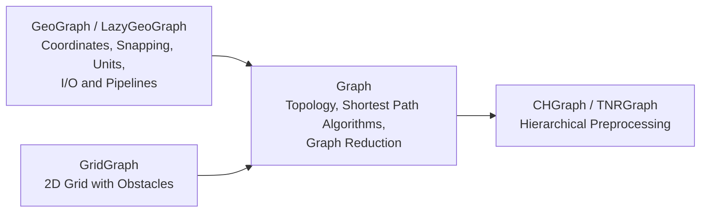
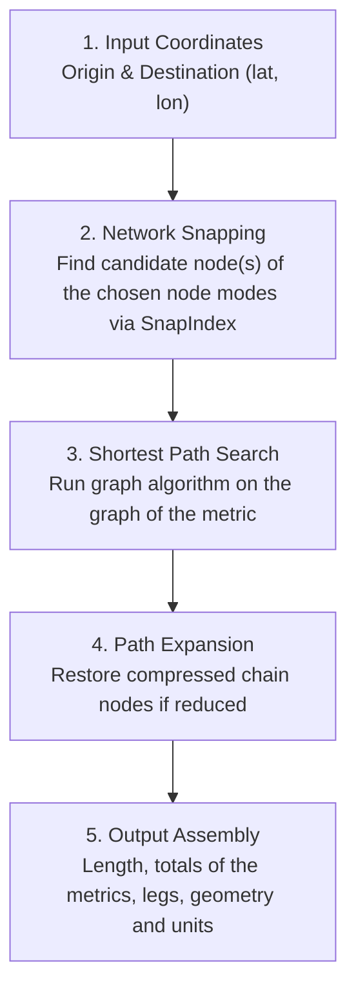
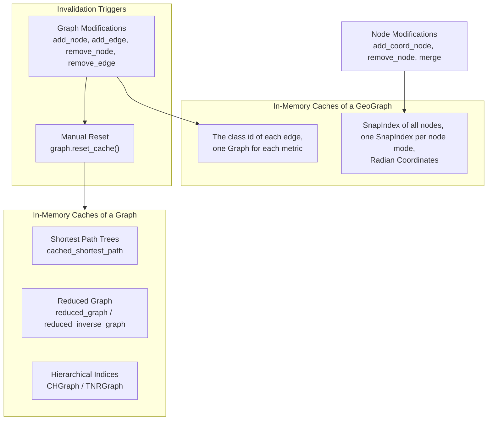

# scgraph — Architecture

This document explains how `scgraph` works inside: how a query runs, how a graph is stored, how graph reduction works, how to add an algorithm, what the caches hold, and the `.scgraph` file format.

The [README](README.md), the guides of [`guides/`](guides/) and the [API Documentation](https://connor-makowski.github.io/scgraph/scgraph.html) show how to use scgraph. [DEVELOPMENT.md](DEVELOPMENT.md) gives the rules of a contribution.

**Words.** An **edge** joins one node to another, in one direction, and has a weight. A **metric** is one weight for every edge of a network, under a name. `length` is the metric that every network has: the length of each edge. The **class** of an edge is its category in its source, such as `motorway` or `suez`. An edge is **closed** in a metric when its weight is infinity: no route by this metric takes it. A **weight per km** is the weight of 1 km of an edge. A **query point** is the origin or the destination of a query. An **off-graph leg** is the straight line between a query point and the node that it snaps to. The **total** of a metric along a route is the sum of the weights of its edges and of its two off-graph legs. The **node mode** of a node is the kind of place where the node is: `road`, `rail`, `sea`, `port`, `airport` or `rail_terminal`. The **edge mode** of a class is the kind of transport of its edges: `road`, `rail`, `sea` or `air`. A **hub** is a port, an airport or a rail terminal. A **leg** is a part of a route on one edge mode. A **transfer** is a node where a route goes from a leg of one edge mode to a leg of another.

---

## Table of Contents

1. [Overview](#1-overview)
2. [Data Model](#2-data-model)
3. [Answering a Geographic Query](#3-answering-a-geographic-query)
4. [Graph Reduction](#4-graph-reduction)
5. [Adding an Algorithm](#5-adding-an-algorithm)
6. [Caches and Invalidation](#6-caches-and-invalidation)
7. [Network File Format](#7-network-file-format)

---

## 1. Overview



`scgraph` separates the graph algorithms from the geographic logic and from the grid logic:

* **`Graph`**: A graph of node ids. It knows nothing about coordinates. It holds the search algorithms (Dijkstra, Bidirectional Dijkstra, A\*, Bellman-Ford, BMSSP) and graph reduction. The section *Choosing an Algorithm* of [guides/routing.md](guides/routing.md#choosing-an-algorithm) lists every algorithm with its use.
* **`GeoGraph` / `LazyGeoGraph`**: A `GeoGraph` holds a `Graph` (attribute `graph_object`) and one point for each node (WGS84 latitude and longitude). It snaps a point to the network with a `SnapIndex`, computes distances, and handles networks with several node modes. It also holds the class of each edge and the metrics of the network, with one `Graph` for each metric. A `LazyGeoGraph` downloads and loads its network at the first query.
* **`GridGraph`**: A 2D grid with obstacles, with 4 or 8 directions of movement.
* **`CHGraph` / `TNRGraph`**: Two hierarchies that a `Graph` builds on demand to answer queries faster: Contraction Hierarchies and Transit Node Routing.

### The C++ Extension and the Pure-Python Code

Each graph operation has two implementations that give the same results:
1. **C++ extension (`scgraph/cpp/`)**: compiled with nanobind, in C++20 with `-O3`. It is the faster one.
2. **Pure Python**: used when the C++ extension is not compiled.

When `scgraph` is imported, it uses the C++ classes if the extension is compiled. Otherwise it uses the Python classes.

### Pipeline Subsystem (`scgraph.pipelines`)

The package `scgraph.pipelines` builds networks from their online sources. A pipeline is one module of this package. It names the sources of one network and has a `build` function. The docstring of `scgraph.pipelines` gives the contract of a pipeline. The guide [scgraph/pipelines/README.md](scgraph/pipelines/README.md) follows a network from its sources to a route: the build step by step, the derivation, the network release and the load, with the numbers of real runs.

The runner, `network_builder.py`, runs a pipeline. `build_network_file` downloads the sources and calls `build` in a work folder. It writes the network to a `.scgraph` file, with the metadata of the build (pipeline, sources, software) in the header. Then it moves the file into the cache.

`derived_networks.py` derives a network file from another network file, the parent file, with no download (`derive_network_file`). The derived file holds some node modes of the parent file, and its land networks inside a bbox. Its header records the digest of the parent file.

A build runs steps. The functions of the steps are in `scgraph.pipelines.steps`, one or two modules for each step:

* **Read the sources (`steps.step1_osm_ways`)**:
  `step1_osm_ways` reads the ways of an OpenStreetMap file with `locate_ways` of `scgraph/helpers/osm.py`, from disk or by HTTP byte ranges (`step1_osm_planet_reader`). `step1_osm_ways.build_way_pieces` cuts each kept way into pieces and simplifies the shape of each piece to within 50 m (`step3_network_assembly.simplify_shapes`, with `scgraph/helpers/douglas_peucker.py`).
* **Join the networks (`steps.step2_hub_connectors`, `steps.step2_land_mask`)**:
  `step2_hub_connectors.join_networks_at_hubs` joins the networks of roads, of railways and of sea lanes at hubs: ports, airports and rail terminals. `step2_land_mask` tells land from water on a Natural Earth raster, and finds the water path of a sea connector (`find_water_path_cells`).
* **Assemble the graph (`steps.step3_network_assembly`)**:
  `step3_network_assembly.build_graph_from_pieces` stores the edges as CSR arrays (`build_csr_from_edges`). A graph holds one edge at most from a node to another. Of several edges between the same two nodes, the build keeps the shortest edge of each class. The shortest of them all stays one edge. The build splits each other kept edge at its middle, with a new node there. `step3_network_assembly.assemble_network` keeps the strongly connected components (`find_strongly_connected_components`, in `scgraph/helpers/components.py`), contracts the chains of pass-through nodes (`contract_chains`), and numbers the nodes along a Hilbert curve.
* **Validate the network (`steps.step4_validation_cases`)**:
  `validate_network` checks a built network against cases. A case describes a known route of the real world, such as a driving distance or a published sea distance. The docstring of `steps/step4_validation_cases` lists the kinds of cases and their rules. With `validate=True`, `build_network_file` validates the built file, and a network that fails does not enter the cache.

The costly functions of `step2_land_mask` and `step3_network_assembly` have a C++ version in `scgraph/cpp/src/pipelines/` (`assembly.hpp`, `landmask.hpp`) and a pure-Python version that gives the same results.

---

## 2. Data Model

### How a Graph Is Stored in Memory

`scgraph` stores a graph in two ways: an adjacency list in Python, and Compressed Sparse Row (CSR) arrays in C++.

#### 1. The Python Adjacency List

In Python, a graph is a list of dictionaries. The position of a dictionary in the list is the id of an origin node:

```python
# graph[origin_node] = {destination_node: weight, ...}
graph = [
    {1: 4.5, 2: 7.2},  # Node 0 has an edge to node 1 (weight 4.5) and to node 2 (weight 7.2)
    {2: 2.1},          # Node 1 has an edge to node 2 (weight 2.1)
    {0: 7.2},          # Node 2 has an edge to node 0 (weight 7.2)
    {},                # Node 3 has no outgoing edge
]
```

* **Directed edges**: Every edge has one direction. A two-way road between `A` and `B` is two edges: `graph[A][B] = w` and `graph[B][A] = w`.
* **Node ids**: The nodes are numbered from `0` to `n - 1`. Every node has an entry in `graph`, even a node with no outgoing edge (`graph[u] = {}`).
* **Reverse graph (`inverse_graph`)**: A bidirectional search also explores backward from the destination. It reads `inverse_graph[v] = {u: weight}`. scgraph builds this structure at the first query that needs it.
* **`graph` and `search_graph`**:
  * `graph` is always the original graph.
  * `search_graph` is the graph that the algorithms search. After `graph.reduce()`, `search_graph` is the reduced graph, and `graph` does not change.

#### 2. The C++ CSR Arrays

A Python dictionary per node takes much memory on a large network, and its entries are scattered in memory.

In the C++ extension, [`CsrGraph`](scgraph/cpp/src/csr_graph.hpp) stores the same graph in **three arrays**:

```
Node IDs:                      0         1      2   3
First edge ids:  [ 0,        2,     3,  4,  4 ]  (length: n + 1)
                   │         │      │   │   │
                   └──┬───┘  └──┬─┘ └─┬─┘ └─┴─ (Node 3 has 0 edges: 4 - 4 = 0)
                      ▼         ▼     ▼
Destination ids: [ 1,   2,     2,     0   ]      (length: m = total edges)
Weights:         [ 4.5, 7.2,   2.1,   7.2 ]      (length: m = total edges)
```

* **Reading the edges of a node**: The edges of node `u` are at the positions `node_first_edge_ids_[u]` to `node_first_edge_ids_[u + 1] - 1` of `edge_destination_ids_` and `weights_`.
* **Mapped files (`mmap`)**: When scgraph opens a `.scgraph` network file, `CsrGraph` reads the arrays in the mapped file. It makes no copy.
* **Edits**:
  * A CSR array is not edited in place. `add_node`, `add_edge` and `remove_edge` record their changes in a hash map (`RowEdits`).
  * The next search writes the changed rows and the unchanged rows into a new `CsrGraph`, in one pass.

### What a GeoGraph Adds

A `GeoGraph` adds these attributes to its `Graph`:

* **`nodes`**: The point of each node, as `[latitude, longitude]` in degrees.
* **`source_node_ids`**: The id of each node in its source (for example its 64-bit OpenStreetMap id). A node that scgraph adds gets a negative id: a node added after the load, and the node that a build puts where it splits an edge. The node mode of a node and its id together name the node.
* **`node_mode_ids`**: A byte array that gives the node mode of each node, such as `road`, `sea` or `port`. Each node has one node mode. The value is the position of that node mode in `node_modes`, counted from 0.
* **`intermediate_nodes`**: The shape of each edge: `intermediate_nodes[u][v] = [[lat, lon], ...]`. The shape of an edge is the list of points that draw it on a map between its two nodes.
* **Node order**: A `.scgraph` file numbers its nodes along a 2D Hilbert curve. A network with several node modes groups its nodes by node mode first, in the order of `node_modes`, then orders each group along the curve. Two nodes that are close on the globe then have close ids. A search reads nearby parts of memory, and the snapping index is faster.

### Classes and Metrics

A `GeoGraph` also holds the class of each edge and the metrics of the network. `scgraph/edge_classes.py` holds the class of each edge, and finds it by the two nodes of the edge. `scgraph/metrics.py` holds the record of a metric, and computes its weights. `scgraph/geograph.py` holds the constructor, the properties and the validation of nodes. `scgraph/geograph_edges.py` holds the code that reads the classes, the metrics and the edges. `scgraph/geograph_routing.py` holds the queries, their totals and their legs. `scgraph/geograph_edits.py` holds the edits of the network, and `scgraph/geograph_files.py` holds the loaders and savers. The docstring of each of the first two modules gives an example with real values.

* **The edges and their ids**: `graph_object.get_edge_arrays()` gives the edges by origin, in three arrays: `node_first_edge_ids`, `edge_destination_ids` and the lengths. The id of an edge is its position in `edge_destination_ids`. An array is by edge id when its value at the position `i` belongs to the edge of id `i`.
* **The classes**: `classes` gives the rows `{"name", "edge_mode"}` of the classes. The geograph finds the class of an edge by its two nodes. For a network file and for the weights per km of `create_metric`, it computes a `uint8` array by edge id: the id of the class of each edge, its position in `classes`. The id 255 is the id of no class, so a geograph holds 255 classes at most. The geograph keeps this array beside the arrays of the edges. A loader gives the classes, or the arguments `classes` and `edge_classes` of the constructor. `classes` gives the rows. `edge_classes` gives, for each node, a dict from the destination of an edge to the name of its class, as `intermediate_nodes`. Without them, a geograph made from a list of dictionaries has no classes.
* **The metrics**: The geograph keeps its metrics in a dict by name. Each metric other than `length` is one record. The record holds a `float64` array of weights by edge id, and the weight per km of the off-graph legs (`off_graph_weight_per_km`). The weights of `length` are those of `graph_object`. `default_metric` names the metric of a query that names no metric. It is `length`, until a loader or the caller sets it: `load_from_osmnx_graph` sets it to `travel_time` with `weight_key="travel_time"`, and the `length` of this geograph is still in km. A query raises a `ValueError` while the geograph lacks its default metric, for example after an edit.
* **One `Graph` for each metric**: `get_graph_object(metric)` returns `graph_object` for `length`. For another metric, it builds a `Graph` from `node_first_edge_ids`, `edge_destination_ids` and the weights of the metric, at the first query by this metric. In the C++ build, the graphs of all the metrics share `node_first_edge_ids` and `edge_destination_ids`. A search called on the graph of a metric returns the total of the metric under the key `length`.

**The weights of a metric.** `create_metric` computes the weights once, at the call, in one of three ways: from weights per km, as a weighted sum, or with a function of an edge. The first two ways have a kernel each: `compute_weights_from_km` and `compute_weighted_sum`. Each kernel has a C++ version (`scgraph/cpp/src/metric_weights.hpp`) and a pure-Python version (`scgraph/helpers/metric_weights.py`). An edge without a class has the class id 255. `create_metric` gives this id the weight per km of the off-graph legs and no weight at a hub, so `compute_weights_from_km` gives such an edge the weight of an off-graph leg: its km times `off_graph_weight_per_km`. No metric depends on another. A weighted sum keeps the weights of its creation, and the caller creates it again to update it.

**After an edit.** An edit of the graph changes the ids of the edges, so an array by edge id is out of date. The classes need no update, because the class of an edge is found by its two nodes. The metrics are removed. scgraph computes no metric again. The caller creates the metrics again with `create_metric`.

* **The classes.** The classes that a loader read, or that the constructor received, stay in three arrays, with the edges of that time. An `add_` method keeps the class of its new edges in a dict, by (origin id, destination id). The class of an edge is the class of this dict, else the class that the loader read for its two nodes, else no class. The array of the class ids is dropped with the arrays of the edges, and computed again when `create_metric` or `save_as_scgraph` needs it: a node whose edges did not change takes the class ids that the loader read, and each edge of another node is found by its two nodes.
* **The metrics.** Each edit method of a `GeoGraph`, such as `add_coord_node`, `remove_edge` or `merge_with_other_geograph`, removes every metric other than `length` at the call. The geograph warns once with their names (`UserWarning`). Each `Graph` counts its edits (`edit_count`). Before a read of the edges or of the metrics, the geograph compares the graph and this count with those of its last read. An edit made on `graph_object` directly is seen by this comparison. Its metrics are then removed at the next read, with the same warning. An assignment into the list of dictionaries of a pure-Python graph (`graph_object.graph[u][v] = w`) is not counted. `create_metric` and `save_as_scgraph` count the edges of this list, and raise a `ValueError` when the count changed without a counted edit. A query does not count them: the count reads every node. A new weight on an existing edge keeps the count, so it is not seen. In the C++ build, this list is a copy, and a write into it changes nothing.

### What an Algorithm Takes and Returns

An algorithm takes its origin and its destination in one of three forms:
* one node id: `int`;
* a set of candidate node ids: `set[int]`;
* a dictionary of start distances: `dict[int, float]`. A query from a point uses it, with one entry for each node that the point is connected to.

An algorithm returns a dictionary:
```python
{"path": [node_0, node_1, ...], "length": total_path_weight}
```

### Trees and Hierarchies

Three algorithms of `Graph` prepare a structure once and then answer queries from it:

* **`cached_shortest_path`**: `get_shortest_path_tree(origin_id)` runs Dijkstra from one origin to every node. `get_tree_path` reads one path from that tree. `cached_shortest_path` keeps the tree of each origin, so a second query from the same origin runs no search.
* **`contraction_hierarchy`**: `create_contraction_hierarchy()` builds a `CHGraph` and stores it on the graph. The preprocessing contracts the nodes in order of importance and adds shortcut edges. A query is a bidirectional Dijkstra search that only goes up in that order.
* **`tnr`**: `create_tnr_hierarchy()` builds a `TNRGraph`. A `TNRGraph` is a `CHGraph` with a set of transit nodes (the most important nodes) and a table of the distances between them. A long query reads the table instead of searching.

`contraction_hierarchy` and `tnr` build their hierarchy at the first query if it does not exist. A hierarchy can be saved and loaded (`save_as_chjson` / `CHGraph.load_from_chjson`, `save_as_tnrjson` / `TNRGraph.load_from_tnrjson`).

---

## 3. Answering a Geographic Query

`GeoGraph.get_shortest_path` takes two points and runs five steps:



### 1. Input Coordinates
The origin and the destination are dictionaries with `latitude` and `longitude` in degrees.

### 2. Network Snapping (`SnapIndex`)
A `SnapIndex` finds the nodes that are near a point. It is a tree of bounding boxes, with 8 children per box.

**The node modes.** By default, a query point snaps to its closest road node when the geograph has roads, and to its closest node otherwise. A geograph has roads when one of its nodes has the node mode `road`. With roads, a query point also snaps to a node without a named node mode. `add_coord_node` without `node_mode` adds such a node, so a default query can start at a node that the user added. `snap_to_node_modes` lists the node modes that a query point may snap to, in place of this default. The geograph has one `SnapIndex` of all its nodes. It builds one more `SnapIndex` for each node mode, at the first query that snaps to this node mode. A query point snaps to the closest node among the indexes of its node modes. The nodes of a network file are sorted by node mode, so the index of a node mode reads the points of its nodes in the file. `scgraph/node_snapping.py` holds these indexes and gives the index of a query. Its docstring gives an example with real values.

**The nodes.** The option `node_addition_type` chooses the nodes that the point is connected to, among the nodes of these node modes:
* `'closest'`: the closest node.
* `'quadrant'`: the closest node in each of the four quadrants around the point.
* `'all'`: every node within `node_addition_lat_lon_bound` degrees of latitude and of longitude of the point. If there is none, the closest node.

**The off-graph legs.** With `'quadrant'` or `'all'`, a point has several candidate nodes. The search multiplies the km of each off-graph leg by `node_addition_circuity` (default: 4). Without this penalty, a route could reach a distant node in a straight line, for example across land in a sea network. With it, the route enters the network at a nearby node. The result multiplies the km of each off-graph leg by `off_graph_circuity` (default: 1), in place of the penalty. A value of `1.2` models winding streets, and `0` leaves the off-graph legs out.

In a metric other than `length`, the weight of 1 km of an off-graph leg is `off_graph_weight_per_km` of the metric. So in the search, the weight of an off-graph leg is its km times `node_addition_circuity` times `off_graph_weight_per_km`. The result counts it as its km times `off_graph_circuity` times `off_graph_weight_per_km`. Example: the metric `hours` gives 1 / 30 hour to 1 km of an off-graph leg. The weight of an off-graph leg of 2 km is then 2 × 4 / 30 hour in the search, and 2 × 1 / 30 hour in the result.

### 3. Shortest Path Search
If the straight line from origin to destination is not longer than the shortest connection of either point to the network, `scgraph` returns the straight line and runs no search. Both lengths include `node_addition_circuity`. This test compares lengths for every metric, so a metric whose off-graph legs have a weight of zero does not make every route direct.

The selected algorithm (default: `bidirectional_buckets`) runs from the origin candidates to the destination candidates:
* The search runs on the graph of the metric of the query: `get_graph_object(metric)`. It reads the `search_graph` of this graph: the reduced graph if `reduce()` was called, the original graph otherwise.
* No search takes a closed edge. When every route needs one, the search raises `PathNotFoundError`.
* `a_star` uses a distance to the destination as a lower bound. With `heuristic_fn=geograph.haversine`, the bound is the great-circle distance. The search computes it from the coordinates in radians, which the `GeoGraph` keeps. With `heuristic_fn=geograph.cheap_ruler`, the bound is the distance that `cheap_ruler` returns. For a metric other than `length`, the `GeoGraph` multiplies each of these two bounds by the smallest weight that the metric gives to 1 km of an open edge (`min_weight_per_length_unit`). The total of a route of `d` km is at least `d` times this value, so the bound stays below the real total. Another heuristic function is used as it is. The search stops when, for the node taken from the queue, the distance from the origin plus the lower bound reaches the length of the best route found. With more than 4 destination candidates, it computes no lower bound and scans the nodes as Dijkstra does.
* A search that counts its node scans (`guides/routing.md`, *Logging*) stores the count for its thread when it ends (`_last_search_in_thread` in Python, `tl_node_scans` in C++). `GeoGraph.get_shortest_path` reads it for its DEBUG record.

### 4. Path Expansion
If the search ran on a reduced graph, `run_with_reduced` replaces each contracted edge of the path by the nodes of its chain.

### 5. Length, Totals and Coordinates of the Result
* **Length**: `length` is the length of the route, for every metric: the lengths of its edges, plus the two off-graph legs times `off_graph_circuity`. For the metric `length`, the search returns this value with the search penalty, and the penalty is removed. For another metric, `get_path_weight` adds the lengths of the edges of the path.
* **Totals**: On a geograph with metrics other than `length`, `metric_totals` gives the total of each one along the route: the weights of its edges, plus the two off-graph legs. The total of the metric of the query is the value that the search returned, without the search penalty.
* **Coordinates**: The `coordinate_path` is built from `nodes` and `intermediate_nodes`, in the requested format (`list_of_lists`, `list_of_dicts`, or GeoJSON).
* **Legs**: With `output_legs=True`, the geograph cuts the edges of the path where the edge mode of their class changes. Each part is a leg, with its length, its totals and its length on each class. Its `mode` is the edge mode of its edges. One off-graph leg comes before the first leg, and one after the last leg: their `mode` is `off_graph`. The sum of the lengths of the legs is `length`, and the sum of their totals is `metric_totals`. `transfers` lists the transfers of the route, each with its node id and its node mode. The two nodes where an off-graph leg meets the network are not transfers.

---

## 4. Graph Reduction

A pass-through node offers no choice: a route that enters it can only go on to one other node. A chain is a run of such nodes. Graph reduction replaces a chain by one contracted edge with the sum of the weights. A search then visits fewer nodes, and every route keeps its exact length.

`scgraph` has two reductions, for two moments:


### Reduction of a Loaded Graph (`GraphReducer`)

`graph.reduce(iterations=-1)` reduces a `Graph` in memory:

1. **Find the pass-through nodes**: a node with one edge in and one edge out, or with two neighbors joined both ways.
2. **Group them into chains**: `reduced_node_chain_ids` gives the chain of each node.
3. **Connect the boundaries**: A boundary node is a kept node at the end of a chain. The reducer adds one contracted edge between the two boundary nodes of a chain. It also records the distance from each node of the chain to its boundary nodes.
4. **Answer a query (`run_with_reduced`)**:
   * **Both ends outside chains**: the search runs on the reduced graph.
   * **Origin inside a chain**: the origin becomes a dictionary of distances to the boundary nodes of its chain.
   * **Destination inside a chain**: the destination becomes a dictionary of distances from the boundary nodes of its chain.
   * **Both ends inside the same chain**: the query is answered on the nodes of the chain, without the reduced graph.
   * **Path expansion**: `@Graph.algorithm` replaces each contracted edge of the result by the nodes of its chain.

`iterations=-1`, the default, repeats the passes until no pass-through node is left. `iterations=1` runs one pass.

`GeoGraph.reduce` reduces `graph_object` and the graph of each metric, each with its own weights (section 2, *Classes and Metrics*). A graph of a metric that is built later is reduced the same way. The pass-through nodes are the same in every graph, because they depend on the edges and not on the weights.

---

### Static CSR Contraction (`step3_network_assembly.contract_chains`)

`contract_chains` works on the CSR arrays of a build:
* It takes `(node_first_edge_ids, edge_destination_ids, weights, node_mode_ids, max_km_between_nodes, edge_class_ids)` and returns a `ContractedGraph` namedtuple:
  * `kept`: the ids of the kept nodes.
  * `origins`, `edge_destination_ids`, `weights`: the contracted edges.
  * `member_offsets`, `members`: the ids of the input edges that each contracted edge replaces.
* `node_mode_ids` is optional. A chain is never contracted across two node modes.
* `edge_class_ids` is optional: the class of each edge. The header of `step3_network_assembly.py` gives its rule.
* `max_km_between_nodes` cuts a chain into segments of about that length (default: no cut).
* A segment that would create a self-loop or a duplicate edge is split at its midpoint. So the node that the build put in the middle of a split edge is kept (section 1, *Assemble the graph*).
* `build_chain_shapes` gives each contracted edge the shape points of its members.

---

## 5. Adding an Algorithm

The decorator `@Graph.algorithm` adds an algorithm to `Graph`:

```python
from scgraph import Graph

@Graph.algorithm(bidirectional=False)
def my_search(graph, origin_node, destination_node, **kwargs):
    # graph.search_graph is the graph to search (reduced or not)
    adjacency = graph.search_graph

    # origin_node and destination_node can be:
    # - int (one node)
    # - dict {node_id: start_distance} (the boundary nodes of a chain, on a reduced graph)
    ...
    return {"path": [origin_id, ..., destination_id], "length": total_weight}
```

### What the Decorator Does
* **On a reduced graph**: It replaces an end inside a chain by a dictionary of distances to the boundary nodes. It runs the function on `search_graph`. It then expands the returned path to the original nodes.
* **With `bidirectional=True`**: The function can also read `graph.search_inverse_graph`.
* **On a graph that is not reduced**: It calls the function directly.

---

## 6. Caches and Invalidation

`scgraph` keeps caches in memory, for one process, and on disk.



### Caches in Memory

**Of a `Graph`.** `reset_cache()` empties the caches below. `add_node`, `remove_node`, `add_edge` and `remove_edge` call it:
* the shortest path trees of `cached_shortest_path`;
* the reduced graph and its chains;
* the hierarchies (`CHGraph` and `TNRGraph`).

`inverse_graph` is kept: each edit updates it.

**Of a `GeoGraph`.** A `GeoGraph` keeps what it builds from its nodes and from its edges:

| Cache | Built | Dropped |
| :--- | :--- | :--- |
| The snapping index of every node (`snap_index`), and the coordinates in radians | At the load of a network file, or at the first snap | When the nodes change: `add_coord_node`, `remove_node`, `remove_coord_node`, `merge_with_other_geograph` |
| One snapping index for each node mode | At the first query that snaps to this node mode | With `snap_index` |
| The edges (`node_first_edge_ids`, `edge_destination_ids`, lengths) | At the first read of an edge or of a metric | At the first read after an edit of `graph_object` (section 2, *Classes and Metrics*) |
| The id of the class of each edge, by edge id | At the load of a network file with classes. After an edit, at the first call that needs the array: `create_metric` from weights per km, or `save_as_scgraph` | With the edges |
| The `Graph` of each metric other than `length`, with its reduced graph, its trees and its hierarchies | At the first query by this metric | With its metric: at an edit of the network, at `remove_metric`, and when `create_metric` makes this metric again |

### Persistent Filesystem Cache (`SCGRAPH_CACHE_DIR`)

scgraph keeps the networks that it builds or downloads in a cache directory (default on Linux: `~/.cache/scgraph`). The module `scgraph/network_cache.py` loads, builds, lists and clears the networks of scgraph, and downloads the file of a released network into the cache. The module `scgraph/built_in_geographs.py` does the same for the seven networks of release 3.6.0. The cache directory holds:
* **Built networks**: `networks/<name>/<region>/<content_sha256>.scgraph` next to a `cache.json` that names the file and gives the download time.
* **Network Releases**: `releases/<tag>/<name>.scgraph` is a network file that `load_geograph` downloaded from the network release `<tag>`. `<name>.no_shapes.scgraph` is the same network without edge shapes. A file gets this name only after its content is checked, so a later load does not check it again. The guide [scgraph/pipelines/README.md](scgraph/pipelines/README.md), Part 4, shows the steps of a load.
* **Atomic Writes**: A build writes into its work folder: `.work/<name>/<region>` of the cache directory, or the `work_dir` of the caller. It then moves the finished `.scgraph` file into the cache. The file arrives beside its final place and takes its name in one step. `cache.json` is written the same way, after the file. `cache.json` therefore always names a whole file. A build that succeeds removes its work folder. A build that fails keeps its work folder, with the downloaded sources. The next build resumes from it. `refresh=True` empties it first.
* **Offline Operation**: With `SCGRAPH_OFFLINE=1` or `local_files_only=True`, scgraph makes no network request. It loads only what the cache holds.
* **Cache Management**: `GeoGraph.clear_geograph_cache()` removes the cached networks. It leaves every other file of the directory in place.

---

## 7. Network File Format

A `.scgraph` file stores one network: its edges, the points of its nodes, its metrics and its metadata. For a metric, the file stores the weights, and not the weights per km or the function that made them. scgraph reads and writes it with the Python standard library only.

This section specifies `format_version` 1. A file built by `build_geograph` also records the version of scgraph that built it, in `metadata.software.scgraph`. For a released version, this section at the tag of that release is the specification that applies to the file.

### Design Principles

1. **Mapped files**: In the C++ build, scgraph maps a `.scgraph` file into memory (`mmap`). The algorithms read the CSR arrays in the mapped file, without a copy.
2. **A digest of the content**: Bytes `8..39` hold the SHA-256 digest of the bytes from byte 40 to the end of the file. Two builds from the same sources, with the same software on the same platform, give the same file, byte for byte.
3. **The origin of the data**: The JSON header records the sources with their licenses and credits, the pipeline with its version, and the software of the build.

---

### Binary File Layout

All multi-byte integers are stored in **little-endian** byte order:

| Byte Offset | Size | Type | Name | Description |
| :--- | :--- | :--- | :--- | :--- |
| `0 .. 7` | 8 bytes | ASCII | Magic Bytes | Constant magic identifier: `SCGRAPH1` |
| `8 .. 39` | 32 bytes | Binary | Content SHA-256 | Raw SHA-256 hash of all bytes from offset 40 to EOF |
| `40 .. 47` | 8 bytes | uint64 | Header Length | Byte length of the unpadded JSON header ($L_H$) |
| `48 .. 48 + L_H - 1` | $L_H$ bytes | UTF-8 | Header JSON | UTF-8 JSON text with sorted keys (`json.dumps(header, sort_keys=True)`) |
| Next | $0 .. 63$ bytes | Zeros | Padding | Zero padding up to the next 64-byte boundary |
| Array Section | Variable | Binary | Contiguous Arrays | Data arrays, each aligned to a 64-byte boundary |

---

### Header JSON Schema

The header contains top-level structural fields and a nested `metadata` dictionary. The values below are examples:

```json
{
  "format_version": 1,
  "arrays": {
    "node_first_edge_ids": {"dtype": "int32", "shape": [10001], "offset": 0},
    "edge_destination_ids": {"dtype": "int32", "shape": [25000], "offset": 40064},
    "weights_length": {"dtype": "float64", "shape": [25000], "offset": 140096},
    "node_points": {"dtype": "int32", "shape": [10000, 2], "offset": 340096}
  },
  "metadata": {
    "crs": "EPSG:4326",
    "metrics": [
      {"name": "length", "unit": "km", "description": "Length of each edge along its shape."}
    ],
    "symmetric": false,
    "node_order": "hilbert",
    "pipeline": {
      "name": "geofabrik_multimodal",
      "region": "europe/luxembourg",
      "version": 2
    },
    "software": {
      "scgraph": "<version>",
      "backend": "cpp",
      "platform": "linux-x86_64 glibc 2.36"
    },
    "sources": [
      {
        "name": "osm",
        "url": "https://download.geofabrik.de/europe/luxembourg-latest.osm.pbf",
        "sha256": "...",
        "bytes": 35600000,
        "license": "ODbL-1.0",
        "credit": "© OpenStreetMap contributors",
        "version": "2026-11-07T21:21:36Z"
      }
    ]
  }
}
```

The example shows one source and one metric. It does not show the arrays and the rows of the node modes and of the classes, and the arrays of the shapes.

#### Header Fields Specification

| Field | Type | Description |
| :--- | :--- | :--- |
| `format_version` | `int` | Format specification version (currently `1`). See *Compatibility Between Versions* for when it changes. |
| `arrays` | `dict` | Map of array names to their `dtype`, `shape`, and byte `offset` (relative to the end of the padded header). |
| `metadata.crs` | `str` | Coordinate reference system (standard: `EPSG:4326`). |
| `metadata.metrics` | `list[dict]` | The info of each metric of the file, `length` first: what describes the metric, without its weights. An info has the `name` of the metric: small letters, digits and `_`, starting with a letter. It may have a `unit` and a `description`, as free text. The info of `length` has its `unit`: `km`, `m`, `mi` or `ft`. Each other info has `off_graph_weight_per_km`: the weight of 1 km of an off-graph leg in the metric, zero or more. |
| `metadata.symmetric` | `bool` | Whether the graph's CSR topology is bidirectional with identical forward and reverse weights. It is computed on `weights_length`. |
| `metadata.node_order` | `str` | How the nodes are numbered. `"hilbert"`: along a 2D Hilbert space-filling curve. With several node modes, the nodes are grouped by node mode first, in the order of `metadata.node_modes`, then numbered along the curve within each node mode. A read of one node mode (`load_from_scgraph(node_modes=...)`) relies on this order. |
| `metadata.node_modes` | `list[dict]` | The node modes of the network. Each node mode is a dict. `name` gives the name of the node mode. When a source gave the node ids of the node mode, `source` holds the name of that source in `sources`. A network with one node mode has no `node_mode_ids`: all its nodes are in that node mode. If that node mode has no name, the file has no `node_modes`. |
| `metadata.classes` | `list[dict]` | Only in a file with `edge_class_ids`: one row for each class, with its `name` and its `edge_mode`, for example `{"name": "motorway", "edge_mode": "road"}` (docstring of `scgraph.pipelines`, *The classes*). A file holds 255 classes at most. |
| `metadata.default_metric` | `str` | Optional. The name of the metric that a query without `metric` minimises: a `name` of `metadata.metrics`. Without this key, it is `length`. |
| `metadata.pipeline` | `dict` | The pipeline that built the file: its name, the region, and its `PIPELINE_VERSION`. |
| `metadata.software` | `dict` | Build environment provenance: `scgraph` version, `backend` (`cpp` or `python`), and host platform (e.g. `linux-x86_64 glibc 2.36` or `macOS 14.5`). |
| `metadata.sources` | `list[dict]` | Data sources with attribution, licenses, URLs, file digests, and data timestamps. |
| `metadata.derivation` | `dict` | Only in a file that `scgraph.pipelines.derived_networks` derived from another network file: the `parent_content_sha256`, and the `node_modes`, the `bbox` and the `min_component_nodes` of the derivation. Such a file has no `metadata.description`. |

---

### Stored Binary Arrays

A **point** is a place, given as one `[latitude, longitude]` pair. Its **coordinates** are its latitude and its longitude. A coordinate is one of these two numbers. A **node** is a vertex of the graph, numbered from `0` to $N - 1$. Its position is a point. The points of an edge between its two nodes are its **shape points**. They are not nodes: the search never visits them. The attribute `GeoGraph.intermediate_nodes` holds the shape points of each edge. `node_points` and `shape_points` are arrays of points: the latitude of a point, then its longitude. A file has $N$ nodes, $M$ edges and $K$ shape points.

The latitude comes first, as in the axis order of `EPSG:4326`. GeoJSON uses the opposite order: `save_as_geojson` writes the longitude first. A latitude is from -90 to 90 degrees, and a longitude from -180 to 180 degrees (`GeoGraph.validate_nodes` checks both).

All arrays are stored as raw, contiguous C-order binary buffers aligned to 64 bytes:

| Array Name | Data Type | Dimensions | Description |
| :--- | :--- | :--- | :--- |
| `node_first_edge_ids` | `int32` | $N + 1$ | For each node, the id of its first edge. The edges that leave node $u$ have the ids `node_first_edge_ids[u]` to `node_first_edge_ids[u+1] - 1`. |
| `edge_destination_ids` | `int32` | $M$ | The destination node id of each edge, from `0` to $N - 1$. |
| `weights_length` | `float64` | $M$ | The length of each edge, in the unit that `metadata.metrics` gives for `length`. |
| `weights_<name>` *(opt)* | `float64` | $M$ | One array for each other metric of `metadata.metrics`: the weight of each edge in the metric `<name>`. The value is infinity for a closed edge. No value is below zero or not a number. |
| `node_points` | `int32` or `float64` | $N \times 2$ | The latitude then the longitude of each node. If `int32`, a value is in units of $10^{-7}$ degree: degrees = value / $10^7$ (~1 cm precision). |
| `edge_first_shape_point_ids` *(opt)* | `int32` | $M + 1$ | The shape of edge $e$ has the points of ids `edge_first_shape_point_ids[e]` to `edge_first_shape_point_ids[e+1] - 1` in `shape_points`. |
| `shape_points` *(opt)* | `int32` or `float64` | $K \times 2$ | The latitude then the longitude of each interior edge point, in the dtype of `node_points`. |
| `source_node_ids` *(opt)* | `int32` or `int64` | $N$ | Original source identifiers (e.g. OSM 64-bit node IDs). A node that the build adds has an id below zero. No two nodes of one node mode have the same id. |
| `node_mode_ids` *(opt)* | `uint8` | $N$ | The node mode of each node: the position of its node mode in `metadata.node_modes`, counted from 0. Each node has one node mode, so the value is a position, not a set of bits. A file has at most 256 node modes. |
| `edge_class_ids` *(opt)* | `uint8` | $M$ | The id of the class of each edge: the position of its class in `metadata.classes`, counted from 0. The id 255 is the id of no class: it is the value of an edge without a class. |

For example, the first node modes of `geofabrik_multimodal` are:

```json
"node_modes": [
  {"name": "road", "source": "osm"},
  {"name": "rail", "source": "osm"},
  {"name": "sea", "source": "sea"},
  {"name": "port", "source": "ports"}
]
```

Its road nodes have the value `0` in `node_mode_ids`, its rail nodes `1`, its sea nodes `2` and its ports `3`. The road nodes come first, then the rail nodes, then the sea nodes, then the ports. Each node mode names its source. The id of a port node is its World Port Index number, from the table `ports`.

A pipeline may record the class of each edge in `edge_class_ids`. A program reads the name of a class from the header of the file. A later version of scgraph may give a class another position.

### Coordinate Encoding (`int32` vs `float64`)

`scgraph` supports two coordinate encodings:
* **`float64`**: Full 64-bit IEEE 754 precision (exact).
* **`int32` ($10^{-7}$ degrees)**: OpenStreetMap's fixed-point encoding (about 1.1 cm at the equator). A coordinate takes 4 bytes instead of 8.

### How scgraph Reads a File

The function `network_file.read` reads a network file. It makes these checks, in this order. If a check fails, it raises a `ValueError`.

1. The first 8 bytes are `SCGRAPH1`.
2. The header is inside the file. The header is valid JSON.
3. `format_version` is `1`. scgraph reads only this version. For another version, the error message gives the version of the file.
4. For each array that scgraph knows, and an array `weights_<name>` is one of them:
   - the dtype is one of the dtypes that the table above allows;
   - the offset is zero or more;
   - the start of the array is a multiple of 64 bytes;
   - the end of the array is inside the file.
5. The file has all the arrays that the table does not mark *(opt)*. The file has both `edge_first_shape_point_ids` and `shape_points`, or neither. The arrays have the correct lengths:
   - `node_first_edge_ids` has $N + 1$ values. The first value is `0`, and the last value is $M$.
   - The first metric of `metadata.metrics` is `length`, with a `unit`. Each metric has its array `weights_<name>`, and each such array has its metric. Each of these arrays has $M$ values. Each metric other than `length` has `off_graph_weight_per_km`.
   - If the file has `edge_first_shape_point_ids`, it has $M + 1$ values. The first value is `0`, and the last value is the number of points in `shape_points`.
   - Each node has one point. If the file has `source_node_ids` or `node_mode_ids`, each node also has one id or one node mode.
   - If the file has `edge_class_ids`, each edge has one class id.

   `node_points` and `shape_points` have the same dtype. If the file has `node_mode_ids`, `metadata.node_modes` is a list. If the file has `edge_class_ids`, `metadata.classes` is a list of 255 rows at most, each with a `name` and an `edge_mode`.
6. If `read` copies the arrays into memory, it also checks each value:
   - the values of `node_first_edge_ids` do not decrease;
   - each destination id is a node;
   - the values of `edge_first_shape_point_ids` do not decrease;
   - each value of `node_mode_ids` is the position of a row of `metadata.node_modes`;
   - each value of `edge_class_ids` is the position of a row of `metadata.classes`, or 255.

   `read` maps the file into memory instead of copying it when its caller passes `mapped=True`, on a little-endian computer. In the C++ build, `load_from_scgraph` always maps the file. A mapped read does not check the values. The C++ graph checks `node_first_edge_ids` and `edge_destination_ids` when it is built.

If `read` gets `node_modes`, it keeps only the nodes of these node modes and the edges between them. It first checks that each name is in `metadata.node_modes`. The function `select_edges` then visits each edge of the kept nodes once. `scgraph/cpp/src/edge_selection.hpp` explains this function, and `scgraph/helpers/edge_selection.py` is its pure-Python version. `select_edges` checks each value that it reads, as step 6 does, and it checks that the values of `node_mode_ids` do not decrease. It writes new `node_first_edge_ids`, `edge_destination_ids` and `edge_first_shape_point_ids`, because their values change. Every other array keeps its values. A mapped read takes these values in place when they are consecutive in the file, and copies them otherwise. Each kept edge keeps its class and its weight in each metric. `metadata.classes` stays the whole list.

`read` does not check the values of the weights. `create_metric` refuses a weight below zero or not a number.

`read` does not check the digest in bytes 8 to 39 (`content_sha256`). scgraph uses the digest as the name of a cached file. `network_file.check_content` computes the digest again, to find a file that was cut or changed after it was written. `load_geograph` calls it once, after a download.

### Compatibility Between Versions

A later version of scgraph can add an optional array or a metadata key, and keep `format_version` at `1`. An earlier version that reads `format_version` 1 still reads such a file, for two reasons:

- `read` ignores an array whose name it does not know.
- `read` keeps all the keys of `metadata`, including the keys that it does not know. `GeoGraph.get_scgraph_info` returns all these keys.

`format_version` changes when an earlier version of scgraph would refuse a file or read it incorrectly. Examples: a new array that the graph needs, or a new meaning for the values of an existing array.
