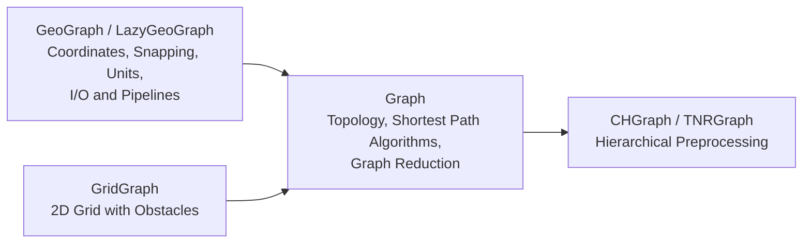
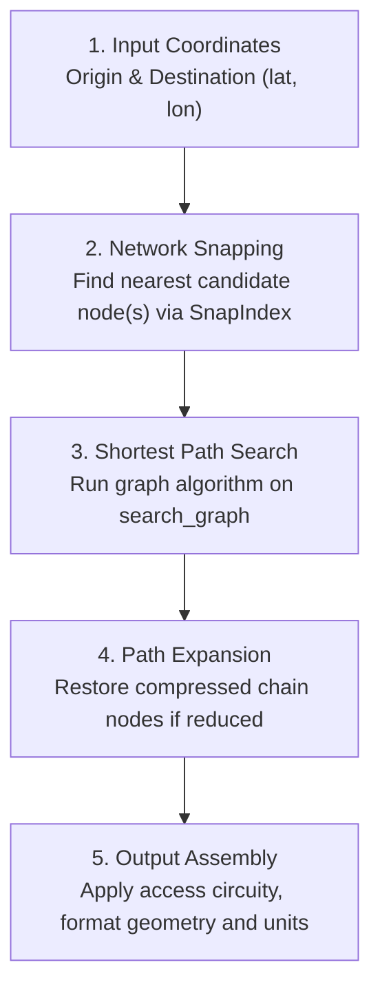
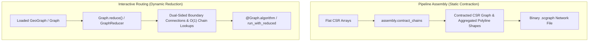
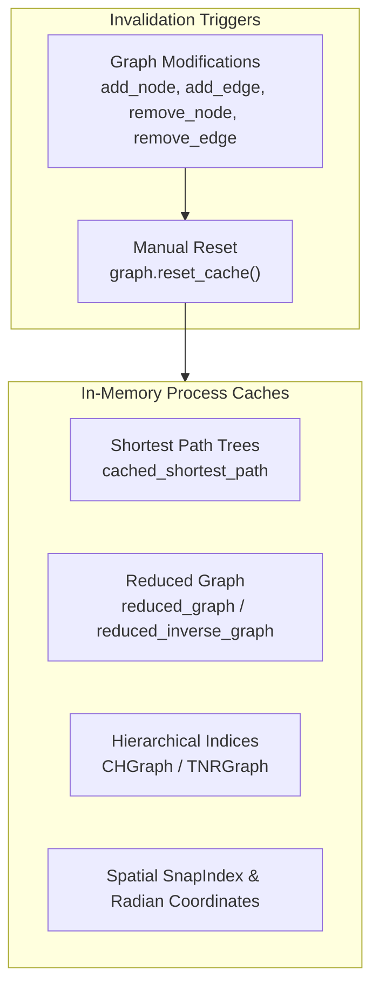

# scgraph — Architecture

Internal architecture and design of `scgraph`: query execution, data models, graph reduction systems, custom algorithm integration, caching lifecycle, and the `.scgraph` binary format.

For user-facing guides and examples, see the [README](README.md) and [API Documentation](https://connor-makowski.github.io/scgraph/scgraph.html). For development and contribution rules, see [DEVELOPMENT.md](DEVELOPMENT.md).

---

## Table of Contents

1. [Overview](#1-overview)
2. [Data Model](#2-data-model)
3. [Answering a Geographic Query](#3-answering-a-geographic-query)
4. [Graph Reduction](#4-graph-reduction)
5. [Adding an Algorithm](#5-adding-an-algorithm)
6. [Caches and Invalidation](#6-caches-and-invalidation)
7. [Network File](#7-network-file)

---

## 1. Overview



`scgraph` separates topological graph algorithms from spatial and grid logic:

* **`Graph`**: Pure topological graph. Knows nothing about geography or coordinates. Implements core search algorithms (Dijkstra, Bidirectional Dijkstra, A\*, Bellman-Ford, BMSSP) and dynamic graph reduction. The *Algorithm Reference* of the [README](README.md#algorithm-reference) lists every algorithm with its use.
* **`GeoGraph` / `LazyGeoGraph`**: Holds a `Graph` (attribute `graph_object`) and adds geographic coordinates (WGS84 latitude/longitude), spatial snapping via `SnapIndex`, distance metrics, and multi-modal network support. `LazyGeoGraph` defers downloading and loading until the first query.
* **`GridGraph`**: 2D grid pathfinding with obstacle collision and configurable connectivity (4-way or 8-way).
* **`CHGraph` / `TNRGraph`**: Hierarchical acceleration structures (Contraction Hierarchies and Transit Node Routing) built from a `Graph` on demand.

### C++ Acceleration and Python Parity

All core graph operations exist in two mirrored implementations:
1. **C++ Extension (`scgraph/cpp/`)**: Compiled via nanobind with C++20 and `-O3`. Provides ~10x speedup on pathfinding and graph reduction.
2. **Pure Python Fallback**: Standard Python implementation with identical semantics, used automatically when the C++ extension is not compiled.

When `scgraph` is imported, it uses the C++ classes if the extension is compiled. Otherwise it uses the Python classes.

### Pipeline Subsystem (`scgraph.pipelines`)

The `pipelines/` package builds reference networks from online sources. Each network has one pipeline module, which names its sources. A build runs in stages:

* **Stage 1 - Ingestion & Extraction (`steps.stage1_extract`)**:
  Streamed raw ingestion (`osm`, `pbf_range_streamer`, `arcgis`), polyline extraction, way filtering, and early geometry simplification at 50 m.
* **Stage 2 - Intermodal Connectors (`steps.stage2_intermodal`)**:
  Multi-modal integration (`ports`, `landmask`), finding water-constrained paths (`find_water_path_cells`) across Natural Earth raster masks to join sea lanes and road networks at ports.
* **Stage 3 - Topology & Assembly (`steps.stage3_assembly`)**:
  CSR graph construction (`build_csr_from_arcs`), strongly connected components (`strongly_connected_components`), pass-through chain contraction (`contract_chains`), Douglas-Peucker simplification of arc shapes (`simplify_shapes`, with `scgraph/helpers/douglas_peucker.py`), and node ordering along a Hilbert curve (`assemble`). The runner then writes the arrays to a `.scgraph` file.
* **Stage 4 - Validation (`steps.stage4_validation`)**:
  `validate_network` checks a built network against cases. A case describes a known route of the real world: a driving distance, a published sea distance, a rail corridor, a passage such as Suez, the road access of a large city. Each kind of case has its own rule and its own CSV file in `cases/`. The docstring of `steps/stage4_validation` lists the kinds and their rules. When `build_file` gets `validate=True`, the runner calls `validate_network` on the built file. A network that fails does not enter the cache.
* **Runner & Orchestrator (`build.py`)**:
  `build_file` downloads the sources, builds the network in a work folder, and moves the finished file into the cache. It writes the metadata of the build (pipeline, sources, software) into the header of the `.scgraph` file.
* **C++ Acceleration (`scgraph/cpp/src/pipelines/`)**:
  The costly kernels of stages 2 and 3 (`assembly.hpp`, `landmask.hpp`) have a C++ version. Each one also has a pure-Python version.

---

## 2. Data Model

### In-Memory Graph Representation

`scgraph` stores a graph in two ways: an adjacency list in Python, and Compressed Sparse Row (CSR) arrays in C++.

#### 1. Conceptual View (Python Adjacency List)

In Python, a graph is represented as a list of dictionaries where each index corresponds to a source node ID:

```python
# graph[source_node] = {target_node: edge_weight, ...}
graph = [
    {1: 4.5, 2: 7.2},  # Node 0 connects to Node 1 (dist: 4.5) and Node 2 (dist: 7.2)
    {2: 2.1},          # Node 1 connects to Node 2 (dist: 2.1)
    {0: 7.2},          # Node 2 connects to Node 0 (dist: 7.2)
    {},                # Node 3 has no outgoing edges (dead-end or isolated node)
]
```

* **Directed Arcs**: Every connection is strictly directional. A two-way road between `A` and `B` is stored as two distinct opposite arcs: `graph[A][B] = w` and `graph[B][A] = w`.
* **Dense Node Numbering**: Nodes are identified by consecutive integers from `0` to `n - 1`. Every node has an entry in `graph`, even if it has no outgoing connections (`graph[u] = {}`).
* **Reverse Graph (`inverse_graph`)**: Bidirectional searches need to explore backward from the destination. The reverse structure `inverse_graph[v] = {u: weight}` is built lazily on demand when first queried.
* **Search View (`graph` vs `search_graph`)**:
  * `graph`: Always references the original, full-resolution network.
  * `search_graph`: The active structure traversed by search algorithms. When `graph.reduce()` is called to collapse long pass-through chains into shortcuts, `search_graph` switches to the compacted graph, while `graph` stays intact.

#### 2. C++ Engine (Compressed Sparse Row / CSR)

While Python dictionaries are flexible, allocating millions of small hash tables consumes excessive memory and degrades CPU cache locality on large networks.

In the C++ extension, [`CsrGraph`](scgraph/cpp/src/csr_graph.hpp) packs the entire topology into **three contiguous memory arrays**:

```
Node IDs:      0         1      2   3
Offsets:     [ 0,        2,     3,  4,  4 ]  (length: n + 1)
               │         │      │   │   │
               └──┬───┘  └──┬─┘ └─┬─┘ └─┴─ (Node 3 has 0 edges: 4 - 4 = 0)
                  ▼         ▼     ▼
Heads:       [ 1,   2,     2,     0   ]      (length: m = total arcs)
Weights:     [ 4.5, 7.2,   2.1,   7.2 ]      (length: m = total arcs)
```

* **How Edge Traversal Works**: To iterate over the outgoing arcs of node `u`, the engine reads `heads_[i]` and `weights_[i]` for indices $i \in [\text{offsets\_}[u], \text{offsets\_}[u + 1][$.
* **Zero-Copy Memory Mapping (`mmap`)**: When opening a `.scgraph` binary network file, `CsrGraph` directly references the mapped memory on disk without allocating or copying vectors.
* **Copy-on-Write Dynamic Updates**:
  * Because CSR arrays are immutable, dynamic edits (`add_node`, `add_edge`, `remove_edge`) are staged in a temporary hash map (`RowEdits`).
  * The next time a search query runs, all changes and untouched rows are repacked in a single pass into a fresh, contiguous `CsrGraph`.

### Geographic Attributes (`GeoGraph`)

`GeoGraph` layers spatial attributes on top of the base `Graph`:

* **`nodes`**: Node coordinates stored as `[latitude, longitude]` in degrees.
* **`node_ids`**: Stable identifiers from the source dataset (e.g. OpenStreetMap 64-bit node IDs). Nodes added dynamically receive negative IDs.
* **`node_modes`**: Optional byte array assigning each node to a transport mode (road, rail, sea, port connector).
* **`intermediate_nodes`**: Detailed polyline shapes for edges between network nodes: `intermediate_nodes[u][v] = [[lat, lon], ...]`.
* **Hilbert Curve Node Ordering**: Node arrays in `.scgraph` files are sorted along a 2D Hilbert curve. Nodes that are geographically close share nearby indices, maximizing CPU cache locality and bounding-box search performance.

### Algorithm Query Interfaces

Search algorithms accept origin and destination in multiple formats:
* Single node ID: `int`
* Set of candidate node IDs: `set[int]`
* Dictionary of starting costs: `dict[int, float]` (used for multi-source starts and chain boundary entries)

Algorithms return a standardized dictionary:
```python
{"path": [node_0, node_1, ...], "length": total_path_cost}
```

### Trees and Hierarchies

Three algorithms of `Graph` prepare a structure once and then answer queries from it:

* **`cached_shortest_path`**: `get_shortest_path_tree(origin_id)` runs Dijkstra from one origin to every node. `get_tree_path` reads one path from that tree. `cached_shortest_path` keeps the tree of each origin, so a second query from the same origin runs no search.
* **`contraction_hierarchy`**: `create_contraction_hierarchy()` builds a `CHGraph` and stores it on the graph. The preprocessing contracts the nodes in order of importance and adds shortcut arcs. A query is a bidirectional Dijkstra search that only goes up in that order.
* **`tnr`**: `create_tnr_hierarchy()` builds a `TNRGraph`. A `TNRGraph` is a `CHGraph` with a set of transit nodes (the most important nodes) and a table of the distances between them. A long query reads the table instead of searching.

`contraction_hierarchy` and `tnr` build their hierarchy at the first query if it does not exist. A hierarchy can be saved and loaded (`save_as_chjson` / `CHGraph.load_from_chjson`, `save_as_tnrjson` / `TNRGraph.load_from_tnrjson`).

---

## 3. Answering a Geographic Query

When `GeoGraph.get_shortest_path` receives GPS coordinates, it runs five steps:



### 1. Input Coordinates
The origin and the destination are dictionaries with `latitude` and `longitude` in degrees.

### 2. Network Snapping (`SnapIndex`)
Spatial coordinates are snapped to the network using `SnapIndex`, an 8-ary spatial bounding-box tree:
* **Snapping Strategies (`node_addition_type`)**:
  * `'closest'`: Connects to the single nearest network node.
  * `'quadrant'`: Connects to the nearest node in each spatial quadrant (up to 4 candidates).
  * `'all'`: Connects to every network node within `node_addition_lat_lon_bound` degrees of latitude and of longitude of the point. If there is none, it connects to the nearest node.
* **Algorithmic Search Penalty (`node_addition_circuity`, default: 4)**:
  * When using `'quadrant'` or `'all'`, multiple candidate entry nodes exist.
  * During the pathfinding search, off-graph connection legs are artificially multiplied by `node_addition_circuity`.
  * This penalty prevents the search algorithm from "flying" off-network across impassable barriers (such as crossing land in a maritime network or crossing unbridged water) to reach a distant node.
  * It forces the route to enter the network at a nearby node.

### 3. Shortest Path Search
If the straight line from origin to destination is not longer than the shortest connection of either point to the network, `scgraph` returns the straight line and runs no search. Both lengths include `node_addition_circuity`.

The selected algorithm (default: `bidirectional_buckets`) runs from the origin candidates to the destination candidates:
* Searches operate on `search_graph` (the reduced graph if `reduce()` was called, otherwise the original graph).
* For `a_star`, great-circle lower bounds are computed using cached spherical radian coordinates.
* A search that counts its node scans (README, *Logging*) stores the count for its thread when it ends (`_last_search_in_thread` in Python, `tl_node_scans` in C++). `GeoGraph.get_shortest_path` reads it for its DEBUG record.

### 4. Path Expansion
If the search ran on a reduced graph, any composite edges in the solution path are expanded back into their full underlying node sequence via `run_with_reduced`.

### 5. Final Distance and Geometry Assembly
* **Physical Distance Multiplier (`off_graph_circuity`, default: 1)**:
  * After the optimal path is identified, the algorithmic penalty is removed.
  * The actual access distances (origin $\to$ entrance node, and exit node $\to$ destination) are scaled by `off_graph_circuity` and added to the final reported route `length`.
  * Set to `1.0` for straight-line distance, `1.2` for urban street winding, or `0` for highway/maritime transit time.
* **Coordinate Output**: The full polyline geometry is assembled from `nodes` and `intermediate_nodes` in the requested format (`list_of_lists`, `list_of_dicts`, or GeoJSON).

---

## 4. Graph Reduction

Graph reduction replaces chains of non-branching nodes with direct composite edges of identical weight. This accelerates shortest-path queries without altering exact path lengths.

`scgraph` provides two distinct reduction systems designed for different phases of the lifecycle:



### Dynamic Query Reduction (`GraphReducer`)

Operates on an instantiated `Graph` via `graph.reduce(iterations=-1)`:

1. **Pass-through Detection**: Identifies degree-2 nodes where traffic flows through without choices (1 in / 1 out, or 2 bidirectional connections).
2. **Chain Grouping**: Groups contiguous pass-through nodes into chains (`reduced_node_chain_ids`).
3. **Boundary Connections**: Runs localized searches from every node to the nearest boundary nodes of its chain. This creates direct composite edges between boundary nodes, and connects interior chain nodes directly to chain boundaries.
4. **Transparent Query Routing (`run_with_reduced`)**:
   * **Both points outside chains**: Search runs directly on the reduced graph.
   * **Origin inside a chain**: Replaced by weighted edges to its chain's exit boundary nodes.
   * **Destination inside a chain**: Replaced by weighted edges from its chain's entry boundary nodes.
   * **Both inside the same chain**: Solved locally on the unreduced chain subgraph.
   * **Path Expansion**: `@Graph.algorithm` automatically expands composite edges back to original nodes.

---

### Static CSR Contraction (`assembly.contract_chains`)

Operates directly on flat C-style arrays during pipeline assembly:
* Takes `(offsets, heads, weights, node_modes, max_km_between_nodes)` and returns a `ContractedGraph` namedtuple:
  * `kept`: Indices of retained nodes.
  * `origins`, `heads`, `weights`: Compressed composite edges.
  * `member_offsets`, `members`: Indices of original input arcs forming each composite edge.
* `node_modes` is optional. A chain is never contracted across two modes.
* `max_km_between_nodes` cuts a chain into segments of about that length (default: no cut).
* A segment that would create a self-loop or a duplicate arc is split at its midpoint.
* The aggregated geometry is generated by `build_chain_shapes` using `members`.

---

## 5. Adding an Algorithm

Custom algorithms plug into `Graph` using the `@Graph.algorithm` decorator:

```python
from scgraph import Graph

@Graph.algorithm(bidirectional=False)
def my_search(graph, origin_node, destination_node, **kwargs):
    # graph.search_graph provides the active graph (reduced or unreduced)
    adjacency = graph.search_graph
    
    # origin_node and destination_node can be:
    # - int (single node)
    # - dict {node_id: starting_distance} (boundary entries on reduced graphs)
    ...
    return {"path": [origin_id, ..., destination_id], "length": total_cost}
```

### Decorator Guarantees
* **Reduced Graph Support**: When the graph is reduced, `@Graph.algorithm` intercepts calls, converts chain-interior endpoints into boundary node dictionaries, executes the search on `search_graph`, and expands the returned path back to original nodes.
* **Bidirectional Searches**: Setting `bidirectional=True` also exposes `graph.search_inverse_graph`.
* **Zero Overhead**: On unreduced graphs, the decorated function executes directly without indirection.

---

## 6. Caches and Invalidation

`scgraph` manages caching at both the process level (RAM) and filesystem level (Disk).



### In-Memory Cache Invalidation
Calling `reset_cache()`, or modifying topology via `add_node`, `remove_node`, `add_edge`, or `remove_edge`, invalidates:
* Cached shortest-path trees (`cached_shortest_path`).
* Reduced graph structures and chain mappings.
* Contraction Hierarchies (`CHGraph`) and Transit Node Routing (`TNRGraph`).
* The geographic snapping index (`snap_index`) and spherical radian coordinates.

The `inverse_graph` is preserved across edits and updated incrementally.

### Persistent Filesystem Cache (`SCGRAPH_CACHE_DIR`)

Networks built or downloaded by `scgraph` are cached on disk (default: `~/.cache/scgraph`):
* **Hierarchy**: `networks/<name>/<region>/<content_sha256>.scgraph` next to a `cache.json` that names the file and gives the download time.
* **Atomic Writes**: A build writes into the work folder `.work/<name>/<region>` of the cache directory. It then moves the finished `.scgraph` file into place, and `cache.json` after it, each with an atomic rename. `cache.json` therefore always names a whole file. A build that succeeds removes its work folder. A build that fails keeps its work folder, with the downloaded sources. The next build resumes from it. `refresh=True` empties it first.
* **Offline Operation**: Setting `SCGRAPH_OFFLINE=1` or `local_files_only=True` prevents all network requests, loading only existing cached builds.
* **Cache Management**: `GeoGraph.clear_geograph_cache()` safely removes cached networks without altering user files.

---

## 7. Network File

The `.scgraph` binary format stores network topologies, spatial coordinates, and metadata in a single self-contained file with zero external dependencies.

### Design Principles

1. **Zero-Copy Memory Mapping**: In the C++ backend, `.scgraph` files are mapped directly into process memory (`mmap`). Graph algorithms read CSR arcs directly from disk pages without deserialization or copying.
2. **Deterministic Content Addressing**: Bytes `8..39` contain the SHA-256 digest of the entire file payload (from byte 40 to end). Two builds from identical sources, software, and platforms produce byte-identical files.
3. **Attribution and Provenance Preservation**: The JSON header preserves dataset licenses, attribution requirements, pipeline versions, and build metadata.

---

### Binary File Layout

All multi-byte integers are stored in **little-endian** byte order:

| Byte Offset | Size | Type | Name | Description |
| :--- | :--- | :--- | :--- | :--- |
| `0 .. 7` | 8 bytes | ASCII | Magic Bytes | Constant magic identifier: `SCGRAPH1` |
| `8 .. 39` | 32 bytes | Binary | Content SHA-256 | Raw SHA-256 hash of all bytes from offset 40 to EOF |
| `40 .. 47` | 8 bytes | uint64 | Header Length | Byte length of the unpadded JSON header ($L_H$) |
| `48 .. 48 + L_H - 1` | $L_H$ bytes | UTF-8 | Header JSON | UTF-8 JSON text with sorted keys (`json.dumps(header, sort_keys=True)`) |
| Next | $0 .. 63$ bytes | Zeros | Padding | Zero padding up to the next 64-byte boundary |
| Array Section | Variable | Binary | Contiguous Arrays | Data arrays, each aligned to a 64-byte boundary |

---

### Header JSON Schema

The header contains top-level structural fields and a nested `metadata` dictionary. The values below are examples:

```json
{
  "format_version": 1,
  "spec": "https://github.com/connor-makowski/scgraph/blob/main/ARCHITECTURE.md#7-network-file",
  "arrays": {
    "offsets": {"dtype": "int32", "shape": [10001], "offset": 0},
    "heads": {"dtype": "int32", "shape": [25000], "offset": 40064},
    "weights": {"dtype": "float64", "shape": [25000], "offset": 140096},
    "latitudes": {"dtype": "int32", "shape": [10000], "offset": 340096},
    "longitudes": {"dtype": "int32", "shape": [10000], "offset": 380096}
  },
  "metadata": {
    "crs": "EPSG:4326",
    "units": "km",
    "symmetric": false,
    "node_order": "hilbert",
    "pipeline": {
      "name": "osm_main_roads",
      "region": "europe/luxembourg",
      "version": 1
    },
    "software": {
      "scgraph": "<version>",
      "backend": "cpp",
      "platform": "linux-x86_64 glibc 2.36"
    },
    "sources": [
      {
        "name": "roads",
        "url": "https://download.geofabrik.de/europe/luxembourg-latest.osm.pbf",
        "sha256": "...",
        "bytes": 35600000,
        "license": "ODbL-1.0",
        "credit": "© OpenStreetMap contributors",
        "version": "2026-11-07T21:21:36Z"
      }
    ],
    "steps": [
      {"step": "read", "pieces": 1200},
      {"step": "contract", "nodes": 10000, "arcs": 25000}
    ]
  }
}
```

#### Header Fields Specification

| Field | Type | Description |
| :--- | :--- | :--- |
| `format_version` | `int` | Format specification version (currently `1`). |
| `spec` | `str` | URL pointing to this specification anchor. |
| `arrays` | `dict` | Map of array names to their `dtype`, `shape`, and byte `offset` (relative to the end of the padded header). |
| `metadata.crs` | `str` | Coordinate reference system (standard: `EPSG:4326`). |
| `metadata.units` | `str` | Distance units of edge weights (`km`, `m`, `mi`, `ft`). |
| `metadata.symmetric` | `bool` | Whether the graph's CSR topology is bidirectional with identical forward and reverse weights. |
| `metadata.node_order` | `str` | Spatial node sorting scheme (`"hilbert"` for 2D Hilbert space-filling curve order). |
| `metadata.modes` | `list[dict]` | Optional transport mode definitions (`road`, `rail`, `sea`, `port`). |
| `metadata.pipeline` | `dict` | Pipeline provenance: network generator name, target region, and pipeline version. |
| `metadata.software` | `dict` | Build environment provenance: `scgraph` version, `backend` (`cpp` or `python`), and host platform (e.g. `linux-x86_64 glibc 2.36` or `macOS 14.5`). |
| `metadata.sources` | `list[dict]` | Data sources with attribution, licenses, URLs, file digests, and data timestamps. |
| `metadata.steps` | `list[dict]` | Assembly execution trace recording intermediate counts across stages (extract, components, contraction). |

---

### Stored Binary Arrays

All arrays are stored as raw, contiguous C-order binary buffers aligned to 64 bytes:

| Array Name | Data Type | Dimensions | Description |
| :--- | :--- | :--- | :--- |
| `offsets` | `int32` | $N + 1$ | CSR row index. Arcs originating from node $u$ span index `offsets[u]` to `offsets[u+1] - 1`. |
| `heads` | `int32` | $M$ | Destination node ID of each arc. |
| `weights` | `float64` | $M$ | Cost / length of each arc. |
| `latitudes` | `int32` or `float64` | $N$ | Node latitudes. If `int32`, values are scaled by $10^7$ (~1 cm precision). |
| `longitudes` | `int32` or `float64` | $N$ | Node longitudes. If `int32`, values are scaled by $10^7$. |
| `shape_offsets` *(opt)* | `int32` | $M + 1$ | Slice index into `shape_points` for detailed arc polylines. |
| `shape_points` *(opt)* | `int32` or `float64` | $K \times 2$ | Interleaved latitude and longitude coordinates of interior arc points. |
| `node_ids` *(opt)* | `int32` or `int64` | $N$ | Original source identifiers (e.g. OSM 64-bit node IDs). |
| `node_modes` *(opt)* | `uint8` | $N$ | Mode index corresponding to `metadata.modes`. |

### Coordinate Encoding (`int32` vs `float64`)

`scgraph` supports two coordinate encodings:
* **`float64`**: Full 64-bit IEEE 754 precision (exact).
* **`int32` ($10^{-7}$ degrees)**: OpenStreetMap's fixed-point encoding (about 1.1 cm at the equator). A coordinate takes 4 bytes instead of 8.
