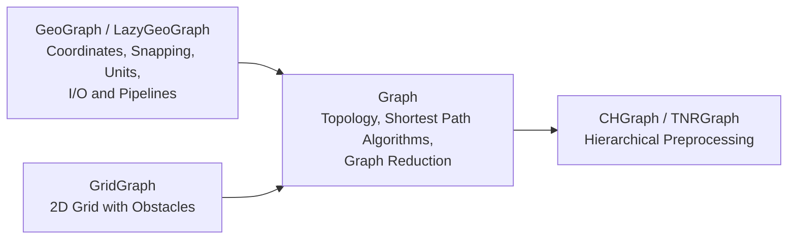
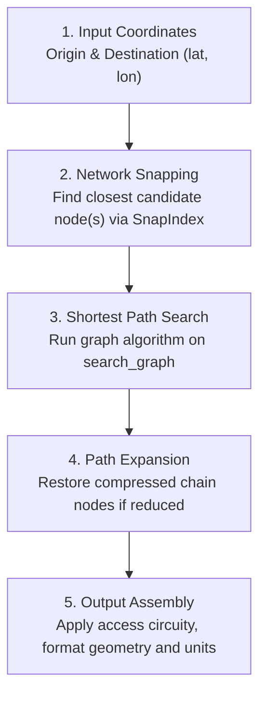
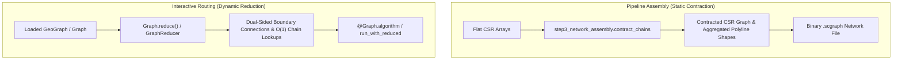
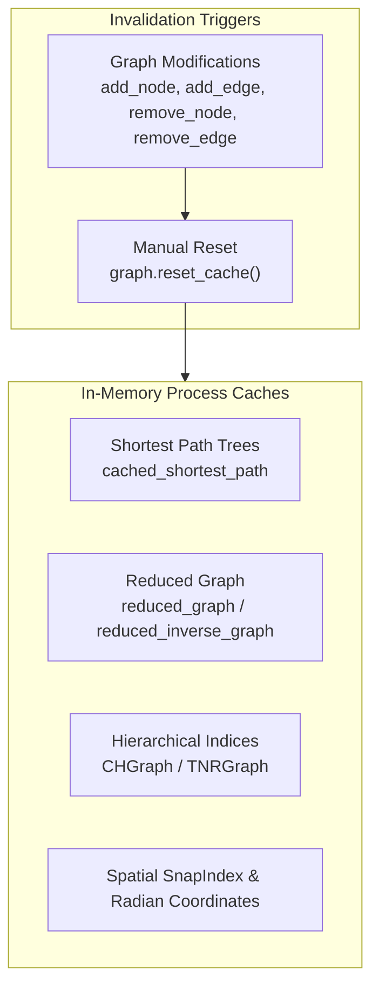

# scgraph — Architecture

This document explains how `scgraph` works inside: how a query runs, how a graph is stored, how graph reduction works, how to add an algorithm, what the caches hold, and the `.scgraph` file format.

The [README](README.md) and the [API Documentation](https://connor-makowski.github.io/scgraph/scgraph.html) show how to use scgraph. [DEVELOPMENT.md](DEVELOPMENT.md) gives the rules of a contribution.

**Words.** An **edge** joins one node to another, in one direction, and has a weight.

---

## Table of Contents

1. [Overview](#1-overview)
2. [Data Model](#2-data-model)
3. [Answering a Geographic Query](#3-answering-a-geographic-query)
4. [Graph Reduction](#4-graph-reduction)
5. [Adding an Algorithm](#5-adding-an-algorithm)
6. [Caches and Invalidation](#6-caches-and-invalidation)
7. [Network File Format](#7-network-file-format)

---

## 1. Overview



`scgraph` separates the graph algorithms from the geographic logic and from the grid logic:

* **`Graph`**: A graph of node ids. It knows nothing about coordinates. It holds the search algorithms (Dijkstra, Bidirectional Dijkstra, A\*, Bellman-Ford, BMSSP) and graph reduction. The *Algorithm Reference* of the [README](README.md#algorithm-reference) lists every algorithm with its use.
* **`GeoGraph` / `LazyGeoGraph`**: A `GeoGraph` holds a `Graph` (attribute `graph_object`) and one point for each node (WGS84 latitude and longitude). It snaps a point to the network with a `SnapIndex`, computes distances, and handles networks with several transport modes. A `LazyGeoGraph` downloads and loads its network at the first query.
* **`GridGraph`**: A 2D grid with obstacles, with 4 or 8 directions of movement.
* **`CHGraph` / `TNRGraph`**: Two hierarchies that a `Graph` builds on demand to answer queries faster: Contraction Hierarchies and Transit Node Routing.

### The C++ Extension and the Pure-Python Code

Each graph operation has two implementations that give the same results:
1. **C++ extension (`scgraph/cpp/`)**: compiled with nanobind, in C++20 with `-O3`. It is the faster one.
2. **Pure Python**: used when the C++ extension is not compiled.

When `scgraph` is imported, it uses the C++ classes if the extension is compiled. Otherwise it uses the Python classes.

### Pipeline Subsystem (`scgraph.pipelines`)

The package `scgraph.pipelines` builds networks from their online sources. A pipeline is one module of this package. It names the sources of one network and has a `build` function. The docstring of `scgraph.pipelines` gives the contract of a pipeline. The guide [scgraph/pipelines/README.md](scgraph/pipelines/README.md) follows a network from its sources to a route: the build step by step, the derivation, the network release and the load, with the numbers of real runs.

The runner, `network_builder.py`, runs a pipeline. `build_network_file` downloads the sources and calls `build` in a work folder. It writes the network to a `.scgraph` file, with the metadata of the build (pipeline, sources, software) in the header. Then it moves the file into the cache.

`derived_networks.py` derives a network file from another network file, the parent file, with no download (`derive_network_file`). The derived file holds some modes of the parent file, and its land networks inside a bbox. Its header records the digest of the parent file.

A build runs steps. The functions of the steps are in `scgraph.pipelines.steps`, one or two modules for each step:

* **Read the sources (`steps.step1_osm_ways`)**:
  `step1_osm_ways` reads the ways of an OpenStreetMap file, from disk or by HTTP byte ranges (`step1_osm_planet_reader`). `step1_osm_ways.build_way_pieces` cuts each kept way into pieces and simplifies the shape of each piece to within 50 m (`step3_network_assembly.simplify_shapes`, with `scgraph/helpers/douglas_peucker.py`).
* **Join the modes (`steps.step2_hub_connectors`, `steps.step2_land_mask`)**:
  `step2_hub_connectors.join_networks_at_hubs` joins the networks of several modes at hubs: ports, airports and rail terminals. `step2_land_mask` tells land from water on a Natural Earth raster, and finds the water path of a sea connector (`find_water_path_cells`).
* **Assemble the graph (`steps.step3_network_assembly`)**:
  `step3_network_assembly.build_graph_from_pieces` stores the edges as CSR arrays (`build_csr_from_edges`). `step3_network_assembly.assemble_network` keeps the strongly connected components (`find_strongly_connected_components`), contracts the chains of pass-through nodes (`contract_chains`), and numbers the nodes along a Hilbert curve.
* **Validate the network (`steps.step4_validation_cases`)**:
  `validate_network` checks a built network against cases. A case describes a known route of the real world, such as a driving distance or a published sea distance. The docstring of `steps/step4_validation_cases` lists the kinds of cases and their rules. With `validate=True`, `build_network_file` validates the built file, and a network that fails does not enter the cache.

The costly functions of `step2_land_mask` and `step3_network_assembly` have a C++ version in `scgraph/cpp/src/pipelines/` (`assembly.hpp`, `landmask.hpp`) and a pure-Python version that gives the same results.

---

## 2. Data Model

### How a Graph Is Stored in Memory

`scgraph` stores a graph in two ways: an adjacency list in Python, and Compressed Sparse Row (CSR) arrays in C++.

#### 1. The Python Adjacency List

In Python, a graph is a list of dictionaries. The index of a dictionary is the id of an origin node:

```python
# graph[origin_node] = {destination_node: weight, ...}
graph = [
    {1: 4.5, 2: 7.2},  # Node 0 has an edge to node 1 (weight 4.5) and to node 2 (weight 7.2)
    {2: 2.1},          # Node 1 has an edge to node 2 (weight 2.1)
    {0: 7.2},          # Node 2 has an edge to node 0 (weight 7.2)
    {},                # Node 3 has no outgoing edge
]
```

* **Directed edges**: Every edge has one direction. A two-way road between `A` and `B` is two edges: `graph[A][B] = w` and `graph[B][A] = w`.
* **Node ids**: The nodes are numbered from `0` to `n - 1`. Every node has an entry in `graph`, even a node with no outgoing edge (`graph[u] = {}`).
* **Reverse graph (`inverse_graph`)**: A bidirectional search also explores backward from the destination. It reads `inverse_graph[v] = {u: weight}`. scgraph builds this structure at the first query that needs it.
* **`graph` and `search_graph`**:
  * `graph` is always the original graph.
  * `search_graph` is the graph that the algorithms search. After `graph.reduce()`, `search_graph` is the reduced graph, and `graph` does not change.

#### 2. The C++ CSR Arrays

A Python dictionary per node takes much memory on a large network, and its entries are scattered in memory.

In the C++ extension, [`CsrGraph`](scgraph/cpp/src/csr_graph.hpp) stores the same graph in **three arrays**:

```
Node IDs:      0         1      2   3
Offsets:     [ 0,        2,     3,  4,  4 ]  (length: n + 1)
               │         │      │   │   │
               └──┬───┘  └──┬─┘ └─┬─┘ └─┴─ (Node 3 has 0 edges: 4 - 4 = 0)
                  ▼         ▼     ▼
Heads:       [ 1,   2,     2,     0   ]      (length: m = total edges)
Weights:     [ 4.5, 7.2,   2.1,   7.2 ]      (length: m = total edges)
```

* **Reading the edges of a node**: The edges of node `u` are at the positions `offsets_[u]` to `offsets_[u + 1] - 1` of `heads_` and `weights_`.
* **Mapped files (`mmap`)**: When scgraph opens a `.scgraph` network file, `CsrGraph` reads the arrays in the mapped file. It makes no copy.
* **Edits**:
  * A CSR array is not edited in place. `add_node`, `add_edge` and `remove_edge` record their changes in a hash map (`RowEdits`).
  * The next search writes the changed rows and the unchanged rows into a new `CsrGraph`, in one pass.

### What a GeoGraph Adds

A `GeoGraph` adds these attributes to its `Graph`:

* **`nodes`**: The point of each node, as `[latitude, longitude]` in degrees.
* **`node_ids`**: The id of each node in its source (for example its 64-bit OpenStreetMap id). A node added after the load gets a negative id.
* **`node_modes`**: A byte array that gives the transport mode of each node, such as road, sea or port. Each node has one mode. The value is the row of that mode in `modes`, counted from 0.
* **`intermediate_nodes`**: The shape of each edge: `intermediate_nodes[u][v] = [[lat, lon], ...]`. The shape of an edge is the list of points that draw it on a map between its two nodes.
* **Node order**: A `.scgraph` file numbers its nodes along a 2D Hilbert curve. A network with several modes groups its nodes by mode first, in the order of `modes`, then orders each group along the curve. Two nodes that are close on the globe then have close ids. A search reads nearby parts of memory, and the snapping index is faster.

### What an Algorithm Takes and Returns

An algorithm takes its origin and its destination in one of three forms:
* one node id: `int`;
* a set of candidate node ids: `set[int]`;
* a dictionary of start distances: `dict[int, float]`. A query from a point uses it, with one entry for each node that the point is connected to.

An algorithm returns a dictionary:
```python
{"path": [node_0, node_1, ...], "length": total_path_weight}
```

### Trees and Hierarchies

Three algorithms of `Graph` prepare a structure once and then answer queries from it:

* **`cached_shortest_path`**: `get_shortest_path_tree(origin_id)` runs Dijkstra from one origin to every node. `get_tree_path` reads one path from that tree. `cached_shortest_path` keeps the tree of each origin, so a second query from the same origin runs no search.
* **`contraction_hierarchy`**: `create_contraction_hierarchy()` builds a `CHGraph` and stores it on the graph. The preprocessing contracts the nodes in order of importance and adds shortcut edges. A query is a bidirectional Dijkstra search that only goes up in that order.
* **`tnr`**: `create_tnr_hierarchy()` builds a `TNRGraph`. A `TNRGraph` is a `CHGraph` with a set of transit nodes (the most important nodes) and a table of the distances between them. A long query reads the table instead of searching.

`contraction_hierarchy` and `tnr` build their hierarchy at the first query if it does not exist. A hierarchy can be saved and loaded (`save_as_chjson` / `CHGraph.load_from_chjson`, `save_as_tnrjson` / `TNRGraph.load_from_tnrjson`).

---

## 3. Answering a Geographic Query

`GeoGraph.get_shortest_path` takes two points and runs five steps:



### 1. Input Coordinates
The origin and the destination are dictionaries with `latitude` and `longitude` in degrees.

### 2. Network Snapping (`SnapIndex`)
A `SnapIndex` finds the nodes that are near a point. It is a tree of bounding boxes, with 8 children per box. The option `node_addition_type` chooses the nodes that the point is connected to:
* `'closest'`: the closest node.
* `'quadrant'`: the closest node in each of the four quadrants around the point.
* `'all'`: every node within `node_addition_lat_lon_bound` degrees of latitude and of longitude of the point. If there is none, the closest node.

With `'quadrant'` or `'all'`, a point has several candidate nodes. During the search, the length of the straight leg from the point to a candidate is multiplied by `node_addition_circuity` (default: 4). Without this penalty, a route could reach a distant node in a straight line, for example across land in a sea network. With it, the route enters the network at a nearby node.

### 3. Shortest Path Search
If the straight line from origin to destination is not longer than the shortest connection of either point to the network, `scgraph` returns the straight line and runs no search. Both lengths include `node_addition_circuity`.

The selected algorithm (default: `bidirectional_buckets`) runs from the origin candidates to the destination candidates:
* The search reads `search_graph`: the reduced graph if `reduce()` was called, the original graph otherwise.
* `a_star` uses the great-circle distance to the destination as a lower bound. It computes this bound from the coordinates in radians, which the `GeoGraph` keeps. The search stops when, for the node taken from the queue, the distance from the origin plus the lower bound reaches the length of the best route found. With more than 4 destination candidates, it computes no lower bound and scans the nodes as Dijkstra does.
* A search that counts its node scans (README, *Logging*) stores the count for its thread when it ends (`_last_search_in_thread` in Python, `tl_node_scans` in C++). `GeoGraph.get_shortest_path` reads it for its DEBUG record.

### 4. Path Expansion
If the search ran on a reduced graph, `run_with_reduced` replaces each contracted edge of the path by the nodes of its chain.

### 5. Length and Coordinates of the Result
* **Length**: The search penalty is removed. The two straight legs (origin to its first node, last node to destination) are multiplied by `off_graph_circuity` (default: 1) and added to the `length` of the route. A value of `1.2` models winding streets, and `0` leaves the two legs out.
* **Coordinates**: The `coordinate_path` is built from `nodes` and `intermediate_nodes`, in the requested format (`list_of_lists`, `list_of_dicts`, or GeoJSON).

---

## 4. Graph Reduction

A pass-through node offers no choice: a route that enters it can only go on to one other node. A chain is a run of such nodes. Graph reduction replaces a chain by one contracted edge with the sum of the weights. A search then visits fewer nodes, and every route keeps its exact length.

`scgraph` has two reductions, for two moments:



### Reduction of a Loaded Graph (`GraphReducer`)

`graph.reduce(iterations=-1)` reduces a `Graph` in memory:

1. **Find the pass-through nodes**: a node with one edge in and one edge out, or with two neighbors joined both ways.
2. **Group them into chains**: `reduced_node_chain_ids` gives the chain of each node.
3. **Connect the boundaries**: A boundary node is a kept node at the end of a chain. The reducer adds one contracted edge between the two boundary nodes of a chain. It also records the distance from each node of the chain to its boundary nodes.
4. **Answer a query (`run_with_reduced`)**:
   * **Both ends outside chains**: the search runs on the reduced graph.
   * **Origin inside a chain**: the origin becomes a dictionary of distances to the boundary nodes of its chain.
   * **Destination inside a chain**: the destination becomes a dictionary of distances from the boundary nodes of its chain.
   * **Both ends inside the same chain**: the query is answered on the nodes of the chain, without the reduced graph.
   * **Path expansion**: `@Graph.algorithm` replaces each contracted edge of the result by the nodes of its chain.

`iterations=-1`, the default, repeats the passes until no pass-through node is left. `iterations=1` runs one pass.

---

### Static CSR Contraction (`step3_network_assembly.contract_chains`)

`contract_chains` works on the CSR arrays of a build:
* It takes `(offsets, heads, weights, node_modes, max_km_between_nodes, edge_classes)` and returns a `ContractedGraph` namedtuple:
  * `kept`: the indices of the kept nodes.
  * `origins`, `heads`, `weights`: the contracted edges.
  * `member_offsets`, `members`: the indices of the input edges that each contracted edge replaces.
* `node_modes` is optional. A chain is never contracted across two modes.
* `edge_classes` is optional: the class of each edge. The header of `step3_network_assembly.py` gives its rule.
* `max_km_between_nodes` cuts a chain into segments of about that length (default: no cut).
* A segment that would create a self-loop or a duplicate edge is split at its midpoint.
* `build_chain_shapes` gives each contracted edge the shape points of its members.

---

## 5. Adding an Algorithm

The decorator `@Graph.algorithm` adds an algorithm to `Graph`:

```python
from scgraph import Graph

@Graph.algorithm(bidirectional=False)
def my_search(graph, origin_node, destination_node, **kwargs):
    # graph.search_graph is the graph to search (reduced or not)
    adjacency = graph.search_graph

    # origin_node and destination_node can be:
    # - int (one node)
    # - dict {node_id: start_distance} (the boundary nodes of a chain, on a reduced graph)
    ...
    return {"path": [origin_id, ..., destination_id], "length": total_weight}
```

### What the Decorator Does
* **On a reduced graph**: It replaces an end inside a chain by a dictionary of distances to the boundary nodes. It runs the function on `search_graph`. It then expands the returned path to the original nodes.
* **With `bidirectional=True`**: The function can also read `graph.search_inverse_graph`.
* **On a graph that is not reduced**: It calls the function directly.

---

## 6. Caches and Invalidation

`scgraph` keeps caches in memory, for one process, and on disk.



### Caches in Memory
`reset_cache()` empties the caches below. `add_node`, `remove_node`, `add_edge` and `remove_edge` call it:
* the shortest path trees of `cached_shortest_path`;
* the reduced graph and its chains;
* the hierarchies (`CHGraph` and `TNRGraph`);
* the snapping index (`snap_index`) and the coordinates in radians.

`inverse_graph` is kept: each edit updates it.

### Persistent Filesystem Cache (`SCGRAPH_CACHE_DIR`)

scgraph keeps the networks that it builds or downloads in a cache directory (default on Linux: `~/.cache/scgraph`). The module `scgraph/network_cache.py` holds the names of the networks that `load_geograph` takes, and the two downloads into the cache. The cache directory holds:
* **Built networks**: `networks/<name>/<region>/<content_sha256>.scgraph` next to a `cache.json` that names the file and gives the download time.
* **Network Releases**: `releases/<tag>/<name>.scgraph` is a network file that `load_geograph` downloaded from the network release `<tag>`. `<name>.no_shapes.scgraph` is the same network without edge shapes. A file gets this name only after its content is checked, so a later load does not check it again. The guide [scgraph/pipelines/README.md](scgraph/pipelines/README.md), Part 4, shows the steps of a load.
* **Atomic Writes**: A build writes into its work folder: `.work/<name>/<region>` of the cache directory, or the `work_dir` of the caller. It then moves the finished `.scgraph` file into the cache. The file arrives beside its final place and takes its name in one step. `cache.json` is written the same way, after the file. `cache.json` therefore always names a whole file. A build that succeeds removes its work folder. A build that fails keeps its work folder, with the downloaded sources. The next build resumes from it. `refresh=True` empties it first.
* **Offline Operation**: With `SCGRAPH_OFFLINE=1` or `local_files_only=True`, scgraph makes no network request. It loads only what the cache holds.
* **Cache Management**: `GeoGraph.clear_geograph_cache()` removes the cached networks. It leaves every other file of the directory in place.

---

## 7. Network File Format

A `.scgraph` file stores one network: its edges, the points of its nodes and its metadata. scgraph reads and writes it with the Python standard library only.

This section specifies `format_version` 1. A file built by `build_geograph` also records the version of scgraph that built it, in `metadata.software.scgraph`. For a released version, this section at the tag of that release is the specification that applies to the file.

### Design Principles

1. **Mapped files**: In the C++ build, scgraph maps a `.scgraph` file into memory (`mmap`). The algorithms read the CSR arrays in the mapped file, without a copy.
2. **A digest of the content**: Bytes `8..39` hold the SHA-256 digest of the bytes from byte 40 to the end of the file. Two builds from the same sources, with the same software on the same platform, give the same file, byte for byte.
3. **The origin of the data**: The JSON header records the sources with their licenses and credits, the pipeline with its version, and the software of the build.

---

### Binary File Layout

All multi-byte integers are stored in **little-endian** byte order:

| Byte Offset | Size | Type | Name | Description |
| :--- | :--- | :--- | :--- | :--- |
| `0 .. 7` | 8 bytes | ASCII | Magic Bytes | Constant magic identifier: `SCGRAPH1` |
| `8 .. 39` | 32 bytes | Binary | Content SHA-256 | Raw SHA-256 hash of all bytes from offset 40 to EOF |
| `40 .. 47` | 8 bytes | uint64 | Header Length | Byte length of the unpadded JSON header ($L_H$) |
| `48 .. 48 + L_H - 1` | $L_H$ bytes | UTF-8 | Header JSON | UTF-8 JSON text with sorted keys (`json.dumps(header, sort_keys=True)`) |
| Next | $0 .. 63$ bytes | Zeros | Padding | Zero padding up to the next 64-byte boundary |
| Array Section | Variable | Binary | Contiguous Arrays | Data arrays, each aligned to a 64-byte boundary |

---

### Header JSON Schema

The header contains top-level structural fields and a nested `metadata` dictionary. The values below are examples:

```json
{
  "format_version": 1,
  "arrays": {
    "offsets": {"dtype": "int32", "shape": [10001], "offset": 0},
    "heads": {"dtype": "int32", "shape": [25000], "offset": 40064},
    "weights": {"dtype": "float64", "shape": [25000], "offset": 140096},
    "node_points": {"dtype": "int32", "shape": [10000, 2], "offset": 340096}
  },
  "metadata": {
    "crs": "EPSG:4326",
    "units": "km",
    "symmetric": false,
    "node_order": "hilbert",
    "pipeline": {
      "name": "geofabrik_multimodal",
      "region": "europe/luxembourg",
      "version": 2
    },
    "software": {
      "scgraph": "<version>",
      "backend": "cpp",
      "platform": "linux-x86_64 glibc 2.36"
    },
    "sources": [
      {
        "name": "osm",
        "url": "https://download.geofabrik.de/europe/luxembourg-latest.osm.pbf",
        "sha256": "...",
        "bytes": 35600000,
        "license": "ODbL-1.0",
        "credit": "© OpenStreetMap contributors",
        "version": "2026-11-07T21:21:36Z"
      }
    ]
  }
}
```

The example shows one source. It leaves out the arrays of the modes, of the classes and of the shapes.

#### Header Fields Specification

| Field | Type | Description |
| :--- | :--- | :--- |
| `format_version` | `int` | Format specification version (currently `1`). See *Compatibility Between Versions* for when it changes. |
| `arrays` | `dict` | Map of array names to their `dtype`, `shape`, and byte `offset` (relative to the end of the padded header). |
| `metadata.crs` | `str` | Coordinate reference system (standard: `EPSG:4326`). |
| `metadata.units` | `str` | The unit of the edge weights (`km`, `m`, `mi`, `ft`). |
| `metadata.symmetric` | `bool` | Whether the graph's CSR topology is bidirectional with identical forward and reverse weights. |
| `metadata.node_order` | `str` | How the nodes are numbered. `"hilbert"`: along a 2D Hilbert space-filling curve. With several modes, the nodes are grouped by mode first, in the order of `metadata.modes`, then numbered along the curve within each mode. A read of one mode (`load_from_scgraph(modes=...)`) relies on this order. |
| `metadata.modes` | `list[dict]` | The transport modes of the network. Each mode is a dict. `name` gives the name of the mode. When a source gave the node ids of the mode, `source` holds the name of that source in `sources`. A network with one mode has no `node_modes`: all its nodes are in that mode. If that mode has no name, the file has no `modes`. |
| `metadata.classes` | `list[str]` | Only in a file with `edge_classes`: the names of the classes (docstring of `scgraph.pipelines`, *The classes*). |
| `metadata.pipeline` | `dict` | The pipeline that built the file: its name, the region, and its `PIPELINE_VERSION`. |
| `metadata.software` | `dict` | Build environment provenance: `scgraph` version, `backend` (`cpp` or `python`), and host platform (e.g. `linux-x86_64 glibc 2.36` or `macOS 14.5`). |
| `metadata.sources` | `list[dict]` | Data sources with attribution, licenses, URLs, file digests, and data timestamps. |
| `metadata.derivation` | `dict` | Only in a file that `scgraph.pipelines.derived_networks` derived from another network file: the `parent_content_sha256`, and the `modes`, the `bbox` and the `min_component_nodes` of the derivation. Such a file has no `metadata.description`. |

---

### Stored Binary Arrays

A **point** is a place, given as one `[latitude, longitude]` pair. Its **coordinates** are its latitude and its longitude. A coordinate is one of these two numbers. A **node** is a vertex of the graph, numbered from `0` to $N - 1$. Its position is a point. The points of an edge between its two nodes are its **shape points**. They are not nodes: the search never visits them. The attribute `GeoGraph.intermediate_nodes` holds the shape points of each edge. `node_points` and `shape_points` are arrays of points: the latitude of a point, then its longitude. A file has $N$ nodes, $M$ edges and $K$ shape points.

The latitude comes first, as in the axis order of `EPSG:4326`. GeoJSON uses the opposite order: `save_as_geojson` writes the longitude first. A latitude is from -90 to 90 degrees, and a longitude from -180 to 180 degrees (`GeoGraph.validate_nodes` checks both).

All arrays are stored as raw, contiguous C-order binary buffers aligned to 64 bytes:

| Array Name | Data Type | Dimensions | Description |
| :--- | :--- | :--- | :--- |
| `offsets` | `int32` | $N + 1$ | CSR row index. Edges originating from node $u$ span index `offsets[u]` to `offsets[u+1] - 1`. |
| `heads` | `int32` | $M$ | The destination node of each edge, from `0` to $N - 1$. |
| `weights` | `float64` | $M$ | Cost / length of each edge. |
| `node_points` | `int32` or `float64` | $N \times 2$ | The latitude then the longitude of each node. If `int32`, a value is in units of $10^{-7}$ degree: degrees = value / $10^7$ (~1 cm precision). |
| `shape_offsets` *(opt)* | `int32` | $M + 1$ | Slice index into `shape_points` for detailed edge polylines. |
| `shape_points` *(opt)* | `int32` or `float64` | $K \times 2$ | The latitude then the longitude of each interior edge point, in the dtype of `node_points`. |
| `node_ids` *(opt)* | `int32` or `int64` | $N$ | Original source identifiers (e.g. OSM 64-bit node IDs). |
| `node_modes` *(opt)* | `uint8` | $N$ | The mode of each node: the row of its mode in `metadata.modes`, counted from 0. Each node has one mode, so the value is an index, not a set of bits. A file has at most 256 modes. |
| `edge_classes` *(opt)* | `uint8` | $M$ | The class of each edge: the row of its class in `metadata.classes`, counted from 0. A file has at most 256 classes. |

For example, the first modes of `geofabrik_multimodal` are:

```json
"modes": [
  {"name": "road", "source": "osm"},
  {"name": "rail", "source": "osm"},
  {"name": "sea", "source": "sea"},
  {"name": "port", "source": "ports"}
]
```

Its road nodes have the value `0` in `node_modes`, its rail nodes `1`, its sea nodes `2` and its ports `3`. The road nodes come first, then the rail nodes, then the sea nodes, then the ports. Each mode names its source. The id of a port node is its World Port Index number, from the table `ports`.

A pipeline may record the class of each edge in `edge_classes`. A program reads the name of a class from the header of the file. A later version of scgraph may give a class another row.

### Coordinate Encoding (`int32` vs `float64`)

`scgraph` supports two coordinate encodings:
* **`float64`**: Full 64-bit IEEE 754 precision (exact).
* **`int32` ($10^{-7}$ degrees)**: OpenStreetMap's fixed-point encoding (about 1.1 cm at the equator). A coordinate takes 4 bytes instead of 8.

### How scgraph Reads a File

The function `network_file.read` reads a network file. It makes these checks, in this order. If a check fails, it raises a `ValueError`.

1. The first 8 bytes are `SCGRAPH1`.
2. The header is inside the file. The header is valid JSON.
3. `format_version` is `1`. scgraph reads only this version. For another version, the error message gives the version of the file.
4. For each array that scgraph knows:
   - the dtype is one of the dtypes that the table above allows;
   - the offset is zero or more;
   - the start of the array is a multiple of 64 bytes;
   - the end of the array is inside the file.
5. The file has all the arrays that the table does not mark *(opt)*. The file has both `shape_offsets` and `shape_points`, or neither. The arrays have the correct lengths:
   - `offsets` has $N + 1$ values. The first value is `0`, and the last value is $M$.
   - `weights` has $M$ values.
   - If the file has `shape_offsets`, it has $M + 1$ values. The first value is `0`, and the last value is the number of points in `shape_points`.
   - Each node has one point. If the file has `node_ids` or `node_modes`, each node also has one id or one mode.
   - If the file has `edge_classes`, each edge has one class.

   `node_points` and `shape_points` have the same dtype. If the file has `node_modes`, `metadata.modes` is a list. If the file has `edge_classes`, `metadata.classes` is a list.
6. If `read` copies the arrays into memory, it also checks each value:
   - the values of `offsets` do not decrease;
   - each head is a node;
   - the values of `shape_offsets` do not decrease;
   - each value of `node_modes` is a row of `metadata.modes`;
   - each value of `edge_classes` is a row of `metadata.classes`.

   `read` maps the file into memory instead of copying it when its caller passes `mapped=True`, on a little-endian computer. In the C++ build, `load_from_scgraph` always maps the file. A mapped read does not check the values. The C++ graph checks the offsets and the heads when it is built.

If `read` gets `modes`, it keeps only the nodes of these modes and the edges between them. It first checks that each name is in `metadata.modes`. The function `select_edges` then visits each edge of the kept nodes once. `scgraph/cpp/src/edge_selection.hpp` explains this function, and `scgraph/helpers/edge_selection.py` is its pure-Python version. `select_edges` checks each value that it reads, as step 6 does, and it checks that the values of `node_modes` do not decrease. It writes new `offsets`, `heads` and `shape_offsets`, because their values change. Every other array keeps its values. A mapped read takes these values in place when they are consecutive in the file, and copies them otherwise. Each kept edge keeps its class, and `metadata.classes` stays the whole list.

`read` does not check the digest in bytes 8 to 39 (`content_sha256`). scgraph uses the digest as the name of a cached file. `network_file.check_content` computes the digest again, to find a file that was cut or changed after it was written. `load_geograph` calls it once, after a download.

### Compatibility Between Versions

A later version of scgraph can add an optional array or a metadata key, and keep `format_version` at `1`. An earlier version that reads `format_version` 1 still reads such a file, for two reasons:

- `read` ignores an array whose name it does not know.
- `read` keeps all the keys of `metadata`, including the keys that it does not know. `GeoGraph.get_scgraph_info` returns all these keys.

`format_version` changes when an earlier version of scgraph would refuse a file or read it incorrectly. Examples: a new array that the graph needs, or a new meaning for the values of an existing array.
