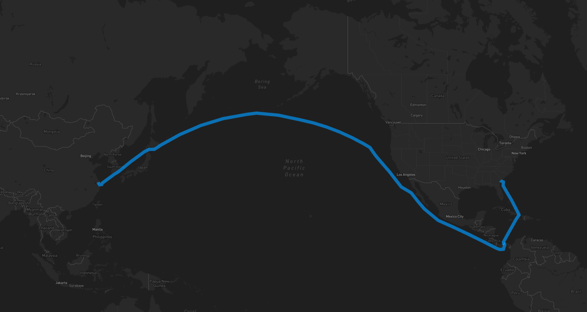

# SCGraph
[](https://badge.fury.io/py/scgraph)
[](https://opensource.org/licenses/MIT)
[](https://pepy.tech/project/scgraph/)

**A high-performance, lightweight Python library for shortest path routing on geographic and supply chain networks.**



SCGraph finds the shortest route between two points of the globe, by road, by rail, by sea and by air. It is for people who plan transport or study supply chains. It gives route lengths, distance matrices, and routes by time, by cost or by CO2. It loads ready networks of the world, or a network of your own data.

- **Docs**: https://connor-makowski.github.io/scgraph/scgraph.html
- **Paper**: https://ssrn.com/abstract=5388845
- **Award**: [2025 MIT Prize for Open Data](https://libraries.mit.edu/opendata/open-data-mit-home/mit-prize/)

## Installation

scgraph needs Python 3.11 or newer.

```bash
pip install scgraph
```

pip installs an optional C++ extension, which makes scgraph faster. Without the extension, scgraph uses its pure-Python code, with the same results.

To install the pure-Python code only, set `SCGRAPH_NO_BUILD=1` in the environment, then run `pip install --no-binary scgraph scgraph`.

## A First Route

Get the shortest route by sea between Shanghai and Savannah, GA:

```py
from scgraph import GeoGraph

world_sea = GeoGraph.load_geograph("world_sea")
route = world_sea.get_shortest_path(
    origin_node={"latitude": 31.23, "longitude": 121.47},
    destination_node={"latitude": 32.08, "longitude": -81.09},
)
print(route["length"])  # the km of the route
```

`world_sea` is a **released network**: the maintainers of scgraph build it and publish it. The first load downloads it and keeps it in a cache. The two points need not be on the network: each one **snaps** to its closest node, where the route starts or ends. The result also holds `coordinate_path`: the points of the route, as `[latitude, longitude]` pairs.

## Which Network?

| Need | Network | Call |
|---|---|---|
| Routes over roads, railways, sea lanes and flights | `world_multimodal`, or a part of the world such as `europe` | `GeoGraph.load_geograph("europe")` |
| Routes by sea | `world_sea` | `GeoGraph.load_geograph("world_sea")` |
| Routes by rail | `world_rail` | `GeoGraph.load_geograph("world_rail")` |
| Routes by road only | a released network, which the maintainers build and publish in a **network release** (a set of networks under one tag), with `node_modes`. The **node mode** of a node is the kind of place where the node is, such as `road`, `sea` or `port` | `GeoGraph.load_geograph("europe", node_modes=["road"])` |
| Routes by road and by sea | a released network, with `node_modes` and the ports that join them | `GeoGraph.load_geograph("europe", node_modes=["road", "sea", "port"])` |
| Routes by time, by cost or by CO2 | a released network, with a **metric**: a weight for each edge other than its length | `geograph.create_metric("hours", weight_per_km=...)`, then `get_shortest_path(..., metric="hours")` |
| The same result later, on any machine | a released network, with the tag of its network release and the checksum `content_sha256` of its file (see the guide Networks) | `GeoGraph.load_geograph("europe", network_release=..., content_sha256=...)` |
| Current data for one region | a network built on your machine (needs `pip install scgraph[osm]`) | `GeoGraph.build_geograph("osm_region_multimodal", region="europe/denmark")` |
| Your own lines | a GeoJSON or an OpenStreetMap file | `GeoGraph.load_from_geojson(file)` or `GeoGraph.load_from_osm(file)` |
| A result of scgraph 3.6.0, unchanged | a deprecated network of 3.6.0 | `GeoGraph.load_geograph("marnet")`, with a `DeprecationWarning` |

`GeoGraph.list_geographs()` lists every network that `load_geograph` takes, with what it holds and the size of its download. The guide [Networks](https://github.com/connor-makowski/scgraph/blob/main/guides/networks.md) describes each network, and how to load, build and save one.

## Common Tasks

The code blocks below run in order, after the first route: a block may use a name of an earlier one. The **edge mode** of an edge is its kind of transport: `road`, `rail`, `sea` or `air`. A **leg** is a part of a route on one edge mode.

### A Route on Several Edge Modes, with Its Legs

`europe` has edges of the four edge modes. `output_legs=True` returns the legs of a route.

```py
europe = GeoGraph.load_geograph("europe")
paris = {"latitude": 48.8566, "longitude": 2.3522}
berlin = {"latitude": 52.52, "longitude": 13.405}

route = europe.get_shortest_path(origin_node=paris, destination_node=berlin, output_legs=True)
for leg in route["legs"]:
    print(leg["edge_mode"], round(leg["length"]), "km")
```

The guide [Routes by Time, Cost and CO2](https://github.com/connor-makowski/scgraph/blob/main/guides/time_cost_co2.md#the-legs-of-a-route) explains the legs.

### A Route by Time, by Cost or by CO2

Here the metric gives each edge a cost in euros.

`weight_per_km` gives the cost of 1 km by road, by rail, by sea and by air. Its key `off_graph` is for the two **off-graph legs**: the straight lines from each point to its node. `weight_at_hub` adds a fee at each port and at each airport. These numbers are examples.

```py
euros_per_km = {"road": 1.2, "rail": 0.4, "sea": 0.1, "air": 5, "off_graph": 1.2}
europe.create_metric("euros", weight_per_km=euros_per_km, weight_at_hub={"port": {"sea": 300}, "airport": {"air": 200}})

route = europe.get_shortest_path(origin_node=paris, destination_node=berlin, metric="euros", output_legs=True)
print(route["length"], route["metric_totals"]["euros"])  # the km and the euros of the cheapest route
for leg in route["legs"]:
    print(leg["edge_mode"], round(leg["metric_totals"]["euros"]), "euros")
```

The guide [Routes by Time, Cost and CO2](https://github.com/connor-makowski/scgraph/blob/main/guides/time_cost_co2.md) adds weighted sums, functions of an edge and closed canals.

### A Distance Matrix

`distance_matrix` returns the distance between every pair of a list of places.

```py
roads = GeoGraph.load_geograph("europe", node_modes=["road"])
rome = {"latitude": 41.9028, "longitude": 12.4964}
madrid = {"latitude": 40.4168, "longitude": -3.7038}
cities = [paris, berlin, rome, madrid]
matrix = roads.distance_matrix(cities)  # matrix[i][j]: the km by road from city i to city j
```

The routing guide gives more detail in [Distance Matrix](https://github.com/connor-makowski/scgraph/blob/main/guides/routing.md#distance-matrix).

### A Network of a Region, or of Your Own Data

`build_geograph` builds the network of a region from current OpenStreetMap data. `GeoGraph` makes a network from your own nodes and edges.

```py
# Needs `pip install scgraph[osm]`, and downloads the extract of the region
denmark = GeoGraph.build_geograph("osm_region_multimodal", region="europe/denmark")

# Your own data: a point for each node, and for each node the km to its neighbors
nodes = [[51.5074, -0.1278], [48.8566, 2.3522], [40.4168, -3.7038]]  # London, Paris, Madrid
my_geograph = GeoGraph(nodes=nodes, graph=[{1: 344}, {0: 344, 2: 1053}, {1: 1053}])
```

Two guides give more detail: [Networks](https://github.com/connor-makowski/scgraph/blob/main/guides/networks.md#building-networks-from-their-sources) and [Your Own Graphs and Grids](https://github.com/connor-makowski/scgraph/blob/main/guides/custom_graphs.md).

### Faster Repeated Queries

`reduce()` prepares a network once, and every later query is faster. With `cached_shortest_path`, the first query from an origin stores its shortest paths, and a later query from this origin reads them.

```py
roads.reduce()

for city in cities[1:]:  # many destinations from one origin
    roads.get_shortest_path(origin_node=cities[0], destination_node=city, algorithm_fn="cached_shortest_path")
```

The routing guide compares these and other methods in [Making Many Queries Fast](https://github.com/connor-makowski/scgraph/blob/main/guides/routing.md#making-many-queries-fast).

## Documentation

| I want to … | Read |
|---|---|
| Choose the options of a route, read its result, choose an algorithm, make many queries fast | [Routing on a Network](https://github.com/connor-makowski/scgraph/blob/main/guides/routing.md) |
| Route by time, by cost or by CO2, read the legs of a route, close a canal | [Routes by Time, Cost and CO2](https://github.com/connor-makowski/scgraph/blob/main/guides/time_cost_co2.md) |
| Choose, load, build or save a network, or load the same network again | [Networks: Load, Build and Save](https://github.com/connor-makowski/scgraph/blob/main/guides/networks.md) |
| Route on my own graph, edit or merge networks, route on a grid | [Your Own Graphs and Grids](https://github.com/connor-makowski/scgraph/blob/main/guides/custom_graphs.md) |
| Move from scgraph 3.6 to 4.0 | [Migrating from 3.6 to 4.0](https://github.com/connor-makowski/scgraph/blob/main/MIGRATING.md) |
| Find every parameter, default, result key and exception of a method | The [API documentation](https://connor-makowski.github.io/scgraph/scgraph.html) |
| Understand how scgraph works inside | [ARCHITECTURE.md](https://github.com/connor-makowski/scgraph/blob/main/ARCHITECTURE.md) |
| Build a network from open data, or publish a network release | [Network Pipelines](https://github.com/connor-makowski/scgraph/blob/main/scgraph/pipelines/README.md) |
| Contribute to scgraph | [DEVELOPMENT.md](https://github.com/connor-makowski/scgraph/blob/dev/DEVELOPMENT.md) |

## Examples

These notebooks open in Google Colab:

- [Getting Started](https://colab.research.google.com/github/connor-makowski/scgraph/blob/main/examples/getting_started.ipynb): load a released network, compute a route, draw it on a map, choose a network.
- [One Trip by Sea, by Road and by Rail](https://colab.research.google.com/github/connor-makowski/scgraph/blob/main/examples/route_examples.ipynb): keep each route by sea, by road or by rail with a metric, compare three routes.
- [Shortest Tour of 14 Cities by Road](https://colab.research.google.com/github/connor-makowski/scgraph/blob/main/examples/travelling_salesman.ipynb): compute a distance matrix, solve the travelling salesman problem (the shortest tour through all cities) with PuLP, a library for linear programs.
- [Using OSMNx with SCGraph](https://colab.research.google.com/github/connor-makowski/scgraph/blob/main/examples/osmnx.ipynb): load OSM data with OSMNx, a library that downloads OpenStreetMap data, then solve for time and distance on bike networks.
- [Creating A Multi-Path GeoJSON](https://colab.research.google.com/github/connor-makowski/scgraph/blob/main/examples/multi_path_geojson.ipynb): export several routes as GeoJSON.
- [Modifying A GeoGraph](https://colab.research.google.com/github/connor-makowski/scgraph/blob/main/examples/geograph_modifications.ipynb): close the Suez Canal with a metric, fix a sea lane, remove and add nodes and edges.
- [Routes on a Multimodal Network](https://colab.research.google.com/github/connor-makowski/scgraph/blob/main/examples/multimodal_networks.ipynb): read the legs of a route, route by road only and by hours, draw the routes on a map.
- [Trade-offs between Time, Cost and CO2](https://colab.research.google.com/github/connor-makowski/scgraph/blob/main/examples/time_cost_co2_trade_offs.ipynb): try several coefficients of a weighted sum of two metrics, find several of the best trade-offs, draw them.
- [Build the Network of a Region](https://colab.research.google.com/github/connor-makowski/scgraph/blob/main/examples/build_a_region.ipynb): build Denmark from the newest OpenStreetMap extract, read its sources, check it.
- [Hilbert Order and Snapping Indexes](https://colab.research.google.com/github/connor-makowski/scgraph/blob/main/examples/hilbert_and_spatial_indexing.ipynb): order nodes along a Hilbert curve (a line that visits every cell of a square grid), compare `OrderedSnapIndex` (the snapping index of scgraph) with `GeoKDTree` (the k-d tree of the library `geokdtree`).

## Public API

The public names of scgraph are the names of the table below. They keep working from one release to the next, and a `DeprecationWarning` announces a change. The [API documentation](https://connor-makowski.github.io/scgraph/scgraph.html) describes each one.

| For | Public names |
|---|---|
| Routes on a network | `scgraph.GeoGraph` and its methods, `scgraph.network_release.TAG` |
| Metrics, classes, node modes and edge modes of a network | The methods `create_metric`, `remove_metric`, `get_graph_object`, `get_nodes`, `get_edges` and `get_path_edges` of `scgraph.GeoGraph`, and its attributes `metrics`, `default_metric`, `classes` and `node_modes` |
| Your own graph or grid | `scgraph.Graph`, `scgraph.CHGraph`, `scgraph.TNRGraph`, `scgraph.GridGraph`, `scgraph.PathNotFoundError`, `scgraph.NegativeCycleError` |
| Distances | `scgraph.utils`: `haversine`, `cheap_ruler`, `distance_converter`, `has_cpp` |
| Lines and GeoJSON | `scgraph.helpers.geojson`, `scgraph.helpers.visvalingam`, `scgraph.helpers.douglas_peucker` |
| Network files | `scgraph.network_file`: `read`, `write`, `get_scgraph_info`, `check_content`, `build_header_metadata`; `scgraph.node_modes.build_node_mode_ids` |
| Building a network | `scgraph.pipelines` and its three pipeline modules, `pipelines.network_builder.build_network_file`, `pipelines.derived_networks.derive_network_file`, `pipelines.steps.step1_osm_sources`, `pipelines.steps.step4_validation_cases`, `scgraph.helpers.osm` (`get_way_direction`, `select_main_roads`, `select_main_roads_with_class`) |
| Snapping and node order | `scgraph.node_snapping`: `OrderedSnapIndex`, `NodeOrderError`; `scgraph.helpers.hilbert.get_hilbert_order` |

In these modules, `__all__` lists the public names. Every other module and name is internal: it can change in any release.

## Citation

If you use SCGraph in your research, please cite:

> Makowski, C., Saragih, A., Guter, W., Russell, T., Heinold, A., & Lekkakos, S. (2025). SCGraph: A Dependency-Free Python Package for Road, Rail, and Maritime Shortest Path Routing Generation and Distance Estimation. *MIT Center for Transportation & Logistics Research Paper Series*, (2025-028). https://ssrn.com/abstract=5388845

```bibtex
@article{makowski2025scgraph,
  title={SCGraph: A Dependency-Free Python Package for Road, Rail, and Maritime Shortest Path Routing Generation and Distance Estimation},
  author={Makowski, Connor and Saragih, Austin and Guter, Willem and Russell, Tim and Heinold, Arne and Lekkakos, Spyridon},
  journal={MIT Center for Transportation & Logistics Research Paper Series},
  number={2025-028},
  year={2025},
  url={https://ssrn.com/abstract=5388845}
}
```

## Development

Contributions start from the `dev` branch. You need Python 3.11 or newer and [uv](https://docs.astral.sh/uv/).

```bash
git clone https://github.com/connor-makowski/scgraph.git
cd scgraph
git checkout dev
uv sync --extra dev
uv run pytest
```

The developer guide, [`DEVELOPMENT.md` on `dev`](https://github.com/connor-makowski/scgraph/blob/dev/DEVELOPMENT.md), gives the commands and the rules of a contribution. [`ARCHITECTURE.md`](https://github.com/connor-makowski/scgraph/blob/dev/ARCHITECTURE.md) explains how scgraph works inside.

## Attributions and Thanks

Originally inspired by [searoute](https://github.com/genthalili/searoute-py), including the use of one of their [datasets](https://github.com/genthalili/searoute-py/blob/main/searoute/data/marnet_densified_v2_old.geojson) that has been modified to work with this package.

The released networks are built from [OpenStreetMap](https://www.openstreetmap.org/copyright) (© OpenStreetMap contributors), Eurostat SeaRoute, Natural Earth, the World Port Index, OurAirports, Wikidata, and flight data of OpenSky, the US Bureau of Transportation Statistics and Eurostat. [scgraph/pipelines/data/README.md](https://github.com/connor-makowski/scgraph/blob/main/scgraph/pipelines/data/README.md) gives the license of each table.

The C++ extension includes [bmssp](https://github.com/lcs147/bmssp) by Lucas Castro and Thailsson Clementino (MIT License), with parts under the Boost Software License. The two license texts are beside the file, in `scgraph/cpp/src/`.
