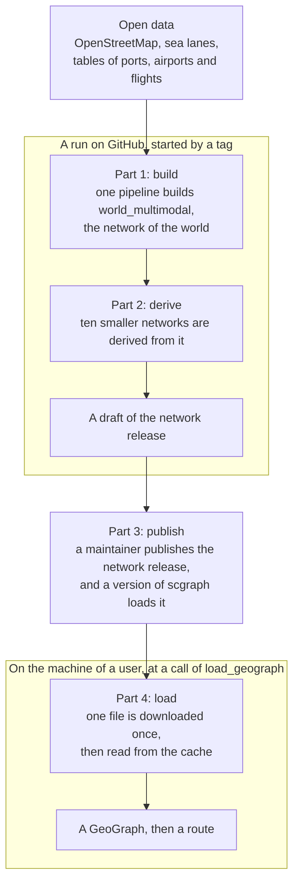
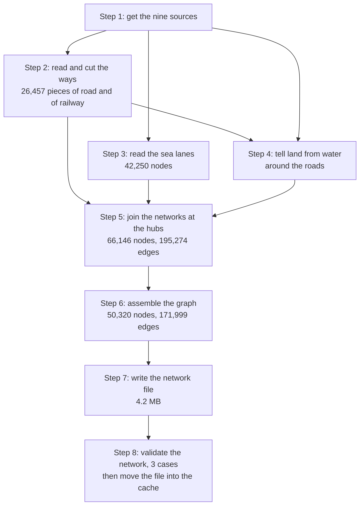
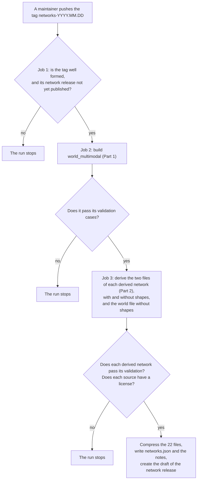

# Network Pipelines

This guide shows how scgraph makes the networks that it publishes, such as `europe` or
`world_multimodal`. It follows one network through four parts: build, derive, publish and
load. Each part gives the numbers of a real run.

A **network release** is a set of network files that scgraph publishes together on GitHub.
The seven networks of scgraph 3.6.0, such as `marnet`, were made in another way.
[MIGRATING.md](https://github.com/connor-makowski/scgraph/blob/main/MIGRATING.md) lists them.

## Pipeline Overview



You can also run Parts 1 and 2 on your own machine. Part 1 gives the command of a build.
The section [Custom Networks](#custom-networks) gives the call of a derivation.

## Part 1. Building a Network

A **pipeline** is a Python module that builds a network from its sources. This part follows
one build of the pipeline `osm_region_multimodal` on the region `europe/denmark`. A region is
the path of an extract on Geofabrik, a server of OpenStreetMap files. An **extract** is the
OpenStreetMap file of one region.

The build ran on 2026-11-20 on Linux, with the C++ extension, from the extract of 2026-11-18.
All the numbers of Part 1 come from the log of this build. A later build gives other numbers,
because the extract and the code change.

### Build Command

```
pip install "scgraph[osm]"
python -m scgraph.pipelines.network_builder osm_region_multimodal --region europe/denmark --validate
```

The command prints the path of the **network file**: the file `<name>.scgraph` that stores one
network. The command logs each download. To see each step with its counts, call the **runner**, the
module `network_builder.py`, from Python with the logging level DEBUG:

```py
import logging
from scgraph.pipelines.network_builder import build_network_file

logging.basicConfig(level=logging.DEBUG)
build_network_file("osm_region_multimodal", region="europe/denmark", run_validation_cases=True)
```

The runner downloads `https://download.geofabrik.de/{region}-latest.osm.pbf`: `--region europe`
names the file of the whole of Europe. Such a build needs much more memory and time than the
build of Denmark. The released network `europe` is not built this way: it is a part of
`world_multimodal` (see Part 2 below). The runner keeps
the sources in a work folder inside the cache directory, and removes it after a build that
succeeds. The environment variable `SCGRAPH_CACHE_DIR`, or the option `--cache-dir`, gives
another cache directory. The option `--work-dir` gives the work folder and keeps it.

### Build Steps

The build below has eight steps. The modules of `scgraph/pipelines/steps` group them in four:
read the sources (`step1_…`), join the networks (`step2_…`), assemble the network
(`scgraph/network_assembly.py`, which `load_from_osm` uses too) and validate (`step4_…`). A
module name gives the group of a step, not its number:
`step2_land_mask` does step 4.



#### 1. Downloading the Sources

A **source** is a file that a pipeline reads. `SOURCES` of the pipeline lists nine sources.
The runner brings each source into its work folder, calls the pipeline and keeps the network
file in the cache. The runner downloads five sources
and copies the four others, which are small tables kept with scgraph.

| Source | What it is | Size |
|---|---|---|
| `sea` | the sea lanes of Eurostat SeaRoute | 7.0 MB |
| `land`, `lakes`, `rivers` | Natural Earth, to tell land from water | 3.6, 1.6 and 2.3 MB |
| `ports`, `airports`, `flights`, `rail_terminals` | the tables of the hubs and of the flights | under 1 MB each |
| `osm` | the Geofabrik extract of Denmark | 498.2 MB |

The runner downloads the extract last. When a small source fails, the large download has not
started.

Where to read more: `network_builder.py`, function `build_network_file`.

#### 2. Reading and Cutting the Ways

`scgraph.helpers.osm.build_way_pieces` reads the extract and keeps the ways that the pipeline
selects. A **way** is a line of OpenStreetMap: a part of a road, of a railway or of a ferry
route. A **piece** is the part of a way between two nodes of the network.

The function cuts each way at its junctions. It also cuts a way where a piece would be longer
than `max_km_between_nodes` (2 km). A route starts at the road node closest to its origin, so
a long road needs nodes along it.

The function simplifies the **shape** of each piece to within 50 m. The shape of an edge is the
list of points that draw the edge on a map between its two nodes.

The **node mode** of a node is the kind of place where the node is: `road`, `rail`, `sea`,
`port`, `airport` or `rail_terminal`. The pipeline reads the extract once, for its two node
modes `rail` and `road`. The log line of this step gives the sum of the two counts: 26,457
pieces.

| Node mode | Which ways it keeps | Pieces |
|---|---|---|
| `rail` | railway lines | 5,680 |
| `road` | main roads | 20,777 |

The build follows these rules:

- Each node mode has its own select function. The function chooses the ways to keep.
- The function gives the class of each way. The **class** of an edge is its category, for
  example `motorway`, `ferry`, `rail_main` or `flight`. A piece has the class of its way.
- Each node mode has its own junctions and its own pieces. A road and a railway can share a
  node of OpenStreetMap at a level crossing. The build makes one node for each node mode
  there, so no route goes from a road to a railway at a level crossing.
- `scgraph.helpers.osm.build_ferry_edges` keeps a vehicle ferry when each end is within 2 km of a
  road node. The ferries give 12 edges in this build, one for each direction.
- `scgraph.network_assembly.build_graph_from_pieces` stores the pieces of each node mode as a
  graph. Between two nodes, it keeps the shortest edge of each class. Two ferry routes of this
  build join the same two road nodes, so the file has 10 edges of the class `ferry`.
- A graph holds one edge at most from a node to another. So the function keeps the shortest
  edge as it is, and splits each other kept edge at its middle, with a new node there.
- For example, a primary road and a shorter motorway join the same two junctions. The function
  splits the primary road. A query by time can then choose between the two roads.

Where to read more: the docstrings at the top of `scgraph/helpers/osm.py` and of
`scgraph/network_assembly.py`.

#### 3. Reading the Sea Lanes

The sea lanes are 72,444 lines. The pipeline makes a graph of 42,250 nodes from them. These are
the sea lanes of the whole world, not only those around Denmark: a route by sea may leave the
region and come back.

#### 4. Telling Land from Water

`LandMask.from_natural_earth` computes a raster of the land around the roads of the region.
Each cell is land or water. The next step uses the raster for two checks: a connector to a
road or to a railway crosses little water, and a connector to a sea lane stays on water.

Where to read more: the docstring at the top of `steps/step2_land_mask.py`.

#### 5. Joining the Networks at the Hubs

At this point the build has three graphs with no edge between them: roads, railways and sea
lanes. `step2_hub_connectors.join_networks_at_hubs` adds the hubs and their connectors.

- A **hub** is a port, an airport or a rail terminal. A hub is one node. A route goes from one
  network to another at a hub.
- A **connector** is the pair of edges that joins a hub to the roads, to the railways or to the
  sea lanes.

The tables give 242 hubs inside the raster, which is wider than Denmark. The function joins a
hub that reaches at least two networks:

- a port can reach a road, a sea lane, and a railway when the column `rail` of the ports table is 1;
- an airport can reach a road, and its flights count as a second network;
- a rail terminal can reach a road and a railway.

A hub reaches a network within a limit: 20 km in a straight line to a road, 10 km to a
railway, and a water path of 2,500 km to a sea lane. This build joins 63 ports, 10 airports and
1 rail terminal. The other hubs stay out.

For example, the port of Aarhus gets three connectors: 0.91 km to a rail node, 4.89 km to a road
node and 0.99 km over water to a sea node.

The step also joins each pair of airports that has regular flights, by one edge each way. The
length of this edge is the great-circle distance. The result is one graph of 66,146 nodes and
195,274 edges.

Where to read more: the docstring at the top of `steps/step2_hub_connectors.py`.

#### 6. Assembling the Graph

`scgraph.network_assembly.assemble_network` keeps the connected part, contracts the chains and
orders the nodes.

| Step | Nodes | Edges |
|---|---|---|
| the joined graph | 66,146 | 195,274 |
| keep the largest strongly connected component | 63,784 | 192,735 |
| contract the chains | 50,320 | 171,999 |

- **Keep the connected part.** In a strongly connected component, a route exists from every
  node to every other node. The step removes the rest, for example a road on a small island
  with no ferry.
- **Contract the chains.** A **chain** is a row of nodes that each have only two neighbors, as
  along a road with no junction. A chain becomes one edge with the length and the shape of the
  chain. The route lengths do not change.
- **Keep some nodes of a chain.** A chain is never contracted across two node modes or two
  classes. A chain longer than `max_km_between_nodes` keeps nodes along it. In this build, 151
  nodes stay because the class changes there.
- **Keep the node of a split.** The new node in the middle of a split road (step 2) stays.
- **Keep a junction with a turn restriction.** A turn restriction is an OpenStreetMap rule that
  forbids one turn at a junction, such as no left turn. Before this step, the pipeline applies the
  turn restrictions between two kept roads. A junction with a turn
  restriction then has more than one road node, at the same point
  (`scgraph/turn_restrictions.py` explains why). Such a junction keeps all its nodes or loses
  them all, and no chain is contracted through it. The table above comes from the extract of
  2026-11-18, built without the turn restrictions. The numbers of this item come from another
  build, on the extract of 2026-11-16. There, the turn restrictions forbid 1,091 turns and
  add 1,028 nodes to the joined graph. The network file has 876
  junctions with more than one node.
- **Order the nodes.** The nodes are sorted by node mode, then along a Hilbert curve (a line that visits every cell of a square grid, so that close nodes get close ids). Nodes
  that are near on the map are then near in the file, so a search reads nearby memory.

Where to read more: the docstring at the top of `scgraph/network_assembly.py`.

#### 7. Writing the Network File

The runner writes the arrays to one file of 4.2 MB, in its work folder. The **header** is the
first part of the file, and it describes the network. The header records the pipeline, each
source with its version and its license, and the software of the build. It also records two
things that a query uses:

- `metrics`: the metrics of the file. A built file has one metric, `length`, in km. A user
  adds other metrics on the loaded network (`GeoGraph.create_metric`).
- `classes`: one row for each class, with its name and its edge mode, such as
  `{"name": "motorway", "edge_mode": "road"}`. The **edge mode** of a class is the kind of
  transport of its edges: `road`, `rail`, `sea` or `air`.

A **query point** is the origin or the destination of a query. A query point snaps to its
closest road node by default, because this network has nodes of the node mode `road`. So a
route starts and ends on a road.

`GeoGraph.get_scgraph_info(file)` reads the header back.

Where to read more: the docstring of `scgraph.pipelines`, part *What the network file
records*, and `ARCHITECTURE.md`, section 7.

#### 8. Validating the Network

With `--validate`, `validate_network` checks the file against the cases of the pipeline. A case
describes one known fact of the real world. Most cases give two points and a reference value
for the route between them. This build has three cases, and all three pass.

For example, one case checks that the port of Aarhus has a connector to a road, to a railway and
to a sea lane. Each kind of case has its node modes, and the two points of a case snap to nodes
of these node modes. A road distance uses road nodes, and a hub uses any node. The default rule
of a query does not apply here.

Then the runner moves the file into the cache. A network that fails a case does not enter the
cache.

Where to read more: the docstring of `steps/step4_validation_cases`.

### Output of a Build

The file holds 50,320 nodes and 171,999 edges.

| Node mode | Nodes |
|---|---|
| `sea` | 42,157 |
| `road` | 6,162 |
| `rail` | 1,927 |
| `port` | 63 |
| `airport` | 10 |
| `rail_terminal` | 1 |

`GeoGraph.build_geograph` calls the runner, then loads the file. It builds nothing when the
cache holds the file. The guide
[Networks](https://github.com/connor-makowski/scgraph/blob/main/guides/networks.md#building-networks-from-their-sources)
gives this call. With the roads alone (`node_modes=["road"]`), the route from the center of
Aarhus (56.1629, 10.2039) to the center of Copenhagen (55.6761, 12.5683) is 302.2 km.

Each edge has a class. A two-way road gives two edges, and the table counts the km of both.

| Classes | Edges | km |
|---|---|---|
| `motorway`, `motorway_link` | 2,198 | 2,845 |
| `trunk`, `trunk_link` | 1,040 | 787 |
| `primary`, `primary_link` | 6,799 | 5,061 |
| `ferry` | 10 | 153 |
| `rail_highspeed`, `rail_main`, `rail_branch`, `rail_other` | 4,540 | 6,770 |
| `open_sea` and the ten passages, such as `suez` | 157,022 | 6,540,886 |
| `flight` | 28 | 5,050 |
| `road_connector`, `rail_connector`, `sea_connector` | 362 | 1,238 |

### World Network

The pipeline `osm_world_multimodal` runs the same steps on the whole planet. It builds the
network `world_multimodal`. The pipeline differs from `osm_region_multimodal` in three points:

- It reads the **planet file**, the OpenStreetMap file of the whole world, by HTTP byte ranges.
  It never stores this file.
- It cuts a road or a railway every 10 km, not every 2 km. This gives about 4.1 million nodes.
- It keeps each strongly connected component of at least 1,000 nodes, not only the largest.
  The roads of an island then stay in the file.

A shortest route counts km only, on every network. A long route therefore often takes a
flight. The guide [Routes by Time, Cost and CO2](https://github.com/connor-makowski/scgraph/blob/main/guides/time_cost_co2.md)
gives each edge mode a speed or a cost, and finds the fastest or the cheapest route.

## Part 2. Deriving a Network from a Network File

`derive_network_file` of `derived_networks.py` reads one network file, the parent file, and
writes a smaller one, the derived file. It downloads nothing. The docstring of
`derived_networks.py` gives the rules.

A derivation takes a list of node modes and a bbox: a rectangle `(south, west, north, east)` in
degrees. The table `DERIVED_NETWORKS` of the same module lists the ten derived networks of a
network release, each with its node modes or its bbox. Two examples are `world_sea` and
`oceania`.

```
mkdir derived
python -m scgraph.pipelines.derived_networks world_multimodal.scgraph derived oceania
```

The arguments are the world file, the output folder and the name of a derived network. The
output folder must exist. The command writes two files and prints their paths:

- `derived/oceania.scgraph`;
- `derived/oceania.no_shapes.scgraph`, the same network without the shapes of its edges.

Without a name, the command writes the files of the ten derived networks, and the world file
without shapes. The workflow of Part 3 runs the command in this way.

The numbers below come from one derivation of `oceania` on 2026-11-27, on Linux, with the C++
extension. The parent file is the `world_multimodal` of the network release
`networks-2026.11.27-dev.1` (313.1 MB).

| Step | Nodes | Edges |
|---|---|---|
| the parent file | 4,143,455 | 7,403,940 |
| select the nodes and remove the other edges | 147,844 | 367,584 |
| keep the components of at least 10 nodes | 147,795 | 367,548 |

- **Select the nodes.** The bbox of `oceania` is `(-50, 110, 0, 180)`. It selects the roads,
  the railways and the rail terminals inside it. The sea lanes, the ports and the airports of
  the world all stay, so a route may leave the bbox by sea or by air.
- **Keep the components.** The selection leaves 49 nodes apart from the rest, in strongly
  connected components of fewer than 10 nodes. `derive_network_file` removes them. It does not
  contract the chains again: a junction that lost a road stays as a node.

The derivation took 1.8 s. The derived file is 15.7 MB, and 7.7 MB without the shapes. Its
header records the node modes, the bbox and the `content_sha256` of the parent file.

The **`content_sha256`** of a network file is the SHA-256 digest of its bytes from byte 40 to
the end. The first 40 bytes hold `SCGRAPH1` (8 bytes) and this digest (32 bytes).

A derived file keeps the length and the class of each edge. `oceania` has roads, so a query
point snaps to its closest road node by default. `world_sea` holds no road, and a query point
snaps to its closest node.

The command checks the derived network against some cases of `world_multimodal`
(`--no-validate` skips this check). It takes the cases whose two points are inside the bbox,
on node modes that the file holds. There are 16 such cases here, and the file fails none.

A **coverage case** checks that a road route joins a city to the main city of its landmass.
The world passes when at most 1 % of its coverage cases fail. A derived network has fewer
coverage cases, so the same failed case can be more than 1 % of them. So a derived file
passes when it fails no case that the parent file passes.

## Part 3. Publishing a Network Release

The workflow `.github/workflows/build_networks.yml` makes a network release. A **workflow** is
a script that GitHub runs on its own machines. This workflow does the work of Parts 1 and 2 for
the world. Then it prepares a **GitHub release**: a page of the repository that offers files
for download.

### Before the Tag

The date of the data is in the code, not in the tag. The constant `PLANET` of
`steps/step1_osm_sources.py` holds the URL of one planet file of OpenStreetMap, and this URL
holds the date of the file. To take newer data, a PR changes this URL. The network release
`networks-2026.11.27-dev.1` holds the planet of 2026-11-02.

### Run Triggers

A maintainer pushes a **tag** `networks-YYYY.MM.DD`, by convention on a commit of the branch
`dev`. The tag names the GitHub release, and the date is the day of the tag. Only a person
with write access to the repository can push a tag. Nothing else starts the workflow: no
schedule, and no merge.

```
git tag networks-2026.11.20 <commit of dev>
git push origin networks-2026.11.20
```

A tag that ends with `-dev.N` makes a development network release, to try the networks before a
new version of scgraph. GitHub shows it as a pre-release. By convention, a version of scgraph
on PyPI loads a network release without `-dev`.

### Run Steps

A **run** is one execution of a workflow. This run has three **jobs**, one after the other, and
each job has a machine of its own. Job 2 gives the world file to job 3 as a file of the run.



| Job | Time |
|---|---|
| 1. Check the tag | 6 s |
| 2. `world_multimodal` | 1 h 6 min |
| 3. Derive and draft | 5 min 5 s |

The times come from the run of the network release `networks-2026.11.27-dev.1`.

- **Job 2 reads the planet from another server.** The workflow first replaces the planet URL
  of the code by a mirror that is faster from a machine of GitHub. The header of the world
  file records the URL that was read.
- **Job 2 always builds the world.** A tag is the choice of a maintainer to build the
  networks, and the tag names the network release. No run takes a file of a network release
  before it.
- **Job 2 has 5 h 55 min.** GitHub stops a job at 6 hours. A job that is run again starts from
  nothing.

`PIPELINE_VERSION` is a number in a pipeline. It has one use: `build_geograph` builds again a
network of the cache that another `PIPELINE_VERSION` built, or that it cannot read. With
`local_files_only`, it warns and loads the file. The workflow does not read the number.

### Contents of a Network Release

The network release `networks-2026.11.27-dev.1` holds 23 files.

- 22 network files, compressed with gzip: `world_multimodal` and the ten derived networks, each
  with and without the shapes of its edges.
  - For example `oceania.scgraph.gz` (7.6 MB) and `oceania.no_shapes.scgraph.gz` (3.8 MB).
  - The shapes are a large part of a file. With `load_intermediate_nodes=False`,
    `load_geograph` loads the file without shapes, for a user who needs only the route lengths.
- `networks.json`, the index of the network release. It gives for each file its size, its
  `content_sha256`, its number of nodes and of edges, its sources and its credit line. The
  **credit line** of a network names its sources and their licenses, and a user cites it with
  a result.

`utils/draft_network_release.py` compresses the files, and writes the index and the notes of the
network release. The notes show a table of the files and the credit line of each file.

### Publishing the Draft

The run ends with a **draft**: a GitHub release before its publication, which only the
maintainers see.

1. **Read the draft.** The maintainer checks three things:
   - When job 2 built the world, its log has the line `Validation PASSED`, with the number of
     cases.
   - The log of job 3 has the line `0 failed in this file only` for each derived network.
   - The table of the notes has 22 files, with numbers of nodes close to those of the last
     network release.
2. **Publish.** The maintainer publishes the draft on its GitHub page. The publication of a
   GitHub release also starts the workflow that publishes scgraph on PyPI. That workflow skips
   a tag that starts with `networks-`.
3. **Pin the network release.** Each version of scgraph **pins** one network release: it
   records the tag of this network release, and loads its networks. The maintainer runs
   `python utils/pin_network_release.py TAG`, and a PR adds the new module to `dev`.
   - The script writes the tag, the `content_sha256` of each file and the counts of each
     network into `scgraph/network_release.py`.
   - The script formats the module as `utils/prettify.py` does, so this formatter changes no
     line.
4. **Update the documents.** The README and the guides of `guides/` hold no number of a
   network release. In the same PR, the maintainer runs their examples again, and updates the
   numbers of Parts 2 to 4 of this guide.
5. **Reach the users.** An install from `dev` loads the new network release immediately. A user
   of PyPI gets it with the next version of scgraph.

Two checks protect a published file. Job 1 stops a run whose tag is already published. And
scgraph refuses a downloaded file whose `content_sha256` is not the one in
`scgraph/network_release.py` (Part 4).

### Troubleshooting

- **A download fails.** A server refused a request. The maintainer runs the failed job again.
- **A validation fails, or a source has no license.** The run stops, and no draft appears. The
  maintainer corrects the code in a PR, then pushes a new tag on the new commit of `dev`, for
  example with the next `-dev.N`. The old tag stays, with no network release.
- **The draft is wrong.** The maintainer deletes it (`gh release delete TAG`), and nothing was
  published. A run that is started again also replaces its own draft.
- **A published network release is wrong.** It stays as it is. The correction is a new network
  release.

Where to read more: the comment at the top of `build_networks.yml`, and the docstring of
`utils/draft_network_release.py`.

## Part 4. Loading a Released Network

A **released network** is a network of a network release. `GeoGraph.load_geograph("oceania")`
loads a released network. The guide
[Networks](https://github.com/connor-makowski/scgraph/blob/main/guides/networks.md#released-networks)
lists the eleven networks, and gives the arguments of the call, the cache and the errors of a
load.

With `local_files_only=True`, or with `SCGRAPH_OFFLINE=1`, a load downloads nothing. It raises
`FileNotFoundError` when the cache does not hold the network.

This part follows one load of `oceania` without its edge shapes. The **cache** is the folder
where scgraph keeps network files on the machine of a user.

1. **Download.** The first call downloads
   `https://github.com/connor-makowski/scgraph/releases/download/networks-2026.11.27-dev.1/oceania.no_shapes.scgraph.gz`
   (3.8 MB), and decompresses it (7.7 MB).
2. **Check the content.** `network_file.check_content` computes the `content_sha256` of the
   decompressed file, and compares it with the one in the header of the file. Two files with
   the same `content_sha256` hold the same network. This check finds a download that was cut
   or damaged.
3. **Check the pin.** For the pinned network release, the `content_sha256` must also be the one
   that `scgraph/network_release.py` records. This check finds a file that was replaced on the
   server. A file of another network release has the first check only.
4. **Keep.** The cache keeps the decompressed file as
   `releases/networks-2026.11.27-dev.1/oceania.no_shapes.scgraph`. A later load makes no
   request, and does not check the file again.
   - The cache is not compressed. With the C++ extension, and without `node_modes`, scgraph
     maps the file and does not copy it into memory.
5. **Read.** The load reads 147,795 nodes and 367,548 edges. When the caller passes a
   `content_sha256`, the load fails if the file of the cache has another one.

scgraph deletes a download that fails step 2 or 3. The file does not enter the cache, and the
load raises a `ValueError`. A file of the cache that has another `content_sha256` than the one
of the caller (step 5) stays: it is a whole file of the network release.

The numbers come from one first load and one later load on 2026-11-22, on Linux, with the C++
extension. The first load took 2.7 s, download included, and the later load 0.01 s. The
shortest route from Sydney (-33.8688, 151.2093) to Perth (-31.9523, 115.8613) is 3311.7 km,
with a flight. With `node_modes=["road"]`, the route is 3930.3 km.

Where to read more: the docstring of `fetch_released_file`, in `geograph_networks.py`.

## Custom Networks

- **A part of a released network.** `derive_network_file` takes any node modes and any bbox:
  [the call](https://github.com/connor-makowski/scgraph/blob/main/guides/networks.md#deriving-a-part-of-a-released-network).
- **Another pipeline.** Copy the pipeline that is closest to your need, and change its sources,
  its select functions or its constants. The docstring of `scgraph.pipelines` gives a short
  pipeline to start from, and the steps to add a network to scgraph.
- **The classes of your pipeline.** A pipeline module can define `CLASSES`: a dict from the name
  of each class to its edge mode, as in `scgraph/edge_classes.py`. The runner reads `CLASSES`
  when `build` returns the arrays of the network file.
- **The road nodes.** A query point snaps to a road node by default when your pipeline names
  the node mode of its road nodes `road`.

## Glossary

Each term is defined at its first use.

| Term | Meaning |
|---|---|
| network file | The file `<name>.scgraph` that stores one network |
| header | The first part of a network file, which describes the network |
| node mode | The kind of place where a node is, such as `road`, `sea` or `port` |
| class | The category of an edge, such as `motorway` or `ferry` |
| edge mode | The kind of transport of the edges of a class: `road`, `rail`, `sea` or `air` |
| hub | A port, an airport or a rail terminal, where a route goes from one network to another |
| query point | The origin or the destination of a query |
| `content_sha256` | The SHA-256 digest of the bytes of a network file after its first 40 bytes |
| network release | A set of network files that scgraph publishes together on GitHub, under a tag `networks-YYYY.MM.DD` |
| released network | A network of a network release |
| pin | To record the tag of one network release in a version of scgraph, which then loads its networks |
| cache | The folder where scgraph keeps network files on the machine of a user |
