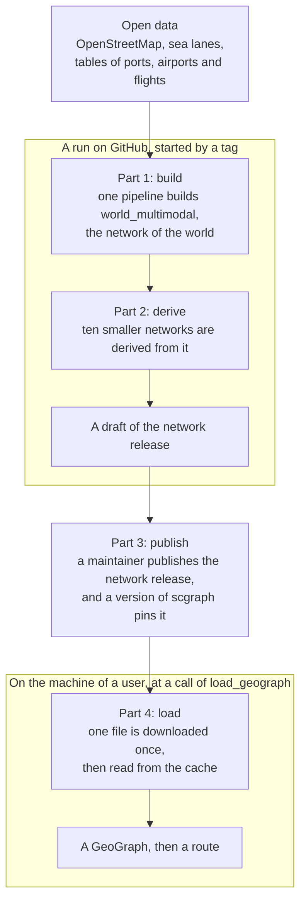
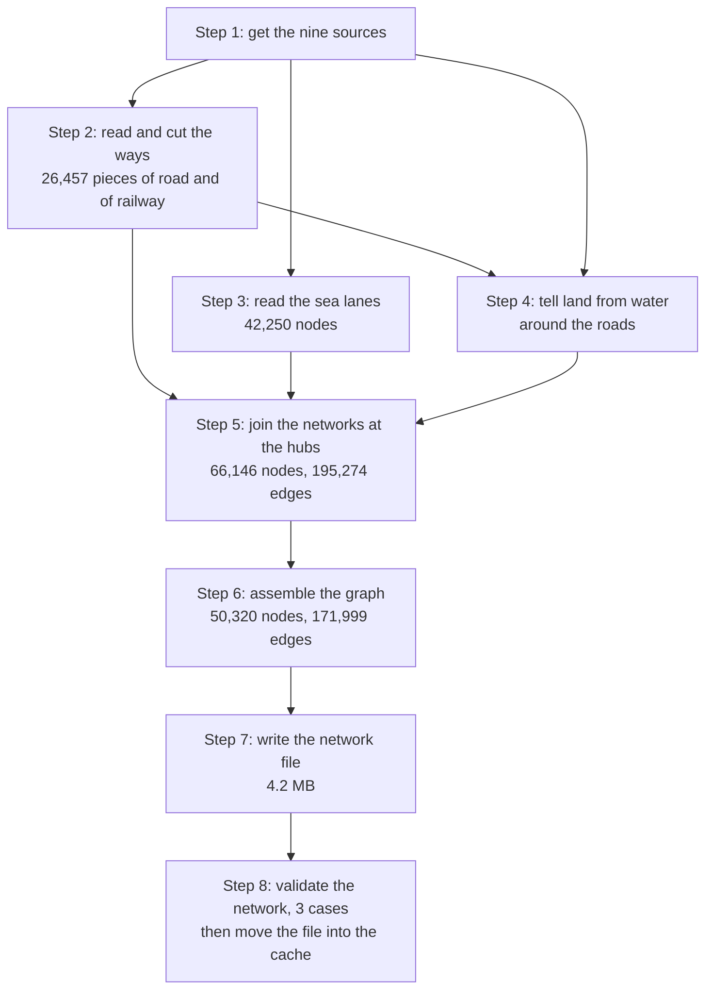
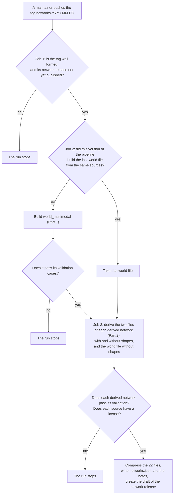
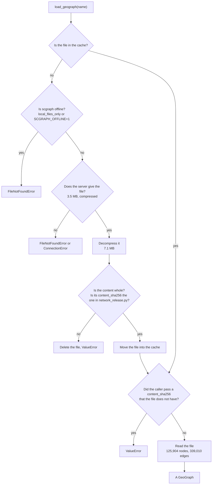

# From open data to a route: how scgraph makes its networks

This guide follows a network of scgraph from its sources to its use. The network starts as
open data on the servers of OpenStreetMap and of other publishers. It ends as a `GeoGraph` on
the machine of a user, who asks it for a route.

The guide is for a reader who knows Python and who does not know this project. It has four
parts: build, derive, publish, load. Each part gives what starts the work, what the work does
and what it produces, with numbers of a real run.

The guide covers the networks that scgraph publishes in network releases, such as `europe` or
`world_multimodal`.
The seven networks of scgraph 3.6.0, such as `marnet`, were made in another way. The README
of the repository describes them.

## The words

- A **network** is a graph with a position for each node. An **edge** joins one node to
  another, in one direction, and has a length in km.
- A **query point** is the origin or the destination of a query. It **snaps** to a node of
  the network: the route starts or ends at this node.
- A **network file** stores one network, as `<name>.scgraph`. Its **header** is the first
  part of the file, which describes the network.
- The **shape** of an edge is the list of points that draw the edge on a map between its two
  nodes.
- A **pipeline** is a Python module that builds a network from its sources. Its
  `PIPELINE_VERSION` is a number that its author raises when a change of the code changes the
  network.
- The **planet file** is the file of OpenStreetMap that holds the whole world. An **extract**
  holds one region.
- The **credit line** of a network names its sources and their licenses. A user cites it with
  a result.
- A **GitHub release** is a page of the scgraph repository that offers files for download.
  A **tag** names it.
- A **network release** is a set of network files that the maintainers publish together, as one
  GitHub release. Its tag has the form `networks-YYYY.MM.DD`. A **draft** is a GitHub release
  before its publication, which only the maintainers see.
- A **released network** is a network of a network release. Each version of scgraph **pins**
  one network release: it records the tag of that release, and loads its networks.
- A **workflow** is a script that GitHub runs on its own machines. A **run** is one execution
  of a workflow. A run has **jobs**, and each job has a machine of its own.
- The **cache** is the folder where scgraph keeps network files on the machine of a user.
- The **`content_sha256`** of a network file is the SHA-256 digest of its content: all its
  bytes after the first 40, which hold this digest. Two files with the same `content_sha256`
  hold the same network.

## The chain in one picture



A user can also do the work of Parts 1 and 2 on a machine of their own. Part 1 gives the
command that builds the network of one country. The section *A network of your own* gives
the call that derives a network.

## Four choices of the design

1. **How do eleven networks stay consistent? One network is built from the sources, and every
   other network is derived from it.** A build of the world reads the whole OpenStreetMap
   planet, which takes more than an hour. A derivation downloads nothing and takes seconds.
   All the networks of one network release therefore hold the same data (Part 2).
2. **How does a user know what a file holds? A network file records where it comes from.**
   A user can then cite the sources and name the exact file behind a result. Step 7 of Part 1
   lists what the header records.
3. **How does a result stay reproducible? A published file never changes, and each version of
   scgraph pins one network release.** The same version of scgraph therefore loads the same
   network on every machine, today and in a year. A correction is a new network release, with
   a new tag (Parts 3 and 4).
4. **How is a wrong network stopped? A check follows the build, each derivation and each
   download.** A network that fails goes no further (Parts 1 to 4).

## Part 1. A pipeline builds a network

This part follows one build from its sources to its network file.

The example runs the pipeline `geofabrik_multimodal` on the region `europe/denmark`. A region is
the path of an extract on Geofabrik, a server of OpenStreetMap extracts. The build ran on
2026-11-20 on Linux, with the C++ extension, from the extract of 2026-11-18. The numbers come
from its log. Another day gives other numbers, because the extract changes every day.

### The words of a build

- A **source** is a file that a pipeline reads, such as an OpenStreetMap extract. Most sources
  are on a server, and some are small tables kept with scgraph.
- The **runner** is the module `network_builder.py`. It downloads the sources, calls the
  pipeline and keeps the network file in the cache.
- A **way** is a line of OpenStreetMap: a part of a road, of a railway or of a ferry route.
- A **piece** is the part of a way between two nodes of the network.
- The **node mode** of a node says where the node is: `road`, `rail`, `sea`, or the kind of a
  hub (`port`, `airport`, `rail_terminal`).
- A **hub** is a place where a route goes from one network to another: a port, an airport or a
  rail terminal. A hub is one node.
- A **connector** is the pair of edges that joins a hub to the network of the roads, of the
  railways or of the sea lanes.
- The **class** of an edge is its category, for example `motorway`, `ferry`, `rail_main` or
  `flight`. The docstring of `scgraph.pipelines` lists the classes.
- The **edge mode** of a class says how its edges are travelled: `road`, `rail`, `sea` or
  `air`.
- A **chain** is a row of nodes that each have only two neighbors, as along a road with no
  junction.

### The command

```
pip install "scgraph[osm]"
python -m scgraph.pipelines.network_builder geofabrik_multimodal --region europe/denmark --validate
```

The command prints the path of the network file. It logs each download. To see each step with
its counts, call the runner from Python with the logging level DEBUG:

```py
import logging
from scgraph.pipelines.network_builder import build_network_file

logging.basicConfig(level=logging.DEBUG)
build_network_file("geofabrik_multimodal", region="europe/denmark", validate=True)
```

### The steps

The build below has eight steps. The modules of `scgraph/pipelines/steps` group them in four:
read the sources (`step1_…`), join the networks (`step2_…`), assemble the network (`step3_…`) and
validate (`step4_…`).



#### Step 1. The runner downloads the sources

`SOURCES` of the pipeline names nine sources. The runner brings each one into its work folder.
It downloads five of them. The four others are small tables kept with scgraph, which it copies.

| Source | What it is | Size |
|---|---|---|
| `sea` | the sea lanes of Eurostat SeaRoute | 7.0 MB |
| `land`, `lakes`, `rivers` | Natural Earth, to tell land from water | 3.6, 1.6 and 2.3 MB |
| `ports`, `airports`, `flights`, `rail_terminals` | the tables of the hubs and of the flights | under 1 MB each |
| `osm` | the Geofabrik extract of Denmark | 498.2 MB |

The extract comes last. When a small source fails, the large download has not started.

Where to read more: `network_builder.py`, function `build_network_file`.

#### Step 2. Read and cut the ways

`step1_osm_ways.build_way_pieces` reads the extract and keeps the ways that the pipeline
selects. It cuts each way at its junctions. It also cuts a way where a piece would be longer
than `max_km_between_nodes` (2 km). A route starts at the road node closest to its origin, so a
long road needs nodes along it. The function simplifies the shape of each piece to within 50 m.

The pipeline reads the extract once, for its two node modes. The log line of this step gives
the sum of the two counts: 26,457 pieces.

| Node mode | Ways kept | Pieces |
|---|---|---|
| `rail` | railway lines | 5,680 |
| `road` | main roads | 20,777 |

A pipeline has one select function for each of these node modes. The function says whether a
way is kept, and gives the class of the way. Each piece has the class of its way.

Each node mode has its own junctions and its own pieces, so the roads and the railways stay
apart. A road and a railway can share a node of OpenStreetMap at a level crossing. The build
makes one node for each node mode there, so no route goes from a road to a railway at a level
crossing.

The function also attaches the vehicle ferries to the roads (`step1_osm_ways.build_ferry_edges`).
A ferry is kept when each of its ends is within 2 km of a road node. The ferries give 12 edges in
this build, one for each direction.

`step3_network_assembly.build_graph_from_pieces` then stores the pieces of each node mode as a
graph. A graph holds one edge at most from a node to another. Of several edges between the same
two nodes, the function keeps the shortest edge of each class. Two ferry routes of this build
join the same two road nodes, so the file has 10 edges of the class `ferry`. Two edges of two
classes are both kept. For example, a primary road and a shorter motorway join the same two
junctions. The function splits the primary road at its middle, with a new node there. A route
by time can then choose between the two roads.

Where to read more: the docstrings at the top of `steps/step1_osm_ways.py` and of
`steps/step3_network_assembly.py`.

#### Step 3. Read the sea lanes

The sea lanes are 72,444 lines. The pipeline turns them into a graph of 42,250 nodes. These are
the sea lanes of the whole world, not only those around Denmark: a route by sea may leave the
region and come back.

#### Step 4. Tell land from water

`LandMask.from_natural_earth` draws a raster of the land around the roads of the region. Each
cell is land or water. The next step uses it for two checks: a connector to a road or to a
railway crosses little water, and a connector to a sea lane stays on water.

Where to read more: the docstring at the top of `steps/step2_land_mask.py`.

#### Step 5. Join the networks at the hubs

At this point the build holds three graphs with no edge between them: roads, railways and sea
lanes. `step2_hub_connectors.join_networks_at_hubs` adds the hubs and their connectors.

The tables give 242 hubs inside the raster, which is wider than Denmark.
`step2_hub_connectors.join_networks_at_hubs` joins a hub that reaches at least two networks:

- a port can reach a road, a sea lane, and a railway when its table says that it has one;
- an airport can reach a road, and its flights count as a second network;
- a rail terminal can reach a road and a railway.

A hub reaches a network within a limit: 20 km in a straight line to a road, 10 km to a railway,
and a water path of 2,500 km to a sea lane. This build joins 63 ports, 10 airports and 1 rail
terminal. The other hubs stay out.

For example, the port of Arhus gets three connectors: 0.91 km to a rail node, 4.89 km to a road
node and 0.99 km over water to a sea node.

The step also joins each pair of airports that has regular flights, by one edge each way. Its
length is the great-circle distance.

The result is one graph of 66,146 nodes and 195,274 edges.

Where to read more: the docstring at the top of `steps/step2_hub_connectors.py`.

#### Step 6. Assemble the graph

`step3_network_assembly.assemble_network` does three things.

| Step | Nodes | Edges |
|---|---|---|
| the joined graph | 66,146 | 195,274 |
| keep the largest strongly connected component | 63,784 | 192,735 |
| contract the chains | 50,320 | 171,999 |

These counts come from the build of 2026-11-20. That build kept one edge between two nodes,
the shortest one. A build of today keeps the shortest edge of each class (step 2), so it can
count a few more nodes and edges.

- **Keep the connected part.** In a strongly connected component, a route exists from every
  node to every other node. The step removes the rest, for example a road on a small island
  with no ferry.
- **Contract the chains.** A chain becomes one edge with the length and the shape of the chain.
  The route lengths do not change. A chain is never contracted across two node modes or two
  classes, and a chain longer than `max_km_between_nodes` keeps nodes along it. In this
  build, 151 nodes stay because the class changes there. The node in the middle of a split
  road (step 2) also stays.
- **Order the nodes.** The nodes are sorted by node mode, then along a Hilbert curve. Nodes
  that are near on the map are then near in the file, so a search reads nearby memory.

Where to read more: the docstring at the top of `steps/step3_network_assembly.py`.

#### Step 7. The runner writes the network file

The runner writes the arrays to one file of 4.2 MB, in its work folder. The header of the file
records the pipeline, each source with its version and its license, and the software of the
build. It also records two things that a query uses:

- `metrics`: the metrics of the file. A built file has one metric, `length`, in km. A user
  adds other metrics on the loaded network (`GeoGraph.create_metric`).
- `classes`: one row for each class, with its name and its edge mode, such as
  `{"name": "motorway", "edge_mode": "road"}`.

A query point snaps to its closest road node by default, because this network has nodes of the
node mode `road`. So a route starts and ends on a road.

`GeoGraph.get_scgraph_info(file)` reads this back.

Where to read more: the docstring of `scgraph.pipelines`, part *What the network file
records*, and `ARCHITECTURE.md`, section 7.

#### Step 8. Validate the network

With `--validate`, `validate_network` checks the file against the cases of the pipeline. A case
describes one known fact of the real world. Most cases give two points and a reference value
for the route between them. This build has three cases, and all three pass. One of them says
that the port of Arhus has a connector to a road, to a railway and to a sea lane.

Each kind of case has its node modes. The two points of a case snap to nodes of these node
node modes: a road node for a road distance, any node for a hub. The default rule of a query does
not count here.

Then the runner moves the file into the cache. A network that fails a case does not enter the
cache.

Where to read more: the docstring of `steps/step4_validation_cases`.

### What comes out

The file holds 50,320 nodes and 171,999 edges.

| Node mode | Nodes |
|---|---|
| `sea` | 42,157 |
| `road` | 6,162 |
| `rail` | 1,927 |
| `port` | 63 |
| `airport` | 10 |
| `rail_terminal` | 1 |

A route may use every network. It starts and ends at a road node, and it goes from one network
to another at hubs. A leg is a part of a route on one edge mode. `output_legs=True` returns the
legs of the route, and the transfers between them.

`GeoGraph.build_geograph` calls the runner, then loads the file. It builds nothing when the
cache holds the file.

```py
from scgraph import GeoGraph

denmark = GeoGraph.build_geograph("geofabrik_multimodal", region="europe/denmark")
route = denmark.get_shortest_path(
    {"latitude": 56.1629, "longitude": 10.2039},  # the center of Aarhus
    {"latitude": 55.6761, "longitude": 12.5683},  # the center of Copenhagen
    output_legs=True,
)
route["length"]  # the km of the shortest route
[(leg["mode"], round(leg["length"])) for leg in route["legs"]]  # the edge modes that it takes
```

To keep some node modes only, load the file with `node_modes`. With the roads alone, the route between
the same two points is 302.2 km:

```py
from scgraph.pipelines.network_builder import build_network_file

file = build_network_file("geofabrik_multimodal", region="europe/denmark")  # the file of the cache
roads = GeoGraph.load_from_scgraph(file, node_modes=["road"])
```

Each edge has a class. A two-way road gives two edges, and the table counts the km of both.

| Classes | Edges | km |
|---|---|---|
| `motorway`, `motorway_link` | 2,198 | 2,845 |
| `trunk`, `trunk_link` | 1,040 | 787 |
| `primary`, `primary_link` | 6,799 | 5,061 |
| `ferry` | 10 | 153 |
| `rail_highspeed`, `rail_main`, `rail_branch`, `rail_other` | 4,540 | 6,770 |
| `open_sea` and the ten passages, such as `suez` | 157,022 | 6,540,886 |
| `flight` | 28 | 5,050 |
| `road_connector`, `rail_connector`, `sea_connector` | 362 | 1,238 |

### The network of the world

The pipeline `osm_world_multimodal` runs the same steps on the whole planet. It builds the
network `world_multimodal`. The pipeline differs from `geofabrik_multimodal` in three points:

- It reads the planet file by HTTP byte ranges, and never stores it.
- It cuts a road or a railway every 10 km, not every 2 km. This gives about 3.4 million nodes.
- It keeps each strongly connected component of at least 1,000 nodes, not only the largest.
  The roads of an island then stay in the file.

A shortest route counts km only, on every network. A long route therefore often takes a
flight. Part 4 loads some node modes only. The README of the repository, section *Routes by
Time, Cost and CO2*, gives each edge mode a speed or a cost, and finds the fastest or the
cheapest route.

## Part 2. Derive a network from a network file

`derive_network_file` of `derived_networks.py` reads one network file, the parent file, and
writes a smaller one, the derived file. It downloads nothing. The docstring of the module
`derived_networks.py` gives the rules.

A derivation takes two choices. The first is a list of node modes. The second is a bbox, a
rectangle `(south, west, north, east)` in degrees. The table `DERIVED_NETWORKS` of the same
module names the ten derived networks of a network release, each with its node modes or its
bbox. Two examples are `world_sea` and `oceania`.

```
mkdir derived
python -m scgraph.pipelines.derived_networks world_multimodal.scgraph derived oceania
```

The arguments are the world file, the output folder and the name of a derived network. The
output folder must exist. The command writes `derived/oceania.scgraph`, and
`derived/oceania.no_shapes.scgraph`: the same network without the shapes of its edges. It
prints the two paths. Without a name, the command writes the files of the ten derived
networks, and the world file without shapes. In a network release, the workflow of Part 3
runs the command this way, once.

The numbers below come from one derivation of `oceania` on 2026-11-22, on Linux, with the C++
extension. The parent file is the `world_multimodal` of the network release
`networks-2026.11.22-dev.2` (335.4 MB).

| Step | Nodes | Edges |
|---|---|---|
| the parent file | 3,376,285 | 6,313,226 |
| select the nodes and remove the other edges | 125,953 | 339,046 |
| keep the components of at least 10 nodes | 125,904 | 339,010 |

- **Select the nodes.** The bbox of `oceania` is `(-50, 110, 0, 180)`. It selects the roads,
  the railways and the rail terminals inside it. The sea lanes, the ports and the airports of
  the world all stay, so a route may leave the bbox by sea or by air.
- **Keep the components.** The selection leaves 49 nodes apart from the rest,
  in strongly connected components of fewer than 10 nodes. `derive_network_file` removes them. It
  does not contract the chains again: a junction that lost a road stays as a node.

The derivation took 1.5 s. The derived file is 19.7 MB, and 7.1 MB without the shapes. Its
header records the `content_sha256` of the parent file, the node modes and the bbox.

A derived file keeps the length and the class of each edge. `oceania` has roads, so a query
point snaps to its closest road node by default. `world_sea` holds no road, and a query point
snaps to its closest node.

The command checks the derived network against some cases of `world_multimodal` (`--no-validate`
skips this check): the cases whose two points are inside the bbox, on node modes that the file
holds.
There are 16 such cases here.

The validation of the world accepts that up to 1 % of the cities of a list have no road route.
The world file can therefore pass with a few failed cases. A derived network has fewer cities,
so the same failed city can be more than 1 % of them. For this reason, a derived file passes
when it fails no case that the parent file passes. Here it fails none.

## Part 3. Publish a network release

The workflow `.github/workflows/build_networks.yml` makes a network release. It does the work of
Parts 1 and 2 for the world, then prepares the GitHub release.

### What comes before the tag

The date of the data is in the code, not in the tag. The constant `PLANET` of
`steps/step1_osm_ways.py` holds the URL of one planet file of OpenStreetMap, and this URL
holds the date of the file. To take newer data, a PR changes this URL. The network release
`networks-2026.11.22-dev.2` holds the planet of 2026-11-02.

### What starts the run

A maintainer pushes a tag `networks-YYYY.MM.DD`, by convention on a commit of the branch
`dev`. The date is the day of the tag. Only a person with write access to the repository can
push a tag. Nothing else starts the workflow: no schedule, and no merge.

```
git tag networks-2026.11.20 <commit of dev>
git push origin networks-2026.11.20
```

A tag that ends with `-dev.N` makes a development network release, to try the chain before a
new version of scgraph. GitHub shows it as a pre-release. By convention, a version of scgraph
on PyPI pins a network release without `-dev`.

### What the run does

The run has three jobs, one after the other. Job 2 hands the world file to job 3 as a file of
the run.



| Job | Time when the world is built | Time when the world file is taken |
|---|---|---|
| 1. Check the tag | 7 s | 3 s |
| 2. `world_multimodal` | 1 h 35 min | 41 s |
| 3. Derive and draft | 4 min 25 s | 3 min 9 s |

The times come from two runs. The run of `networks-2026.11.22-dev.2`, on 2026-11-22, built the
world. A run of 2026-11-19 took the world file of the network release before it.

- **Job 2 reads the planet from another server.** The workflow first replaces the planet URL
  of the code by a mirror that is faster from a machine of GitHub. The header of the world
  file records the URL that was read.
- **Job 2 builds the world only when something changed.** It reads the header of the world file
  of the last published network release. It takes this file when the pipeline has the same name,
  the same `PIPELINE_VERSION` and the same source URLs, the mirror on both sides. A new planet
  URL therefore gives a new build.
- **Job 2 has 5 h 55 min.** GitHub stops a job at 6 hours. A job that is run again starts from
  nothing.

### What a network release holds

The network release `networks-2026.11.22-dev.2` holds 23 files.

- 22 network files, compressed with gzip: `world_multimodal` and the ten derived networks, each
  with and without the shapes of its edges. For example `oceania.scgraph.gz` (9.2 MB) and
  `oceania.no_shapes.scgraph.gz` (3.5 MB). The shapes are half of a file or more. A user who
  needs only the route lengths loads the file without them (`load_intermediate_nodes=False`).
- `networks.json`, the index of the network release. It gives for each file its size, its
  `content_sha256`, its number of nodes and of edges, its sources and its credit line.

`utils/draft_network_release.py` compresses the files, and writes the index and the notes of the
network release. The notes show a table of the files and the credit line of each file.

### From the draft to the users

The run ends with a draft.

1. **Read the draft.** The maintainer checks three things. When job 2 built the world, its log
   has the line `Validation PASSED`, with the number of cases. The log of job 3 has the line
   `0 failed in this file only` for each derived network. The table of the notes has 22 files, with
   numbers of nodes close to those of the last network release.
2. **Publish.** The maintainer publishes the draft on its GitHub page. The publication of a
   GitHub release also starts the workflow that publishes scgraph on PyPI. That workflow skips
   a tag that starts with `networks-`.
3. **Pin the network release.** The maintainer runs
   `python utils/pin_network_release.py TAG`. The script writes the tag, the `content_sha256`
   of each file and the counts of each network into `scgraph/network_release.py`. It writes
   the module as the formatter keeps it, so `utils/prettify.py` changes no line. A PR brings
   this module into `dev`.
4. **Update the documents.** The README of the repository names the pinned network release,
   with the sizes of its files and one `content_sha256`. Its examples show lengths on the
   released networks. In the same PR, the maintainer runs these examples again, and updates
   the tag, the sizes, the counts and each length that changed. The maintainer also updates
   the numbers of Parts 2 to 4 of this guide.
5. **Reach the users.** An install from `dev` loads the new network release at once. A user of
   PyPI gets it with the next version of scgraph.

Two checks protect a published file. Job 1 stops a run whose tag is already published. And
scgraph refuses a downloaded file whose `content_sha256` is not the one in
`scgraph/network_release.py` (Part 4).

### When something fails

- **A download fails.** A server refused a request. The maintainer runs the failed job again.
- **A validation fails, or a source has no license.** The run stops, and no draft appears. The
  maintainer corrects the code in a PR, then pushes a new tag on the new commit of `dev`, for
  example with the next `-dev.N`. The old tag stays, with no network release.
- **The draft is wrong.** The maintainer deletes it (`gh release delete TAG`), and nothing was
  published. A run that is started again also replaces its own draft.
- **A published network release is wrong.** It stays as it is. The correction is a new network
  release.

Where to read more: the comment at the top of `build_networks.yml`, and the docstring of
`utils/draft_network_release.py`.

## Part 4. Load a released network

```py
from scgraph import GeoGraph

oceania = GeoGraph.load_geograph("oceania", load_intermediate_nodes=False)
sydney = {"latitude": -33.8688, "longitude": 151.2093}
perth = {"latitude": -31.9523, "longitude": 115.8613}
route = oceania.get_shortest_path(origin_node=sydney, destination_node=perth)
route["length"]  # 3311.7 km: the route takes a flight

roads = GeoGraph.load_geograph("oceania", load_intermediate_nodes=False, node_modes=["road"])
route = roads.get_shortest_path(origin_node=sydney, destination_node=perth)
route["length"]  # 3930.3 km, by road
```

`load_geograph` takes the name of a released network. `load_intermediate_nodes=False` asks for
the file without the shapes of the edges, and `node_modes` for some node modes only. The README of
the repository lists the eleven networks, in section *Network Releases*. It also gives the
other arguments, the way to read the credit line, and the way to load exactly the same file
later. The notebook `examples/multimodal_networks.ipynb` of the repository draws such routes on
a map.

The first call downloads
`https://github.com/connor-makowski/scgraph/releases/download/networks-2026.11.22-dev.2/oceania.no_shapes.scgraph.gz`.
The cache keeps the decompressed file as
`releases/networks-2026.11.22-dev.2/oceania.no_shapes.scgraph`.



The numbers come from one first load and one later load on 2026-11-22, on Linux, with the C++
extension. The first load took 2.7 s, download included. The later load took 0.01 s: it found
the file in the cache and made no request.

- **Which network release.** `load_geograph` loads a network of the pinned network release,
  which `scgraph/network_release.py` names. The argument `network_release` gives the tag of another
  network release.
- **Which checks after a download.** `network_file.check_content` computes the
  `content_sha256` of the decompressed file, and compares it with the one in the header of the
  file. This finds a download that was cut or damaged. For the pinned network release, the
  `content_sha256` must also be the one that `scgraph/network_release.py` records. This finds a
  file that was replaced on the server. A file of another network release has the first check
  only. A file of the cache is not checked again.
- **Which check at each load.** A caller can pass the `content_sha256` of the file that it
  wants. The load fails when the file of the cache has another one.
- **After an error.** A downloaded file that fails a check does not enter the cache. In every
  error case of the picture, the cache is as before, and the call can be made again.
- **Why the cache is not compressed.** With the C++ extension, and without `node_modes`, scgraph
  maps the file and does not copy it into memory.
- **How long the cache keeps a file.** The cache keeps the files of each network release until
  `GeoGraph.clear_geograph_cache` removes them. The README of the repository gives the place
  of the cache, in section *Cache Management*.

Where to read more: the docstring of `_fetch_released_file`, in `geograph.py`.

## A network of your own

- **Another network derived from a released network.** `derive_network_file` takes any node
  modes and any bbox. The parent file is in the cache after a load, and `scgraph_file` gives
  its path. The parent file must have the shapes of its edges.

  ```py
  from scgraph import GeoGraph
  from scgraph.pipelines.derived_networks import derive_network_file

  europe = GeoGraph.load_geograph("europe")
  derive_network_file(europe.scgraph_file, "iberia.scgraph", bbox=(36, -10, 44, 4))
  iberia = GeoGraph.load_from_scgraph("iberia.scgraph")
  ```

- **Another pipeline.** Copy the pipeline that is closest to your need, and change its sources,
  its select functions or its constants. The docstring of `scgraph.pipelines` gives a short
  pipeline to start from, and the steps to add a network to scgraph.

- **The classes of your pipeline.** A pipeline module can define one more name. The runner
  reads it when `build` returns the arrays of the network file.

  ```py
  # The edge mode of each class, by the name of the class
  CLASSES = {"cycleway": "road", "towpath": "road", "ferry": "road"}
  ```

  The array `edge_class_ids` holds the id of the class of each edge in `CLASSES`, counted from
  0: `0` for `cycleway`, `1` for `towpath`. Without `CLASSES`, the runner writes the classes of
  `scgraph.pipelines.CLASSES`. The docstring of `scgraph.pipelines` gives the contract of this
  name. A query point snaps to a road node by default when your pipeline names the node mode
  of its road nodes `road`.
